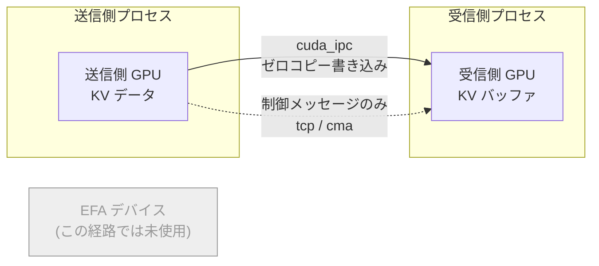
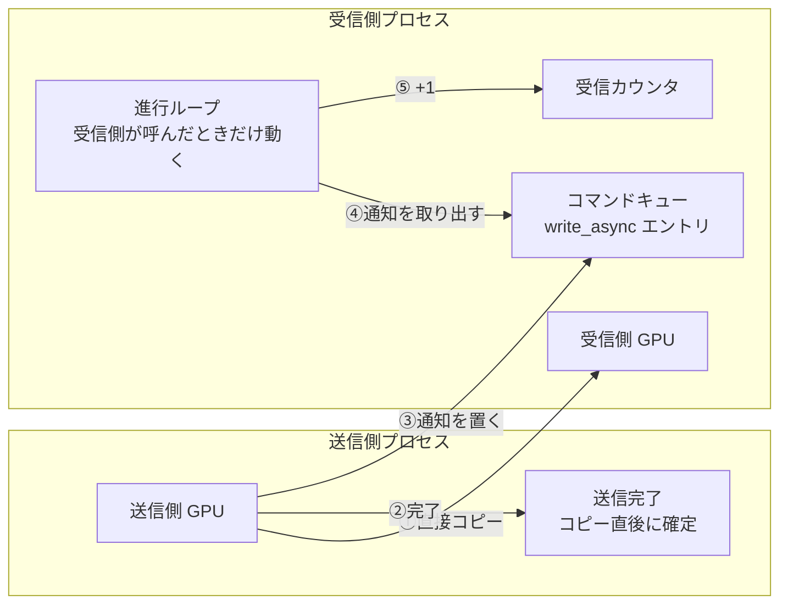
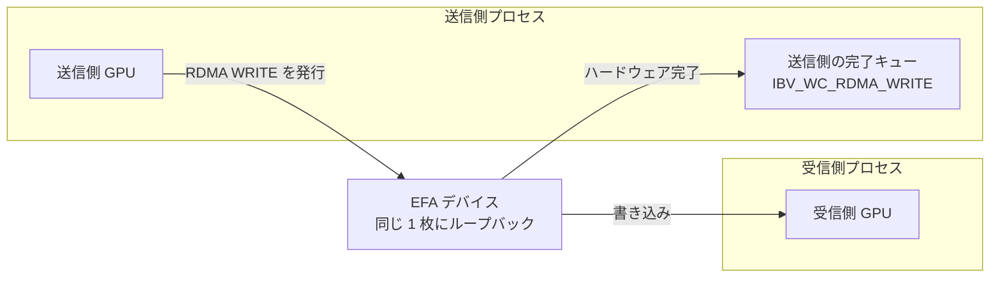
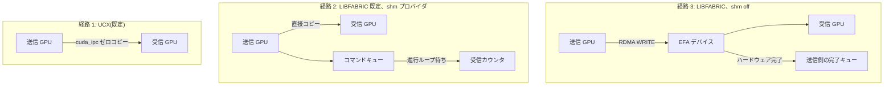

## はじめに

SGLang で prefill エンジンと decode エンジンを分けて動かすと、2 つのエンジンの間で KV キャッシュ(それまでに読んだ文脈の attention 計算の途中結果)を転送する必要があります。この転送には NIXL を使います。NIXL のバックエンドに `LIBFABRIC` を選び、`FI_PROVIDER=efa` で EFA(Elastic Fabric Adapter、AWS の低遅延ネットワークカード)を明示的に指定すれば、当然 EFA を使って転送してくれる、と考えるのは自然です。

ところが同じノードの中で prefill と decode を動かした場合、今回計測した条件では EFA デバイスを一度も通っていませんでした。libfabric の EFA プロバイダは、相手が同じノードにいることを検出すると、既定の設定では自動的に `shm` プロバイダ(shared memory の略で、同じノード内のプロセス同士が GPU メモリを直接コピーし合う方式)に処理を渡します。ログを詳しく出さないと気付けない挙動です。

さらに重要なのは、この shm 経由の転送は負荷がかかると急激に遅くなるという点です。本記事では、同じノード内にある 3 つの転送経路(UCX、LIBFABRIC の既定動作、LIBFABRIC で shm を無効にした場合)がそれぞれどんな通信をしているかをソースコードと実機ログで追い、混雑時にどちらが速いかを計測した結果をまとめます。原因の内部構造まで完全に特定できたわけではない点も、推測の範囲として区別して書きます。分離推論(prefill/decode を分ける仕組み)自体の説明や NIXL 自体の説明は省くので、前提知識が要る方は末尾の関連リンクを先に見てください。

## 検証した環境と測り方

計測は次の構成で行いました。

- モデル: DeepSeek-V2-Lite-Chat
- 推論エンジン: SGLang 0.5.12.post1、prefill エンジンと decode エンジンをそれぞれ TP(Tensor Parallel)2 で起動
- KV キャッシュ転送ライブラリ: NIXL 1.1.0
- ネットワークライブラリ: libfabric 2.4.0(EFA installer 1.47.0)
- インスタンス: g7.48xlarge の 1 台で prefill と decode を同じノードに同居させる構成
- リクエストの作り方: 入力 8,192 トークン・出力 256 トークンの長い文脈のリクエストを、到着がポアソン過程(到着の間隔がランダムにばらつく、よくある負荷のモデル)になるように流す
- 乱数シード: 3 本の到着シードで繰り返し、ブレを確認
- 計測方法: SGLang の `--enable-metrics` が出すステージ別カウンタと、EFA デバイスのハードウェアカウンタの両方を使う。ステージ別カウンタは `prefill_transfer_kv_cache` などの区間ごとに転送にかかった時間を積み上げたもので、ハードウェアカウンタは `sysfs` 配下の値を転送の前後で読んで差分を取る

以降の数値はすべてこの環境での実測、ソースコードを読んで確認した事実、まだ確認できていない点をそれぞれ区別して書きます。

## 同じノード内の 3 つの転送経路

NIXL は転送のバックエンドとして UCX と LIBFABRIC の両方を選べます。どちらも「同じノード上の GPU 同士なら安いコピー手段を使う」という方針自体は同じですが、その中身は違います。LIBFABRIC はさらに `FI_EFA_ENABLE_SHM_TRANSFER` という設定で挙動が変わるので、合わせて 3 つの経路を見ていきます。

### 経路 1: UCX の cuda_ipc 自動選択

UCX は何も設定しなくても、同じノード上の GPU 同士の転送には CUDA IPC(GPU のメモリを別プロセスから直接見える状態にする仕組み)を自動選択します。`UCX_PROTO_INFO=y` を付けて起動したときのログにそれが出ています。

```
device(cuda_ipc/cuda) am(tcp/<network-interface> cma/memory cuda_ipc/cuda)
remote memory write by ucp_put*(multi) from cuda/GPU0 to cuda/dev[0] | zero-copy | cuda_ipc/cuda
```

GPU から GPU への実データはゼロコピー(途中の一時バッファへのコピーを挟まず、相手の GPU メモリへ直接書き込む)で動き、`tcp` や `cma` は小さな制御メッセージのためだけに使われています。



実データも制御メッセージも、どちらも EFA デバイスを経由しません。

### 経路 2: LIBFABRIC の既定動作、shm プロバイダ

LIBFABRIC バックエンドでは、NIXL 自身は同じノードかどうかを特別扱いしません。同じノードを検出して処理を切り替えているのは、libfabric の EFA プロバイダ自身です。`FI_LOG_LEVEL=info` で見ると次のログが出ます。

```
efa_is_local_peer(): The peer is local.
efa_conn_rdm_insert_shm_av(): Successfully inserted ... to shm provider's av.
```

相手が同じノードだと分かった時点で、EFA プロバイダはその相手を shm プロバイダのアドレス表に登録し直します。以降のやり取りは shm プロバイダが処理し、EFA デバイス(ネットワークカード)の出番はありません。

shm プロバイダの中身をソースコードで追うと、次のようになっています。[`smr_rma_fast()`](https://github.com/ofiwg/libfabric/blob/5a13558c2fcea15f1a6c4e8c06dc702e50724cf8/prov/shm/src/smr_rma.c#L58-L99) で、送信側プロセスが受信側のメモリへ直接バイト列をコピーします(CUDA IPC と同種の、相手のメモリへ直接書き込む方式で、ホストメモリを経由する一時バッファではありません)。送信側はこのコピーが終わった時点で自分の完了を同期的に確定し、受信側の状況を待ちません。コピーと同時に、送信側プロセスは `write_async` という印の付いた通知を、受信側に宛てた共有メモリ上の箱(以下「コマンドキュー」)に積みます。

libfabric では、届いた通知の後片付け(カウンタの更新など)は自動では進みません。受信側プロセスが libfabric の関数を呼んだときにだけ、溜まっている処理をまとめて片付けます。本記事ではこの片付け処理を「進行ループ」と呼びます。コマンドキューに積まれた通知は、受信側が自分の進行ループ([`smr_progress_cmd()`](https://github.com/ofiwg/libfabric/blob/5a13558c2fcea15f1a6c4e8c06dc702e50724cf8/prov/shm/src/smr_progress.c#L1213-L1266))を実行してそのキューを処理するまで、「何件届いたか」を数える受信側自身のカウンタ(以下「受信カウンタ」)には反映されません。つまりバイト列のコピー自体は送信側だけで完了する一方通行の作業であるのに対し、受信側が「このデータが届いた」と記帳する作業(受信カウンタへの反映)は、受信側のソフトウェアが追いつくかどうかに依存している、という非対称な作りになっています。



番号は、コピー、送信側の完了、通知、そして受信側が自分の進行ループを実行したときにようやく進む記帳、という順序を示しています。この記帳の遅れが、実際に prefill 側の転送ステージの計測時間(次節の `prefill_transfer_kv_cache`)をどう遅くしているのか、内部の正確な経路までは今回確認できていません。確認できているのは、受信側の記帳が受信側自身のソフトウェアに依存する仕組みがソースコード上に存在することと、次節で示すとおり shm を無効にすると混雑時の計測時間が大きく減ることの 2 点で、両者を直接つなぐ内部の詳しい挙動は推測の範囲です。

:::details gdrcopy は使われていません
GPU のメモリに CPU 側から直接アクセスするための高速化ライブラリ gdrcopy も、ログ上では最初に試されます。ただしカーネル側のデバイスファイル `/dev/gdrdrv` がこの環境に存在しないため `gdr_open failed!` で失敗し、常に gdrcopy なしの経路にフォールバックします。
:::

### 経路 3: `FI_EFA_ENABLE_SHM_TRANSFER=0`、EFA デバイスへの切り替え

環境変数 `FI_EFA_ENABLE_SHM_TRANSFER` を 0 にすると、挙動が変わります。[`efa_shm_info_create()`](https://github.com/ofiwg/libfabric/blob/5a13558c2fcea15f1a6c4e8c06dc702e50724cf8/prov/efa/src/efa_shm.c#L68-L77) はこの設定を見た時点で shm 用の情報を作らずに即座に戻ります。shm プロバイダの実体(`shm_ep`)が一切作られないということです。

その結果、EFA プロバイダ内の「相手がローカルで、かつ shm 用の受け口がある場合だけ shm を使う」という各種チェック([`efa_rdm_rma.c`](https://github.com/ofiwg/libfabric/blob/5a13558c2fcea15f1a6c4e8c06dc702e50724cf8/prov/efa/src/rdm/efa_rdm_rma.c) 内に複数箇所)は、`shm_ep` が無いので常に不成立になります。相手がローカルかどうかに関係なく、書き込みは本来のハードウェア経路である [`efa_rdm_rma_post_write()`](https://github.com/ofiwg/libfabric/blob/5a13558c2fcea15f1a6c4e8c06dc702e50724cf8/prov/efa/src/rdm/efa_rdm_rma.c) に進み、条件を満たせば [`efa_rdm_rma_should_write_using_rdma()`](https://github.com/ofiwg/libfabric/blob/5a13558c2fcea15f1a6c4e8c06dc702e50724cf8/prov/efa/src/rdm/efa_rdm_rma.h#L30-L66) の判定を経て、本当の RDMA WRITE(ネットワークカードが、相手の CPU を介さずに相手のメモリへ直接書き込む操作)が EFA デバイスに発行されます。

今回の環境ではノードに EFA デバイスが 2 枚ありますが、prefill と decode の両プロセスは同じ 1 枚のデバイスを選びます(ログで確認)。つまり書き込みはそのデバイス自身に向けて発行され、1 枚のデバイスの中でループバックする形になります。送信側の完了は本物のハードウェア完了で、`ibv_cq`(ネットワークカードの完了キュー)から `IBV_WC_RDMA_WRITE` という完了種別を読み取って判定されています。受信側がこの書き込みの到着をどう把握するか(ハードウェア側の通知を使うのか、別の仕組みを使うのか)は、今回のソース読解では特定できておらず未確認です。



### 3 つの経路を並べる



| 項目 | 経路 1: UCX(既定) | 経路 2: LIBFABRIC(既定、shm) | 経路 3: LIBFABRIC、shm off |
|---|---|---|---|
| 実データの経路 | GPU 間ゼロコピー(cuda_ipc) | GPU 間の直接コピー(CUDA IPC 相当) | EFA デバイスへの RDMA WRITE |
| EFA デバイスを使うか | 使わない | 使わない | 使う(同じ 1 枚にループバック、今回の計測環境で確認) |
| 完了の確定方法(送信側) | 未確認 | 同期的に即確定、受信側を待たない | ハードウェアの完了(`IBV_WC_RDMA_WRITE`) |
| 受信側の記帳の仕組み | 未確認 | 受信側自身の進行ループがキューを処理して初めて受信カウンタに反映 | 未確認 |

shm プロバイダと UCX の cuda_ipc は、どちらも「ネットワークカードを使わない GPU 間の直接コピー」という点では同じ系統の方式です。違うのは、受信側がそのデータの到着をどう記帳するかで、分かっているのは経路 2(shm)がソースコード上、受信側自身の進行ループに依存していることだけです。経路 1(UCX)と経路 3(shm off)の受信側の記帳の仕組みは、今回のソース読解では確認できていません。

## バイト単位での裏取り

ログの文言だけでは「本当に EFA デバイスを通ったのか」は確証になりません。そこで EFA デバイスのハードウェアカウンタ(ネットワークカード自身が数えている送受信バイト数)を転送の前後で読み、差分を取りました。TP 2 ランクで 17 リクエストぶんの転送を行ったときの結果です。

| 条件 | `rdma_write_bytes` の差分 | 期待値 | 比率 |
|---|---|---|---|
| 経路 2: LIBFABRIC 既定(shm) | 0 | ~0 | - |
| 経路 1: UCX | 0 | ~0 | - |
| 経路 3: LIBFABRIC、shm off | 8,663,389,312 | 8,663,334,912 | 1.0000063 |

期待値は 254,803,968 バイト(1 リクエスト・1 ランクぶんの KV データ量、8,192 トークン × 27 層 × 576 値 × 2 バイト)× 2 ランク × 17 リクエスト で計算した値です。shm off のときだけハードウェアカウンタが動き、実測は期待値との差が 0.0006 %(約 54 KB)でした。このときの書き込み回数(`rdma_write_wrs`)は 3,742 回で、転送直前に 20 秒間トラフィックを止めた区間ではカウンタの動きは完全にゼロでした。経路 2 と経路 1 ではこのカウンタはどちらも 0 のままで、この条件下では「EFA デバイスには乗っていない」という読み方と一致します。

:::message alert
EFA のハードウェアカウンタは `/sys/class/infiniband/<デバイス名>/ports/1/hw_counters` 配下にありますが、Kubernetes の Pod がホストネットワークを使わない設定だと、この `hw_counters` ディレクトリ自体が Pod の中には存在しません。そのため Pod の内側からはこの場所を読めず、どの転送方式を使っていてもバイト数が 0 だったという結果しか得られません。同じノードでホストネットワークを使う別の Pod から読むと、同じデバイス名で正しくカウンタが見えました。つまり「カウンタが 0 だった」という結果だけを根拠に「EFA に乗っていない」と判断するのは誤りで、カウンタが読める場所から読み直す必要があります。この sysfs の見え方の違いがなぜ Pod のネットワーク namespace によって起きるのかは、カーネル側の正確な理由まで確認できていません。
:::

## 混雑時の転送時間

ステージ別カウンタで見た転送段階(`prefill_transfer_kv_cache`、prefill 側が KV キャッシュを送り出すのにかかった時間)の平均値です。KV キャッシュの「ページサイズ」とは、転送をまとめる単位(何トークンぶんをひとまとまりにして転送するか)のことで、小さいほど転送の塊が増えます。次の表は 3 本の到着シードをまとめた結果です(経路 2・ページサイズ 1・到着レート 1 req/s の行だけは、別の回に 1 シードで取った基準値をそのまま引用しています)。

| 設定 | ページサイズ | 到着レート 1 req/s | 到着レート 2 req/s |
|---|---|---|---|
| 経路 2: LIBFABRIC 既定(shm) | 1 | 1,775.5 ms(1 シードの基準値) | - |
| 経路 3: LIBFABRIC、shm off | 1 | 196.2 ms | 495.0 ms |
| 経路 3: LIBFABRIC、shm off | 64 | 60.0 ms | 187.1 ms |

同じ構成を、別の回に取った単発実行(1 回の実行の中で 40 件前後のリクエストを平均したもの)でも比較しています。到着レート 2 req/s、ページサイズ 1 にそろえた結果です。

| 設定 | prefill_transfer_kv_cache |
|---|---|
| 経路 2: LIBFABRIC 既定(shm) | 1,772.8 ms |
| 経路 1: UCX | 344.9 ms |
| 経路 3: LIBFABRIC、shm off(1 回目) | 17.1 ms |
| 経路 3: LIBFABRIC、shm off(2 回目) | 218.5 ms |

この単発実行同士の比較では、shm を切るだけで 1,772.8 ms が 17.1~218.5 ms まで下がりました。少なくとも約 8 倍、単発比較では最大 100 倍程度ですが、shm off 側の実行ごとのばらつきが大きい点には注意してください。先の 3 シード平均の表では同条件(ページサイズ 1、到着レート 2 req/s)で shm off が 495.0 ms なので、実行回によって絶対値のばらつきは大きいものの、shm off にすると shm 既定より大きく速くなるという方向は一貫しています。

ここで気になるのは、「孤立した 1 回の転送では shm の方が速いはずなのに、なぜ混雑時には EFA デバイス経由が勝つのか」という点です。1 回・16 MiB のデータだけを孤立させて測った単発の転送速度は次のとおりです。

| 経路 | 1 回・16 MiB の転送時間 | 帯域 |
|---|---|---|
| 経路 2: shm(GPU 間の直接コピー) | 0.165 ms | 94.6 GiB/s |
| 経路 3: EFA デバイス(RDMA WRITE) | 0.637 ms | 24.5 GiB/s |
| 経路 1: UCX(cuda_ipc) | 1.10 ms | 14.2 GiB/s |

1 リクエストあたりの KV データは約 243 MiB(254,803,968 バイト)なので、この帯域で単純に換算すると、shm で約 2.5 ms、EFA デバイスで約 10 ms、UCX で約 17 ms のはずです。実測の数百~1,700 ms はこれよりはるかに大きく、コピーそのものの時間ではなく、何らかの待ち時間が支配的だと分かります。

ここから言えるのは次の 2 つです。1 つは、経路 2(shm)と経路 3(shm off)の比較です。shm 経由は 1 回あたりは最速なのに、たくさんの転送が同時に来るとこの差が逆転します。前節で見たとおり、shm の受信側の記帳は受信側自身の進行ループに依存する仕組みがソースコード上に存在するので、これが混雑時に詰まる候補の一因と考えられますが、システム内部のどこが実際に飽和しているのかは特定できていません。もう 1 つは、経路 2(shm)と経路 1(UCX)の比較です。UCX も混雑時に速いままですが、この差を生む仕組みは今回のソース読解や実験(進行スレッドの数を変える介入を含む、次節で紹介します)では特定できず、未解明のまま残っています。つまり「混雑時に強い経路が 2 つある」ことは実測で分かっていますが、その 2 つが同じ理由で強いとは言えません。

### 分かったことと、分かっていないこと

| | 内容 | 根拠 |
|---|---|---|
| 確定 | 既定の LIBFABRIC は同じノード内では shm を使い、EFA デバイスを通らない | ログ、ハードウェアカウンタ |
| 確定 | 1 回だけの転送なら shm が最速 | 16 MiB 単発計測 |
| 確定 | 混雑時は shm off と UCX が shm より大幅に速い | ステージ別カウンタ |
| 確定 | shm は受信側の記帳が受信側自身の進行ループ任せになる作り | ソースコード |
| 推測 | その作りが、混雑時に shm が詰まる一因 | 上 2 つの状況証拠のみ、内部のどこが飽和するかは未確認 |
| 未解明 | UCX が混雑時に速い理由(shm off と同じ理由かは不明) | 進行スレッド数の介入では変化なし |

## 棄却した仮説

遅さの原因について、途中で試して棄却した仮説も残しておきます。いずれも経路 2(LIBFABRIC、shm 既定)と経路 1(UCX)の速さの差を説明しようとした仮説で、両方とも到着レート 1 req/s、ページサイズ 1 の条件で検証しました。

- **転送の塊(ディスクリプタ)が負荷で増えて遅くなっているのではないか**: 実際に数えてみると、負荷の大小にかかわらず1 リクエストあたりのディスクリプタ数はほぼ 27 個のままで、これはモデルの層数と同じです。ごくまれに断片化で数百個に増える場合もありましたが、1 個あたりのコストは非常に小さく、観測された遅さの差(1,000 ms 単位)を説明できる規模ではありませんでした。
- **進行用のスレッドを増やせば速くなるのではないか**: SGLang の接続処理は、UCX には進行スレッドを 8 本渡しますが LIBFABRIC には渡していません。この非対称性が原因かを確かめるため、UCX の進行スレッド数を既定の 8 本から 0 本に減らしてみましたが、速さはほとんど変わりませんでした(130.0 ms と 132.9 ms)。反対に、検証用に NIXL を 1.4.0 へ一時的に上げて LIBFABRIC 側に追加された、転送を発行する側のスレッドプールを有効にしてみても、無効時と比べて大きな差はありませんでした(無効 434.6 ms、有効 388.5 ms)。どちらの介入もスレッド数を動かしただけでは速さが動かず、スレッド数は今回観測された遅さの説明にはなりませんでした。

## 実務での使い分け

今回計測した構成では、同じノードの中での KV キャッシュ転送は、次の 2 つのどちらかを選ぶと混雑時に遅くなりにくい経路になりました。

1. UCX バックエンドを使い、cuda_ipc による自動選択に任せる
2. LIBFABRIC バックエンドのまま `FI_EFA_ENABLE_SHM_TRANSFER=0` を設定する

後者を選ぶ利点は、ノード内でもノード間でも同じバックエンド(LIBFABRIC)で統一できることです。環境変数を 1 つ足すだけで、ノード内の転送もノード間と同じ EFA デバイス経路を使うようになります。もっとも、孤立した 1 回の転送だけを見れば shm 経由の方が速いこと、UCX が混雑時にも速い理由は今回特定できていないことを踏まえると、どちらが適切かはモデルの形やトラフィックの混み方によって変わり得ます。また、ノード内のループバック通信も EFA デバイスの帯域を使うため、ノード間通信と同時に流れる構成では競合の影響が出る可能性がありますが、これは今回検証していません。自分の環境に適用する前には、転送のステージ時間と、ホストネットワークから見える EFA のハードウェアカウンタの両方で、実際にどの経路を通り、効果が出ているかを確かめることをお勧めします。

## 関連リンク

分離推論を提案した論文 [DistServe](https://arxiv.org/abs/2401.09670) と、大規模な Expert Parallelism と組み合わせた実装を解説する [SGLang チームのブログ記事](https://lmsys.org/blog/2025-05-05-large-scale-ep/) は、分離推論の背景が整理されていておすすめです。

KV キャッシュ転送に使う NIXL 自体については、[NIXL のリポジトリ](https://github.com/ai-dynamo/nixl) を参照してください。

関連して、AWS 上で分離推論の検証環境を EFA と NIXL を使って一から構築する手順を解説した [Zenn 記事](https://zenn.dev/tosshi/articles/009bb138491dd1) もあります。本記事とは逆に、環境の作り方そのものに焦点を当てた内容です。

`FI_EFA_ENABLE_SHM_TRANSFER` 自体の説明は、libfabric の [`fi_efa` マニュアルページ](https://ofiwg.github.io/libfabric/main/man/fi_efa.7.html) にあります。

## まとめ

- 同じノード内では、`FI_PROVIDER=efa` を指定しても libfabric は既定で shm プロバイダに切り替え、EFA デバイスを通りませんでした(ログとハードウェアカウンタで確認)。
- shm は 1 回だけの転送なら最速ですが、混雑時には大幅に遅くなりました。`FI_EFA_ENABLE_SHM_TRANSFER=0` にして EFA デバイス経由にすると、混雑時の転送時間は数分の一から 100 分の 1 程度まで短くなりました。
- shm の受信側の記帳が受信側自身の進行ループに依存する仕組みがソースコード上にあり、これが混雑時に詰まる一因だと考えられますが、内部のどこが実際に飽和するかは未確認です。
- UCX(cuda_ipc)も混雑時に速いままですが、その理由は今回特定できておらず未解明です。
- 経路の確認は、Pod 内からではなくホストネットワーク側から EFA のハードウェアカウンタを読んで行う必要があります(Pod 内からは常に 0 に見えます)。
