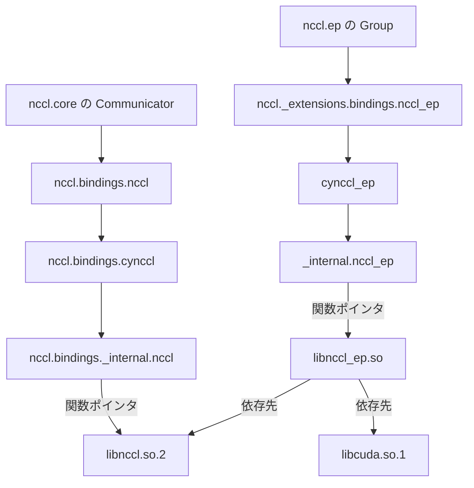

## はじめに

NCCL のリリース一覧には、NCCL4Py の版と、NCCL EP の最初の版が並んでいます。名前が似ているので、どれが何なのかが分かりにくいと思います。この記事では、3 つがそれぞれ何を受け持ち、どうつながっているかを図で見ていきます。後半の「[配布物の中身](#配布物の中身)」では、配布物の中のライブラリとソースコードを読み、実際に動かしてつながり方を確かめます。

## 登場する部品


1 台の GPU サーバーの上には、次の部品が載っています。NCCL4Py と NCCL EP は、どちらも NCCL 本体のすぐ上に並びます。

| 部品 | 中身 | 入れ方 |
|---|---|---|
| NCCL 本体 | GPU どうしの通信を受け持つライブラリ | nccl4py などに CUDA 12 か 13 を指定して入れる |
| NCCL4Py | NCCL 本体を Python から呼ぶ窓口 | nccl4py を入れる |
| NCCL EP | MoE の通信を受け持つライブラリ | nccl-extensions を入れる |
| NCCL EP の Python の窓口 | NCCL EP を Python から呼ぶ窓口 | nccl-extensions を入れる |

NCCL 本体と NCCL4Py は、NVIDIA の NCCL のリポジトリで作られています。NCCL EP とその Python の窓口は、別のリポジトリで作られています。名前は nccl-extensions です。

## NCCL: GPU どうしの通信を受け持つ


たくさんの GPU で 1 つのモデルを学習するとき、GPU どうしで計算の結果を足し合わせます。NCCL は、この GPU 間のやり取りを速く行うためのライブラリです。図の all-reduce は代表的な操作で、参加した GPU の値をまとめ、同じ結果を全員に渡します。

PyTorch で分散学習をするとき、通信の方式に NCCL を選べます。そうすると、PyTorch の中で NCCL が動きます。そのため、NCCL を直接呼ばなくても使えます。

## NCCL EP: 送る所と戻す所を受け持つ

MoE でトークンを担当のエキスパートの GPU へ送る dispatch と、結果を元の GPU へ戻す combine、そしてそれを支える通信の層は「[MoE の all-to-all を支える層](https://zenn.dev/tosshi/articles/a0f5ff21eed405)」で説明しています。ここでは、その dispatch と combine を NCCL EP がどう受け持つかを見ます。


NCCL EP の EP は、エキスパート並列 (Expert Parallelism) の略です。NCCL EP は、dispatch と combine の 2 つの操作を受け持つライブラリです。エキスパートの計算そのものは、NCCL EP ではなくモデルのプログラムが受け持ちます。

NCCL EP は、NCCL 本体の機能の上に作られています。その機能の 1 つが、GPU の計算の途中から、ほかの GPU との通信を直接始める仕組みです。

## NCCL EP の 2 つのモード


NCCL EP には、Low-Latency と High-Throughput の 2 つのモードがあります。[NCCL EP の README](https://github.com/NVIDIA/nccl-extensions/blob/nccl-extensions-v0.1.0/nccl_ep/README.md) では、Low-Latency は待ち時間が大事な推論向けとされています。こちらは、流すトークンが少ないときに使います。High-Throughput は、学習と、推論で最初に入力をまとめて読む段階向けです。2 つは、向くトークンの量だけでなく、送り方も違います。High-Throughput は、ノードの中で一度まとめてから、ほかのノードへ送ります。

## NCCL4Py: Python から NCCL を呼ぶ窓口


NCCL 本体には、C 言語から呼ぶための入口があります。NCCL4Py は、その NCCL 本体を Python から呼べるようにした公式の窓口です。NCCL 2.29.2 で試験的に入り、その後は本体とは別の番号で版を重ねています。

最近の NCCL4Py の版は、それぞれ特定の版の NCCL 本体に合わせて作られています。たとえば NCCL4Py v0.6.0 は、NCCL 2.32.3 に合わせて作られています。

## nccl という名前を 2 つの配布物で分け合う


Python では、どちらも nccl という名前で読み込みます。その下に、読み込むときの名前を 2 つの配布物が置きます。nccl4py は nccl.core を、nccl-extensions は nccl.ep を置きます。1 つの名前を複数の配布物で分け合う、Python の仕組みを使っています。

nccl-extensions は nccl4py に依存しています。そのため、入れると nccl4py も一緒に入ります。nccl.m2n は、同じ nccl-extensions に入っている NCCL M2N の窓口です。NCCL M2N は、2 つの GPU の群の間でデータを配り直す、試験的なライブラリです。学習側の GPU から推論側の GPU へ重みを送る用途があります。

## 版の組み合わせに気をつける


nccl-extensions v0.1.0 が対応する NCCL 本体は、2.30.7 だけです。**CUDA 12 か 13 を指定して入れると、NCCL 本体は 2.30.7 に固定されます。** 一方、nccl-extensions は NCCL4Py の版を指定していません。新しい環境に入れると、最新の NCCL4Py が選ばれます。2026 年 10 月 19 日時点でも v0.6.0 です。

NCCL4Py v0.6.0 は、NCCL 2.32.3 を基に作られています。NCCL4Py v0.6.0 が NCCL 本体に探しに行く 93 個の関数のうち 14 個は、2.30.7 の本体にありません。この組み合わせで実際に動かして確かめた結果は、後の「[配布物の中身](#配布物の中身)」で示します。

GPU の側で動く試験的な機能には、もっと厳しい条件があります。NCCL4Py の [`nccl.core.device.cute`](https://github.com/NVIDIA/nccl/blob/893470119efc83fb6ecd4f9240efcf60c0aef6a3/bindings/nccl4py/nccl/core/device/cute/__init__.py#L9-L15) は、GPU のカーネルから NCCL を使うための試験的な窓口です。その説明には、使う `libnccl_device.bc` が NCCL4Py を作ったときの NCCL と完全に同じ版でなければならず、版の確認はしない、と書かれています。`libnccl_device.bc` は `nvidia-nccl` の配布物に入っているので、nccl-extensions が選ぶ組み合わせでは 2.30.7 のものが使われ、NCCL4Py の 2.32.3 と一致しません。そうした機能を試す環境と、NCCL EP を使う環境は、分けておくのが安全です。

nccl-extensions の main ブランチでは、この制約を緩める変更が進んでいます。[NCCL EP の README](https://github.com/NVIDIA/nccl-extensions/blob/25c0638e22132e1fc8c0648e1d52010838c3e528/nccl_ep/README.md#nccl-ep-compatibility-with-newer-nccl-runtimes) には、2.31 以降で作ったものは新しい NCCL 本体でそのまま動き、2.30.5 以上 2.31 未満で作ったものは `NCCL_DEV_API_JIT` を有効にすれば動く、と書かれました。ただし 2026 年 10 月 19 日時点ではまだリリースに入っておらず、main の[依存関係の定義](https://github.com/NVIDIA/nccl-extensions/blob/25c0638e22132e1fc8c0648e1d52010838c3e528/python/pyproject.toml#L52-L60)も NCCL 本体を 2.30.7 に固定したままです。

NCCL EP には、動くときに GPU のプログラムをその場で組み立てる処理があります。そのため、CUDA の開発道具も必要です。開発道具も、CUDA 12 か 13 かを指定した版にそろえます。配布されている NCCL4Py を入れるだけなら、この開発道具は要りません。

## NCCL4Py v0.3.1 のころといま


[NCCL4Py v0.3.1](https://github.com/NVIDIA/nccl/releases/tag/nccl4py-v0.3.1) には、nccl.ep と、NCCL EP のライブラリそのものが同梱されていました。ただし同梱の NCCL EP は CUDA 13 向けで、CUDA 12 の環境では自分で用意する必要がありました。2026 年 9 月 3 日には [v0.3.1.post1](https://pypi.org/project/nccl4py/0.3.1.post1/) が PyPI に出ています。中身は v0.3.1 と同じく nccl.ep を含みます。v0.3.1 は依存する NCCL 本体の版を固定していませんでしたが、v0.3.1.post1 は 2.30.4 に固定しています。


[NCCL4Py v0.4.1](https://github.com/NVIDIA/nccl/releases/tag/nccl4py-v0.4.1) で、nccl.ep は NCCL4Py から外れました。いまは [nccl-extensions v0.1.0](https://github.com/NVIDIA/nccl-extensions/releases/tag/nccl-extensions-v0.1.0) が、NCCL EP v0.2 を配っています。nccl.ep も、こちらに入っています。v0.3.1 で nccl.ep を使っていたプログラムがあるとします。新しい NCCL4Py で動かすには、nccl-extensions も入れます。nccl.ep の使い方は変わりうると、当時から書かれていました。そのため、書き直しが要ることもあります。

v0.3.1 は、自分の中に nccl.ep を持っています。nccl-extensions は NCCL4Py の版を指定しないので、足しても v0.3.1 は残ります。すると、2 つの nccl.ep が同じ置き場所でぶつかります。実際に v0.3.1 の環境へ pip で `nccl-extensions[cu13]==0.1.0` を足すと、NCCL4Py は v0.3.1 のまま残り、`nccl/ep` の持ち主として 2 つの配布物が記録されました。v0.3.1.post1 の環境では結果が違い、NCCL 本体の固定が 2.30.4 と 2.30.7 でぶつかるため、pip は NCCL4Py を v0.6.0 に入れ替えました。どちらの場合も、古い環境に足すより、新しい環境を作って入れるのが確実です。

## 配布物の中身

ここからは、配布物の中のライブラリとソースコードを読み、実際に動かして、つながり方を確かめます。調べたのは、`nccl-extensions` を入れたときに選ばれる組み合わせの NCCL4Py v0.6.0、nccl-extensions v0.1.0、NCCL 2.30.7 です。

先に、この節で使う言葉を説明します。`.so` は Linux の共有ライブラリで、プログラムが実行のときに読み込む機械語の部品です。ライブラリを開くとは、動いているプログラムが途中で `.so` を読み込み、中の関数を呼べるようにすることで、Linux では `dlopen` という関数がこれを行います。関数ポインタは、開いたライブラリの中で関数が置かれている場所を指す値で、プログラムはこの値を通して関数を呼びます。`.so` の中には、一緒に必要なほかのライブラリの一覧である依存先が書かれています。動的リンカーは、ライブラリを開くときにこの依存先を探して一緒に読み込む仕組みです。

`.so` には 2 つの種類が混ざっています。`nccl.cpython-312-x86_64-linux-gnu.so` のように Python の版が名前に入っているものは、Python の `import` が読み込む拡張モジュールです。`libnccl.so.2` や `libnccl_ep.so` は、C から呼ぶためのふつうのライブラリです。

| 配布物 | 中の主な `.so` | 中身 |
|---|---|---|
| `nvidia-nccl-cu13` | `nvidia/nccl/lib/libnccl.so.2` | NCCL 本体 |
| `nccl4py` | `nccl/bindings/` の下の拡張モジュール 4 つ | Python から NCCL 本体を呼ぶ窓口。NCCL 本体そのものは入っていない |
| `nccl-extensions` | `nccl/ep/lib/cu12/libnccl_ep.so` と `nccl/ep/lib/cu13/libnccl_ep.so` | NCCL EP の本体。CUDA 12 用と 13 用の 2 つが同梱されている |
| `nccl-extensions` | `nccl/_extensions/bindings/` の下の拡張モジュール | NCCL EP を Python から呼ぶ窓口 |

### 呼び出しの受け渡し



all-reduce を例に、NCCL4Py の中を上から追います。使う人が触る `nccl.core` の `Communicator` は、Python で書かれた窓口です。その下の [`nccl.bindings.nccl` の `all_reduce`](https://github.com/NVIDIA/nccl/blob/893470119efc83fb6ecd4f9240efcf60c0aef6a3/bindings/nccl4py/nccl/bindings/nccl.pyx#L5587-L5591) は、Python の値を C の型に直し、GIL を手放してから下を呼びます。GIL は、Python のコードを同時に 1 つしか進めないようにする仕組みです。`all_reduce` が GIL を手放すので、NCCL の処理を待つ間もほかのスレッドが動けます。

次の [`cynccl` の `ncclAllReduce`](https://github.com/NVIDIA/nccl/blob/893470119efc83fb6ecd4f9240efcf60c0aef6a3/bindings/nccl4py/nccl/bindings/cynccl.pyx#L172-L173) は、C の関数と同じ名前と引数を持つ Cython の関数です。Cython は、Python に近い書き方で拡張モジュールを書ける言語です。最後の [`_internal` の `_ncclAllReduce`](https://github.com/NVIDIA/nccl/blob/893470119efc83fb6ecd4f9240efcf60c0aef6a3/bindings/nccl4py/nccl/bindings/_internal/nccl_linux.pyx#L1533-L1540) が、手元に持っている関数ポインタを通して `libnccl.so.2` の `ncclAllReduce` を呼びます。

`cynccl` が独立した段になっている理由は、[NCCL4Py の README](https://github.com/NVIDIA/nccl/blob/893470119efc83fb6ecd4f9240efcf60c0aef6a3/bindings/nccl4py/README.md#L37-L46) に書かれています。試験的な Cython の API として、Cython の拡張モジュールから Python の負担を小さくして NCCL の関数を呼べるようにするためです。nccl-extensions も、[`cynccl_ep.pxd`](https://github.com/NVIDIA/nccl-extensions/blob/e57f0dad43dc1ca5bf96f09bf4075afc2eae6599/python/nccl/_extensions/bindings/cynccl_ep.pxd#L15) で `nccl.bindings.cynccl` から NCCL の型を取り込んでいます。

このうち下の 3 段の分け方は、NVIDIA の cuda-python の `cuda.bindings` と同じです。たとえば nvJitLink の窓口も `nvjitlink`、`cynvjitlink`、`_internal` に分かれていて、[次の項で説明するのと同じ手順](https://github.com/NVIDIA/cuda-python/blob/308e4e17991fa9cc8fd5d9ac76619317f948b3e6/cuda_bindings/cuda/bindings/_internal/nvjitlink_linux.pyx#L94)で関数を探します。

### 最初の呼び出しで開く libnccl.so.2

NCCL4Py の拡張モジュールの依存先には、`libnccl.so.2` が書かれていません。NCCL4Py は動的リンカーに任せず、NCCL 本体を自分で開きます。

開くのは、最初に NCCL の関数を呼んだときです。[`_init_nccl`](https://github.com/NVIDIA/nccl/blob/893470119efc83fb6ecd4f9240efcf60c0aef6a3/bindings/nccl4py/nccl/bindings/_internal/nccl_linux.pyx#L433-L437) は、93 個の関数を 1 つずつ探します。まず、すでにプロセスの中に読み込まれている関数を探します。見つからなければ [`load_library`](https://github.com/NVIDIA/nccl/blob/893470119efc83fb6ecd4f9240efcf60c0aef6a3/bindings/nccl4py/nccl/bindings/_internal/nccl_linux.pyx#L1146-L1148) が、NVIDIA の `cuda.pathfinder` に NCCL 本体を探させて開きます。`cuda.pathfinder` は、[次の順](https://github.com/NVIDIA/cuda-python/blob/308e4e17991fa9cc8fd5d9ac76619317f948b3e6/cuda_pathfinder/cuda/pathfinder/_dynamic_libs/load_nvidia_dynamic_lib.py#L165-L198)で `libnccl.so.2` を探します。

1. pip で入った `nvidia/nccl/lib` と、conda の環境の中を探します
2. 同じ名前のライブラリがすでに読み込まれていれば、それを使います
3. 2 に当てはまらず、1 で見つけたファイルがあれば、それを開きます
4. 無ければ、`LD_LIBRARY_PATH` などを使うシステムの検索に任せます
5. それでも無ければ、`NCCL_HOME` と `CUDA_PATH` の下を探します

開くときは、[`RTLD_GLOBAL` という指定](https://github.com/NVIDIA/cuda-python/blob/308e4e17991fa9cc8fd5d9ac76619317f948b3e6/cuda_pathfinder/cuda/pathfinder/_dynamic_libs/load_dl_linux.py#L19)を付けます。この指定で開いたライブラリの関数は、後から開くほかのライブラリからも使えます。後で見る `libnccl_ep.so` は、この仕組みで NCCL 本体の関数を使います。

GPU の無い Linux の機械に `nccl-extensions[cu13]==0.1.0` を入れて、2 つのことを確かめました。1 つ目に、`import nccl.core` の直後は `libnccl.so.2` がプロセスに読み込まれておらず、`get_version()` を呼んだ後で読み込まれていました。2 つ目に、別の場所に置いた NCCL 2.32.3 の `libnccl.so.2` を、Python の `ctypes.CDLL` に `RTLD_NOW | RTLD_GLOBAL` を指定して先に開きました。すると NCCL4Py は、pip が入れた 2.30.7 ではなく、先に開いた 2.32.3 を使いました。同じプロセスの中でほかのライブラリが先に `libnccl.so.2` を `RTLD_GLOBAL` で開いていれば、NCCL4Py はそれを使うということです。

### 呼んだときに分かる足りない関数

NCCL4Py v0.6.0 は 2.32.3 のヘッダーから作られているので、2.30.7 の本体には無い関数も探しに行きます。NCCL4Py が探す 93 個の関数と、2 つの版の本体が公開している関数を突き合わせると、次のようになりました。

| NCCL 本体 | NCCL4Py が探す 93 個のうち、本体に無いもの |
|---|---|
| 2.30.7 | 14 個 |
| 2.32.3 | 0 個 |

2.30.7 に無い 14 個は、`ncclAllReduceConfig` のように集団通信に設定を渡す版が 8 個、`ncclGetPeerDeviceLeInfo` のように名前が `LeInfo` で終わるものが 3 個、`ncclTeamCft` と `ncclTeamCftMultimem` の 2 個、そして `ncclSetEncryption` です。`ncclSetEncryption` は、[NCCL 2.32.3 のリリースノート](https://github.com/NVIDIA/nccl/releases/tag/v2.32.3-1)によれば、NCCL が自分で張るソケット通信を暗号化するための API です。

見つからない関数は、関数ポインタが空のまま残ります。`import` も、ほかの関数の呼び出しも、ふつうに通ります。2.30.7 の上で `nccl.bindings.nccl.set_encryption(0)` を呼ぶと、そのときに初めて次のエラーになりました。同じ呼び出しは、先に 2.32.3 を開いたプロセスでは、このエラーを出さずに戻りました。GPU の無い機械なので、確かめたのはここまでです。

```text
FunctionNotFoundError: function ncclSetEncryption is not found
```

### 依存先に libnccl.so.2 を書いている libnccl_ep.so

NCCL4Py の拡張モジュールと違い、`libnccl_ep.so` は依存先に `libnccl.so.2` と `libcuda.so.1` を書いています。そのため `libnccl_ep.so` を開くと、動的リンカーが `libnccl.so.2` も探して読み込もうとします。ただし、どのディレクトリから探すかは書かれていません。システムの標準の場所や `LD_LIBRARY_PATH` に `libnccl.so.2` が無く、まだ読み込まれてもいなければ、見つからずに失敗します。

Python の窓口は、[`_resolve_library_path`](https://github.com/NVIDIA/nccl-extensions/blob/e57f0dad43dc1ca5bf96f09bf4075afc2eae6599/python/nccl/_extensions/bindings/_internal/nccl_ep_linux.pyx#L86-L113) で `libnccl_ep.so` の場所を決めます。最初に見るのは nccl-extensions の中の `nccl/ep/lib/cu12` か `cu13` で、どちらを選ぶかは、入っている `cuda.bindings` の版から[決めています](https://github.com/NVIDIA/nccl-extensions/blob/e57f0dad43dc1ca5bf96f09bf4075afc2eae6599/python/nccl/_extensions/_runtime.py#L26-L30)。次に `CONDA_PREFIX`、`CUDA_HOME` と `CUDA_PATH` の下を見て、最後はシステムの検索に任せます。

`libnccl_ep.so` を開く直前、[`load_library`](https://github.com/NVIDIA/nccl-extensions/blob/e57f0dad43dc1ca5bf96f09bf4075afc2eae6599/python/nccl/_extensions/bindings/_internal/nccl_ep_linux.pyx#L354-L369) は、わざと NCCL4Py の読み込み処理を走らせます。コメントによれば、NCCL4Py に先に `libnccl.so.2` を `RTLD_GLOBAL` で開かせておけば、`libnccl_ep.so` の依存先の要求がファイルを探さずに満たされます。さらに「nccl4py stays the one place that locates libnccl」とあり、NCCL 本体を探す場所を NCCL4Py の 1 箇所にまとめる意図が書かれています。

これを動的リンカーのログで確かめました。`LD_DEBUG=files` を付けて実行すると、動的リンカーが何をどこから読み込んだかが出力されます。`nccl.ep` から開いたときのログは次のとおりでした。

```text
file=libnccl.so.2 [0];  dynamically loaded by v/bin/python [0]
file=libcuda.so.1 [0];  needed by /tmp/ncclprobe/v/lib/python3.12/site-packages/nccl/ep/lib/cu13/libnccl_ep.so [0]
```

1 行目は、`libnccl.so.2` を Python のプロセスが自分で開いたことを示します。2 行目は、`libnccl_ep.so` の依存先として探しに行ったのが `libcuda.so.1` だけだったことを示します。`libnccl.so.2` の要求は、読み込み済みのもので満たされたということです。`libcuda.so.1` は GPU のドライバーと一緒に入るライブラリなので、GPU の無い機械にはありません。そのため、この後は `libcuda.so.1` が見つからずに止まりました。一方、NCCL 本体を開いていないプロセスで `ctypes` から `libnccl_ep.so` だけを開くと、`libnccl.so.2: cannot open shared object file` で失敗しました。

読み込み順には、NCCL EP の使い方の面からも意味があると考えられます。[`Group.create`](https://github.com/NVIDIA/nccl-extensions/blob/e57f0dad43dc1ca5bf96f09bf4075afc2eae6599/python/nccl/ep/group.py#L140) は、NCCL4Py の `Communicator` が持つ `comm.ptr` を、そのまま [`ncclEpCreateGroup`](https://github.com/NVIDIA/nccl-extensions/blob/e57f0dad43dc1ca5bf96f09bf4075afc2eae6599/nccl_ep/include/nccl_ep.h#L370) に渡します。`comm.ptr` は、NCCL 本体が作った通信路を指すポインタです。`libnccl_ep.so` は NCCL 本体の関数を 18 個呼び出していて、このポインタもその一部に渡します。`ncclDevCommCreate`、`ncclCommWindowRegister`、`ncclTeamLsa`、`ncclMemAlloc` などです。NCCL4Py が使う本体と `libnccl_ep.so` が使う本体が同じであれば、片方が作ったポインタをもう片方が受け取る形になりません。

`libnccl_ep.so` が自分で公開している関数も 18 個あります。呼び出している NCCL 本体の 18 個とは別のもので、`ncclEpCreateGroup`、`ncclEpCreateHandle`、`ncclEpDispatch`、`ncclEpCombine`、`ncclEpComplete` などです。`libcuda.so.1` からは、`cuModuleLoadDataEx` や `cuLaunchKernel` など、実行中に作った GPU のプログラムを読み込んで起動する関数を 10 個呼び出しています。

`libnccl_ep.so` の中には `nvcc` という文字列もあります。NCCL EP が動くときに CUDA のコンパイラを呼ぶという、前の節の説明と合います。[`nccl.ep` を読み込むと](https://github.com/NVIDIA/nccl-extensions/blob/e57f0dad43dc1ca5bf96f09bf4075afc2eae6599/python/nccl/ep/__init__.py#L19-L31)、`NCCL_EP_HOME` と `NCCL_HOME` がまだ設定されていなければ、値が入ります。`NCCL_EP_HOME` には nccl-extensions のパッケージの場所が、`NCCL_HOME` には `nvidia-nccl` が入れた NCCL の場所が入ります。`libnccl_ep.so` の中にこの 2 つの名前の文字列があるので、実行中のコンパイルで NCCL のヘッダーを探すのに使われると考えられます。

### pnccl の別名と呼び出しの横取り

`libnccl.so.2` が公開している関数は、`ncclAllReduce` のような `nccl` で始まるものが 83 個と、`pnccl` で始まるものが 82 個です。`pnccl` の関数は、NCCL の [`NCCL_API` マクロ](https://github.com/NVIDIA/nccl/blob/73cf112295c33aee2b895f329f592f2a9b4b0f97/src/include/core.h#L17-L20)が作る別名です。このマクロは、`PROFAPI` を有効にして作ったとき、本物の関数に `pnccl` で始まる別名を付けます。そのため、同じ `nccl` の名前を持つ関数を外から差し込んで呼び出しを横取りしても、差し込んだ関数の中から本物を `pnccl` の名前で呼べます。MPI で同じ目的に使われる `PMPI` と似た仕組みです。

これも試しました。`ncclGetVersion` という名前の関数を持つ小さなライブラリを作り、中で `pncclGetVersion` を呼ばせます。

```c
#include <stdio.h>
typedef int ncclResult_t;
ncclResult_t pncclGetVersion(int* v);
ncclResult_t ncclGetVersion(int* v) {
  ncclResult_t r = pncclGetVersion(v);
  fprintf(stderr, "[shim] ncclGetVersion を横取り: 本物は %d を返した\n", *v);
  return r;
}
```

これを `LD_PRELOAD` で先に読み込ませてから、NCCL4Py の `get_version()` を呼びました。`LD_PRELOAD` は、指定したライブラリをプログラムの起動時にほかより先に読み込ませる環境変数です。差し込んだ関数を通ってから、本物の値が返りました。NCCL4Py はまず読み込み済みの関数を探すので、先に読み込まれた差し込みの関数が見つかったわけです。この実験で確かめたのは、`pnccl` の名前で本物を呼べることと、NCCL4Py が読み込み済みの関数を先に使うことです。

```text
[shim] ncclGetVersion を横取り: 本物は 23007 を返した
```

`libnccl.so.2` の依存先には、`libcuda.so.1` も CUDA のランタイムも書かれていません。中に `libcuda.so.1` という文字列があるので、NCCL 本体は必要になったときに自分で開くと考えられます。GPU の無い機械でも NCCL4Py から版を問い合わせられたのに、`libnccl_ep.so` は開く段階で止まったのは、この違いのためです。

### 手元での確かめ方

どの NCCL 本体が使われているかは、[`nccl.core.show_versions()`](https://github.com/NVIDIA/nccl/blob/893470119efc83fb6ecd4f9240efcf60c0aef6a3/bindings/nccl4py/nccl/core/utils.py#L117-L133) で確かめられます。

```bash
uv venv .venv --python 3.12
uv pip install --python .venv/bin/python "nccl-extensions[cu13]==0.1.0"
.venv/bin/python -c "import nccl.core; nccl.core.show_versions()"
```

GPU の無い機械で実行すると、次のように出ました。`bindings` は NCCL4Py を作ったときのヘッダーの版、`libnccl` は実際に読み込んだ本体の版と場所です。パスは作業した場所に応じて変わります。

```text
NCCL4Py versions
----------------
nccl4py  : 0.6.0
bindings : 2.32.3
libnccl  : 2.30.7+cuda13.3 @ /tmp/ncclblog/.venv/lib/python3.12/site-packages/nvidia/nccl/lib/libnccl.so.2
```

`bindings` と `libnccl` の版が違うことが、そのまま見えます。NCCL EP の側は、`nccl.ep.get_lib_path()` で `libnccl_ep.so` の場所を確かめられます。ただしこの機械では `libcuda.so.1` が無く `libnccl_ep.so` を開けないので、この関数の出力は確かめていません。ライブラリの読み込みでつまずいたときは、`LD_DEBUG=files` を付けて実行すると、どのライブラリがどのライブラリを要求したかが分かります。

## やりたいことから選ぶ


3 つは、どれか 1 つだけを選ぶ関係ではありません。自分がどの処理を直接書きたいかで、意識する相手が決まります。PyTorch で標準の分散学習をするだけなら、どれも直接は触りません。

## 各部品の受け持ち

| 部品 | 受け持ち | 使う人 | 実体 |
|---|---|---|---|
| NCCL 本体 | GPU どうしの通信 | PyTorch などのフレームワーク、C と CUDA で書く人 | `libnccl.so.2` |
| NCCL4Py | Python から NCCL 本体を呼ぶ | Python から NCCL を直接使う人 | Cython の拡張モジュール。NCCL 本体は最初の呼び出しで開く |
| NCCL EP | MoE の dispatch と combine | MoE の通信を組み込む人 | `libnccl_ep.so`。依存先に NCCL 本体と `libcuda.so.1` を書いている |
| NCCL EP の Python の窓口 | Python から NCCL EP を呼ぶ。nccl-extensions が配る | Python から NCCL EP を使う人 | Cython の拡張モジュール。NCCL4Py に NCCL 本体を開かせてから `libnccl_ep.so` を開く |

## まとめ

NCCL4Py と NCCL EP は、どちらも NCCL 本体の上に載ります。Python から NCCL EP を使うときは、nccl-extensions を入れます。NCCL4Py は、プロセスの中にすでに読み込まれた NCCL 本体があればそれを使い、NCCL EP の Python の窓口は、NCCL4Py に先に NCCL 本体を開かせてから `libnccl_ep.so` を開きます。nccl-extensions v0.1.0 が選ぶ組み合わせでは、NCCL4Py v0.6.0 が探す関数のうち 14 個が NCCL 2.30.7 に無く、呼んだときに初めてエラーになります。どの本体が使われているかは `nccl.core.show_versions()` で確かめられます。

## 参考

- [NCCL v2.29.2-1 のリリースノート](https://github.com/NVIDIA/nccl/releases/tag/v2.29.2-1)
- [NCCL v2.30.3-1 のリリースノート](https://github.com/NVIDIA/nccl/releases/tag/v2.30.3-1)
- [NCCL v2.32.3-1 のリリースノート](https://github.com/NVIDIA/nccl/releases/tag/v2.32.3-1)
- [NCCL4Py v0.6.0 の README](https://github.com/NVIDIA/nccl/blob/nccl4py-v0.6.0/bindings/nccl4py/README.md)
- [NCCL4Py v0.6.0 の依存関係の定義](https://github.com/NVIDIA/nccl/blob/nccl4py-v0.6.0/bindings/nccl4py/pyproject.toml)
- [NCCL4Py v0.3.1 のリリースノート](https://github.com/NVIDIA/nccl/releases/tag/nccl4py-v0.3.1)
- [NCCL4Py v0.4.1 のリリースノート](https://github.com/NVIDIA/nccl/releases/tag/nccl4py-v0.4.1)
- [NCCL4Py v0.5.0 のリリースノート](https://github.com/NVIDIA/nccl/releases/tag/nccl4py-v0.5.0)
- [NCCL4Py v0.6.0 のリリースノート](https://github.com/NVIDIA/nccl/releases/tag/nccl4py-v0.6.0)
- [NCCL EP v0.1.0 のリリースノート](https://github.com/NVIDIA/nccl/releases/tag/nccl-ep-v0.1.0)
- [NCCL v2.30.3-1 に入った NCCL EP](https://github.com/NVIDIA/nccl/tree/v2.30.3-1/contrib/nccl_ep)
- [NCCL EP の README](https://github.com/NVIDIA/nccl-extensions/blob/nccl-extensions-v0.1.0/nccl_ep/README.md)
- [NCCL のリポジトリの contrib の案内](https://github.com/NVIDIA/nccl/blob/v2.32.3-1/contrib/README.md)
- [nccl-extensions v0.1.0 のリリースノート](https://github.com/NVIDIA/nccl-extensions/releases/tag/nccl-extensions-v0.1.0)
- [nccl-extensions v0.1.0 の依存関係の定義](https://github.com/NVIDIA/nccl-extensions/blob/nccl-extensions-v0.1.0/python/pyproject.toml#L39-L60)
- [nccl-extensions の README (2026 年 10 月 19 日時点)](https://github.com/NVIDIA/nccl-extensions/blob/main/README.md)
- [PyPI の nccl4py (2026 年 10 月 19 日時点)](https://pypi.org/project/nccl4py/)
- [PyPI の nccl-extensions (2026 年 10 月 19 日時点)](https://pypi.org/project/nccl-extensions/)
- [PyPI の nccl4py v0.3.1.post1](https://pypi.org/project/nccl4py/0.3.1.post1/)
- [NCCL EP の README の互換性の節 (main、2026 年 10 月 19 日時点)](https://github.com/NVIDIA/nccl-extensions/blob/25c0638e22132e1fc8c0648e1d52010838c3e528/nccl_ep/README.md#nccl-ep-compatibility-with-newer-nccl-runtimes)
- [NCCL4Py v0.6.0 の NCCL 本体を開く処理](https://github.com/NVIDIA/nccl/blob/893470119efc83fb6ecd4f9240efcf60c0aef6a3/bindings/nccl4py/nccl/bindings/_internal/nccl_linux.pyx)
- [NCCL4Py v0.6.0 の `show_versions`](https://github.com/NVIDIA/nccl/blob/893470119efc83fb6ecd4f9240efcf60c0aef6a3/bindings/nccl4py/nccl/core/utils.py#L117-L133)
- [nccl-extensions v0.1.0 の `libnccl_ep.so` を開く処理](https://github.com/NVIDIA/nccl-extensions/blob/e57f0dad43dc1ca5bf96f09bf4075afc2eae6599/python/nccl/_extensions/bindings/_internal/nccl_ep_linux.pyx)
- [NCCL EP の C の入口 `nccl_ep.h`](https://github.com/NVIDIA/nccl-extensions/blob/e57f0dad43dc1ca5bf96f09bf4075afc2eae6599/nccl_ep/include/nccl_ep.h)
- [cuda-pathfinder v1.8.3 のライブラリの探し方](https://github.com/NVIDIA/cuda-python/blob/308e4e17991fa9cc8fd5d9ac76619317f948b3e6/cuda_pathfinder/cuda/pathfinder/_dynamic_libs/load_nvidia_dynamic_lib.py#L165-L198)
- [NCCL 2.30.7 の `NCCL_API` マクロ](https://github.com/NVIDIA/nccl/blob/73cf112295c33aee2b895f329f592f2a9b4b0f97/src/include/core.h#L18-L20)
