## はじめに

本章では、PyTorch DDP のテストケースのコンテナ学習を直した 2 組の Issue と PR をまとめる。[Issue #1038](https://github.com/awslabs/awsome-distributed-ai/issues/1038) と [PR #1039](https://github.com/awslabs/awsome-distributed-ai/pull/1039) はイメージと引数の誤りを、[Issue #1047](https://github.com/awslabs/awsome-distributed-ai/issues/1047) と [PR #1048](https://github.com/awslabs/awsome-distributed-ai/pull/1048) は CPU のノードでときどき失敗する問題を扱う。

:::details DDP と GLOO
DDP（DistributedDataParallel）は、同じモデルを各プロセスに置き、勾配を全プロセスで足し合わせて学習する PyTorch の仕組みである。GPU のときは NCCL、CPU のときは GLOO が、プロセスの間の通信を受け持つ。このテストケースは、CPU だけのクラスタでも動かせるように GLOO を使う。
:::

## Issue と PR の概要

| PR | 解決したいこと | やったこと | マージ |
| --- | --- | --- | --- |
| #1039 | コンテナ学習が `No module named 'mlflow'` で止まり、直すと次に引数の名前で止まる | Dockerfile からイメージを作り、引数の名前を合わせた | [7334940](https://github.com/awslabs/awsome-distributed-ai/commit/7334940bbf8b359ae18d07af436f62249372a619) |
| #1048 | CPU のノードで、ときどき MNIST の破損と GLOO の接続切れで失敗する | PyTorch を 2.10.0 に固定し、`NPROC_PER_NODE` で 1 ノードのプロセス数を変えられるようにした（回避策で、`nproc_per_node=4` の失敗は残る） | [cbdc4ee](https://github.com/awslabs/awsome-distributed-ai/commit/cbdc4eeaed2d3639ee9882e0166c46a47b7bc418) |

## PR #1039: イメージと引数

**何を解決しようとしたか**。`ddp.py` はモジュールの先頭で `mlflow` を無条件に import するので、MLflow を使わない実行でも `mlflow` が要る。venv の手順（`0.create-venv.sh`）は `mlflow==2.13.2` と `sagemaker-mlflow==0.1.0` を入れるが、コンテナの手順の `2.create-enroot-image.sh` は `docker://pytorch/pytorch` を Docker Hub から直接取り込み、これらを入れる1 つ上のディレクトリの `ddp/Dockerfile` を使っていなかった。そのため、コンテナの学習だけが `ModuleNotFoundError` で止まった。

**どうやったか**。[2.create-enroot-image.sh](https://github.com/awslabs/awsome-distributed-ai/blob/7334940bbf8b359ae18d07af436f62249372a619/3.test_cases/pytorch/ddp/slurm/2.create-enroot-image.sh) を、`docker build` で Dockerfile からイメージを作って `dockerd://` で取り込む形に変えた。これを直すと 2 つ目の誤りが現れた。sbatch は `--use-mlflow` を渡していたが、`ddp.py` の argparse は `--use_mlflow` を定義していた。[3.container-train.sbatch](https://github.com/awslabs/awsome-distributed-ai/blob/7334940bbf8b359ae18d07af436f62249372a619/3.test_cases/pytorch/ddp/slurm/3.container-train.sbatch) の引数を合わせた。

**なぜそうしたか**。依存を足す方法として、他のテストケース（deepspeed、trl、mosaicml-composer）も Dockerfile からイメージを作って `dockerd://` で取り込んでいる。同じ形にそろえた。

**テスト**。c5.4xlarge の 2 ノード、1 ノードに 4 プロセスの計 8 プロセスで、GLOO で学習が進み、各 rank がエポックの損失を出すことを確かめた。

## PR #1048: CPU のノードでときどき失敗する

**何を解決しようとしたか**。Issue #1047 は、2026 年 4 月 9 日の ParallelCluster のワークショップで使う DDP のコンテナ学習が、ときどき失敗することを報告した。ParallelCluster 3.14.2、c5n.9xlarge の 2 ノード、共有の FSx for Lustre で、`nproc_per_node=4`（計 8 プロセス）の失敗の例では、一部の rank が MNIST の読み込みで `File not found or corrupted` を出し、他の rank が GLOO の `Connection closed by peer` を出した。筆者の計測では、`nproc_per_node=4` の成功率は PyTorch 2.2.1（`pytorch:latest` が指していた版）で 0%、2.10.0 で約 70% だった（試行の回数は Issue に書いていない）。PyTorch 2.10.0 で `nproc_per_node=1`（計 2 プロセス）にすると、10 回中 10 回成功した。

筆者は原因を確定させず、仮説として 3 つを挙げた。PyTorch 2.2.1 の GLOO の不安定さ、プロセスの数が多いことによる同時のダウンロード、FSx for Lustre のメタデータの反映の遅れである。

**どうやったか**。[Dockerfile](https://github.com/awslabs/awsome-distributed-ai/blob/cbdc4eeaed2d3639ee9882e0166c46a47b7bc418/3.test_cases/pytorch/ddp/Dockerfile) の `FROM` を `pytorch/pytorch:2.10.0-cuda12.6-cudnn9-runtime` に固定し、venv の手順（`torch==2.10.0`）とそろえた。この版は Python 3.12 で PEP 668 に従うので、`pip install` に `--break-system-packages` を付けた。コンテナは使い捨てで、ホストから切り離されているので、この指定の害は小さい。sbatch には `NPROC_PER_NODE=${NPROC_PER_NODE:-4}` を足し、既定の 4 を保ったまま、ワークショップでは 1 を選べるようにした。

**なぜそうしたか**。直近のワークショップで安定して動くことを優先し、PR の範囲を版の固定と実行時の切り替えに絞った。`ddp.py` は変えていない。筆者は Issue のコメントで、共有データ向けの `--container-mounts` の設定、データセットによらない barrier での同期、ストレージの見直し、の 3 つを後続で調べる項目に挙げた。

**レビュー**。メンテナから、既定値を代入する行が、それを使う配列の宣言より後にあると指摘があった。bash の配列は宣言の時点で展開されるので、既定値が効かない。代入を配列の前に移し、変数を引用符で囲んだ。

**テスト**。筆者は ParallelCluster の c5n.9xlarge の 2 ノードで、既定の `nproc_per_node=4` と `NPROC_PER_NODE=1` の 2 通りを試した。どちらも毎回の前に `rm -rf ../data` で MNIST を消し、初めてのダウンロードから再現させた。イメージの中の版が `2.10.0+cu126` であることも確かめた。`nproc_per_node=4` のログには、rank の 1 つが MNIST のダウンロードで例外を出す場面が残った。メンテナは別の環境の [SageMaker HyperPod の Slurm](https://github.com/awslabs/awsome-distributed-ai/pull/1048)（ml.c5.2xlarge の 2 ノード、FSx for Lustre）でも、`NPROC_PER_NODE` を使う venv の sbatch で確かめ（NVIDIA のドライバの無い CPU のインスタンスではコンテナの経路が使えないため）、`NPROC_PER_NODE=1` は 5 回中 5 回、`4` は 5 回中 4 回成功した。失敗した 1 回は、同じ MNIST の破損と GLOO の接続切れだった。メンテナは、すべての rank が共有のストレージに対して `datasets.MNIST(download=True)` を呼ぶことによる競合は PyTorch の版と別の問題で、`ddp.py` に `torch.distributed.barrier()` の守りを入れれば直せるとし、後続の PR に回すとした。barrier の修正は、この PR では実装も検証もしていない。

## 技術的な要点

- **GLOO の接続切れが出たときの最初の確認**。この章の失敗では、ある rank が MNIST の `File not found or corrupted` で先に落ち、残りの rank が GLOO の `Connection closed by peer` を出した。接続切れのエラーだけを追わず、最初に落ちた rank のトレースバックを探す。
- **1 つずつ現れる誤り**。1 つの誤りを直すと、次の誤りが現れることがある。直した後も、最後まで動かして確かめる。
- **配列を組み立てる前の既定値の代入**。`NPROC_PER_NODE=${NPROC_PER_NODE:-4}` のような代入は、その変数を使う配列の宣言より前に置く。配列の要素は宣言の時点で展開されるので、後から代入しても配列の中の値は変わらない。
- **latest のタグ**。`latest` は、いつ何を指すかが変わる。テストケースは版を固定する。

## PR の整理 (FAQ)

この節は、本章の PR を、設計の判断、不具合の原因、検証の 3 つの面から問答の形で整理したものである。問は、全体と設計、不具合の原因の深掘り、検証と振り返りの 3 つに分けた。各問は英語の質問 (見出し)、日本語の質問、噛み砕き (ひとことでの表とやさしい版の図)、英語の回答、日本語の回答の順に書いた。不具合の問には原因の連鎖の図を付け、回答は症状、原因、突き止め方、直し方と比べた案、検証、残ったこと、の順に書いた。回答は本章の本文と、PR、Issue、マージ前後のコードで確かめた事実だけを使う。

### 全体と設計

:::details Q1. What do these two PRs change, in short?
**質問 (日本語)**

この 2 つの PR は、要するに何を変えたのか。

**Answer (English)**

Both fix the containerized path of the PyTorch DDP test case, which uses GLOO so it runs on CPU-only clusters. PR #1039 fixed a startup failure: the container image didn't contain `mlflow`, and once that was fixed, an argument name mismatch appeared. PR #1048 dealt with an intermittent failure on CPU nodes, where some ranks reported a corrupted MNIST file and others a GLOO connection drop. That one I scoped as a workaround for an upcoming workshop: pin PyTorch to 2.10.0 and make processes per node configurable. A download race on shared storage was pointed out in review as the likely cause; the PR didn't confirm or fix it, and that was left for a follow-up.

**回答 (日本語)**

どちらも PyTorch DDP のテストケースのコンテナの経路を直したもので、このテストケースは CPU だけのクラスタでも動くよう GLOO を使う。PR #1039 は起動の失敗を直した。コンテナのイメージに `mlflow` が無く、それを直すと引数の名前の不一致が現れた。PR #1048 は CPU のノードでときどき起きる失敗を扱い、一部の rank が MNIST のファイルの破損を、他の rank が GLOO の接続切れを出した。こちらは直近のワークショップのための回避策と範囲を決め、PyTorch を 2.10.0 に固定し、1 ノードのプロセス数を変えられるようにした。共有のストレージへの同時のダウンロードの競合が原因らしいとレビューで指摘されたが、この PR では確かめも直しもせず、後続に回した。
:::

:::details Q2. Why build the image from the Dockerfile instead of installing packages at runtime?
**質問 (日本語)**

なぜ実行時にパッケージを入れるのではなく、Dockerfile からイメージを作ったのか。

**噛み砕き (ひとことで)**

既にある組み立て手順書に合わせて、イメージの作り方をリポジトリ全体とそろえた。

| 項目 | 内容 |
|---|---|
| 論点 | イメージを組み立ての手順書 (Dockerfile) から作るか、動かすたびにその場でパッケージを入れるか。 |
| 選んだこと | 依存を入れる Dockerfile は既にリポジトリにあったので、他のテストケースと同じようにそこから作る形にそろえた。 |
| 良い点 | 環境の定義が 1 つになり、ジョブのたびに組み直す暗黙の 2 つ目の定義を持たずに済む。 |
| 悪い点・代償 | ほかの案は PR に記録されておらず、決め手はリポジトリとそろえることだった。 |

**図 (やさしい版)**

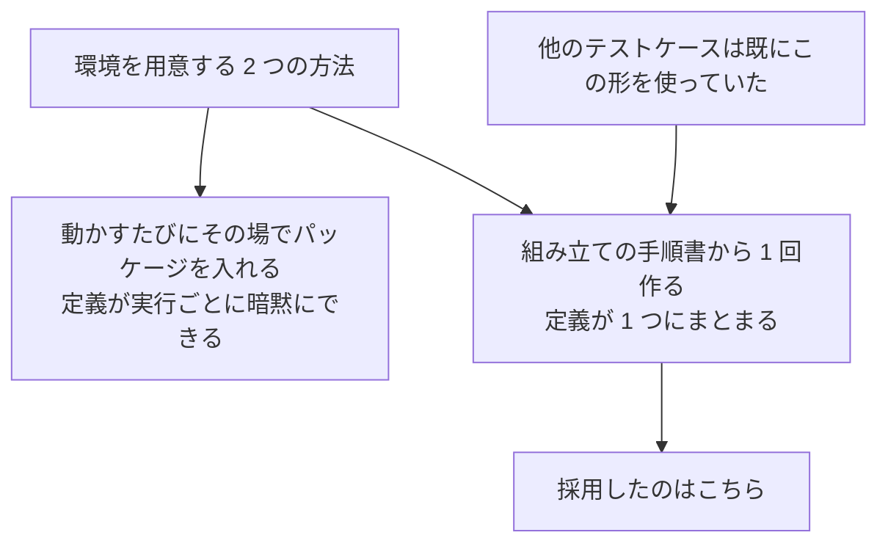

**Answer (English)**

The repository already had `ddp/Dockerfile` that installs the dependencies; the container script just wasn't using it. Other test cases, such as deepspeed, trl and mosaicml-composer, already build from a Dockerfile and import with `dockerd://`, so I followed the same pattern. That keeps one definition of the environment, built once, instead of a second, implicit one that each job would rebuild at runtime. No other option is recorded in the PR; consistency with the repository was the deciding reason.

**回答 (日本語)**

依存を入れる `ddp/Dockerfile` はリポジトリに既にあり、コンテナのスクリプトがそれを使っていなかっただけである。deepspeed、trl、mosaicml-composer などほかのテストケースは既に Dockerfile から作って `dockerd://` で取り込んでいるので、同じ形にそろえた。これで環境の定義が 1 つになり、一度だけ作られる。ジョブのたびに実行時に組み直す、暗黙のもう 1 つの定義を持たずに済む。PR にほかの案の記録は無く、決め手はリポジトリとそろえることだった。
:::

### 不具合の原因の深掘り

:::details Q3. [Bug] Why did only the container path fail with `No module named 'mlflow'`?
**質問 (日本語)**

なぜコンテナの経路だけが `No module named 'mlflow'` で止まったのか。

**原因の連鎖 (図)**

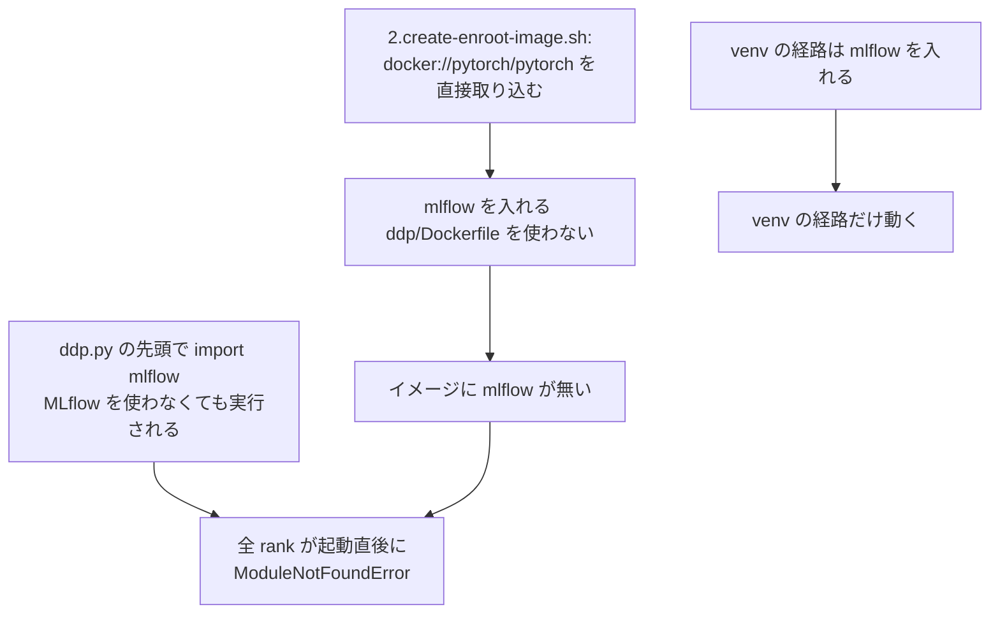

**噛み砕き (ひとことで)**

無条件に読み込む部品が、コンテナの経路のイメージだけに入っていなかった。

| 項目 | 内容 |
|---|---|
| 原因 | 学習のスクリプトが使わなくても 1 つの部品 (mlflow) を無条件に読み込むのに、コンテナの経路だけが公開イメージを直接取り込んでいて、その部品を入れる手順書を通していなかった。 |
| やったこと | 組み立て手順書から作ったイメージを使うように、取り込み方を変えた。 |
| 良い点 | 全ての役割 (rank) が起動直後に落ちる症状の原因を、2 つの事実の組み合わせとして正しく説明できた。 |
| 悪い点・代償 | 別の経路 (手元の仮想環境) はこの部品 (mlflow) を入れていたため、問題はコンテナの経路だけに出た。 |

**図 (やさしい版)**

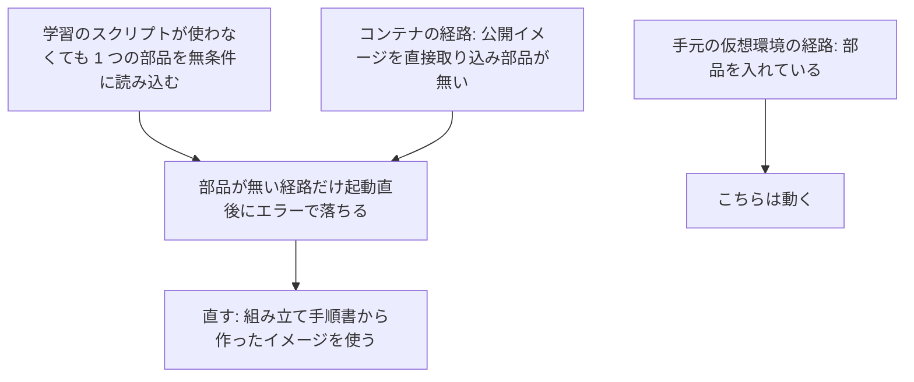

**Answer (English)**

Two facts combined. `ddp.py` imports `mlflow` unconditionally at the top of the module, lines 8 and 9, so the import runs even when MLflow isn't used. And the container script imported `docker://pytorch/pytorch` straight from Docker Hub, so the image never got the packages that `ddp/Dockerfile` adds. The venv script installs `mlflow` and `sagemaker-mlflow`, which is why only the container path failed: every rank died with `ModuleNotFoundError` right at startup. I changed the script to `docker build` from the Dockerfile and import it with `dockerd://`.

**回答 (日本語)**

2 つの事実が重なった。`ddp.py` はモジュールの先頭 (8 行目と 9 行目) で `mlflow` を無条件に import するので、MLflow を使わなくても import が走る。そしてコンテナのスクリプトは Docker Hub の `docker://pytorch/pytorch` を直接取り込んでいたので、イメージには `ddp/Dockerfile` が足すパッケージが入らなかった。venv のスクリプトは `mlflow` と `sagemaker-mlflow` を入れるので、コンテナの経路だけが失敗し、全 rank が起動の直後に `ModuleNotFoundError` で落ちた。スクリプトを、Dockerfile から `docker build` して `dockerd://` で取り込む形に変えた。
:::

:::details Q4. [Bug] After that fix, a second error appeared. What was it, and what's the lesson?
**質問 (日本語)**

その修正の後に 2 つ目の誤りが現れた。何で、教訓は何か。

**原因の連鎖 (図)**

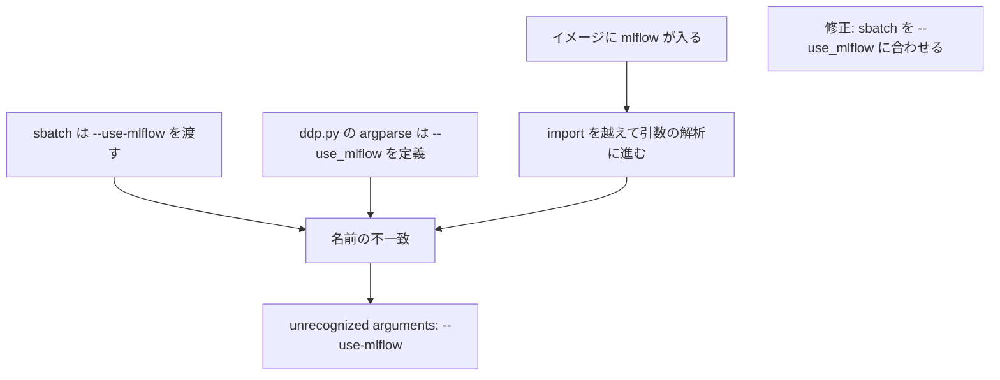

**噛み砕き (ひとことで)**

1 つ目のエラーを直すと、引数の名前の不一致という 2 つ目の問題が現れた。

| 項目 | 内容 |
|---|---|
| 原因 | 部品のエラーを直した後、実行の設定が渡す引数の名前の書き方と、スクリプトが受け取る引数の名前の書き方が一致していなかった。 |
| やったこと | 実行の設定の引数の書き方をスクリプトの定義に合わせ、複数のプロセスで最後まで動くことを確かめた。 |
| 良い点 | 「1 つ目のエラーが消えたら終わり」にせず、最後まで動かして 2 つ目の問題を見つけられた。 |
| 悪い点・代償 | 1 つ目のエラーが 2 つ目を隠していたので、1 回の修正だけでは不十分だったという教訓が残る。 |

**図 (やさしい版)**

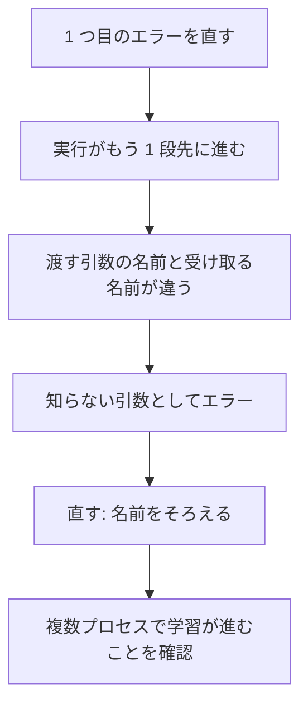

**Answer (English)**

Once the import succeeded, execution got one step further and hit argument parsing: the sbatch passed `--use-mlflow`, while the argparse in `ddp.py` defined `--use_mlflow`, so it was rejected as an unrecognized argument. The first error was masking the second. The lesson is that a fix isn't done when the first error disappears; you run the path to the end. After aligning the argument, I confirmed PR #1039 on two c5.4xlarge nodes with four processes each, eight in total, with every rank reporting its epoch loss over GLOO.

**回答 (日本語)**

import が通ると実行が 1 段先に進み、引数の解析に当たった。sbatch は `--use-mlflow` を渡していたが、`ddp.py` の argparse は `--use_mlflow` を定義していたので、知らない引数として拒まれた。1 つ目の誤りが 2 つ目を隠していたのである。教訓は、最初の誤りが消えたところで終わりにせず、最後まで動かすことである。引数を合わせた後、PR #1039 は c5.4xlarge の 2 ノード、1 ノードに 4 プロセスの計 8 プロセスで、GLOO で学習が進み各 rank がエポックの損失を出すことを確かめた。
:::

:::details Q5. [Bug] What was the intermittent MNIST and GLOO failure, and what is the likely cause?
**質問 (日本語)**

ときどき起きる MNIST と GLOO の失敗は何で、原因は何と考えられるか。

**原因の連鎖 (図)**

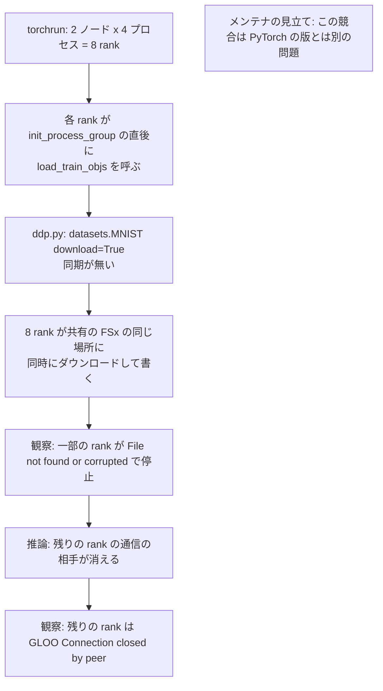

**噛み砕き (ひとことで)**

全員が同時に同じ場所へ書き込む競合が、2 種類の違うエラーとして現れていた。

| 項目 | 内容 |
|---|---|
| 原因 | 全ての役割 (rank) が、足並みをそろえる仕組み (同期) 無しで、同時に同じ共有の置き場所へ学習データをダウンロードして書き込む。レビューでこの競合が原因らしいと指摘されたが確定していない。一部が壊れたファイルを読んで落ち、残りがその相手を失って通信が切れるという説明は推論である。 |
| やったこと | 最初に落ちた役割を探し、1 ノードあたりのプロセス数と版を変えて成功率を測った (4 プロセスで版 2.2.1 は 0 パーセント、2.10.0 は約 70 パーセント、1 プロセスなら 10 回中 10 回)。原因の切り分けはしていない。 |
| 良い点 | 「後から出た通信切れのエラーを追わず、最初に落ちた役割を探す」という正しい調べ方の順番を実践できた。 |
| 悪い点・代償 | 原因はレビューで指摘された推測であって確定させておらず、修正自体もこの作業では実装も検証もしていない。 |

**図 (やさしい版)**

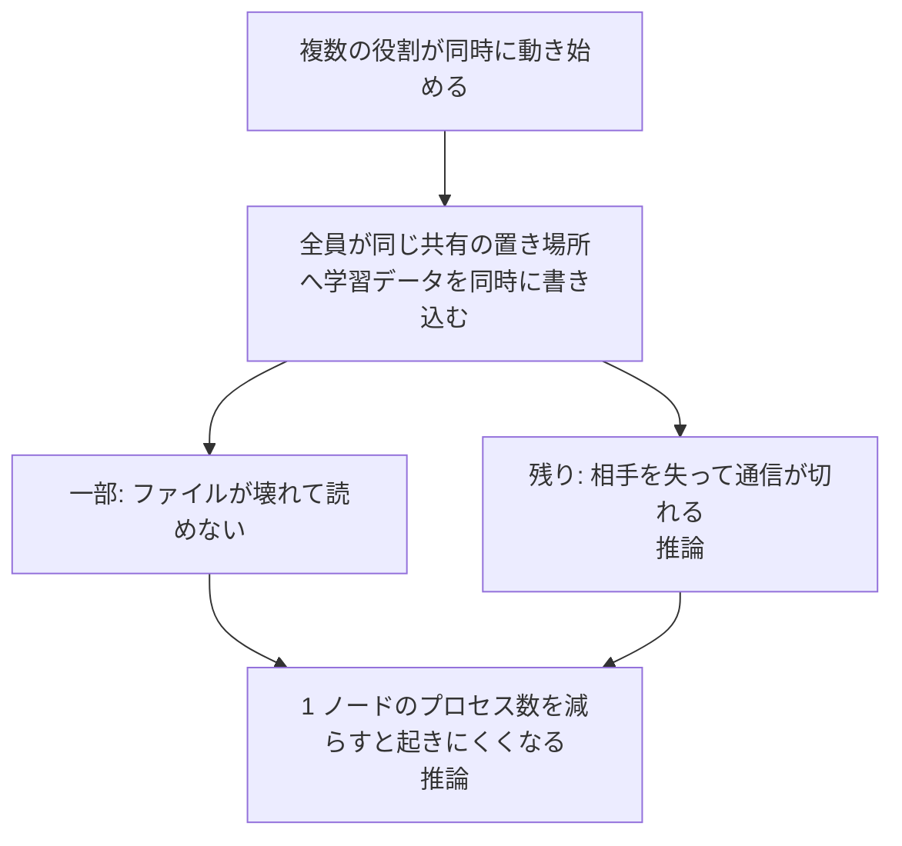

**Answer (English)**

The symptom on two c5n.9xlarge nodes with shared FSx for Lustre and four processes per node was that some ranks failed loading MNIST with `File not found or corrupted`, and the rest reported GLOO `Connection closed by peer`. The first rule is to find the rank that failed first and not chase the connection errors. In `ddp.py`, every rank calls `datasets.MNIST(download=True)` right after `init_process_group`, with no synchronization, so all eight processes download and write into the same shared directory at once. The maintainer pointed to this race in review as a problem separate from the PyTorch version, and proposed synchronizing with `torch.distributed.barrier()`. I didn't confirm it as the cause, and the fix isn't implemented or tested in this PR. With one process per node, two ranks still share that directory, so the race isn't eliminated; my inference is that it becomes less likely with fewer concurrent writers, but I didn't isolate that. Why the other ranks show a GLOO disconnect isn't explained in the PR; my reading of the code is that once one rank dies, its peers lose their connection, but I'd label that an inference. I measured success rates, 0% on PyTorch 2.2.1, which `latest` pointed to, about 70% on 2.10.0, and 10 out of 10 with one process per node, and I didn't isolate why the version changed the rate.

**回答 (日本語)**

共有の FSx for Lustre を使う c5n.9xlarge の 2 ノード、1 ノードに 4 プロセスで、一部の rank が MNIST の読み込みで `File not found or corrupted` を出し、残りが GLOO の `Connection closed by peer` を出した。最初の決まりは、接続切れを追わずに最初に落ちた rank を探すことである。`ddp.py` では各 rank が `init_process_group` の直後に `datasets.MNIST(download=True)` を同期無しで呼ぶので、8 プロセスすべてが同じ共有のディレクトリへ同時にダウンロードして書く。メンテナはレビューでこの競合を PyTorch の版とは別の問題として挙げ、`torch.distributed.barrier()` を使う同期を提案した。筆者は原因として確定させておらず、その修正もこの PR では実装も検証もしていない。1 ノード 1 プロセスでも 2 rank が同じ場所を使うので競合は無くならない。同時に書くものが減って起きにくくなると推論するが、切り分けてはいない。ほかの rank が GLOO の接続切れを出す理由は PR に説明が無い。コードを読む限り、1 つの rank が落ちると相手の rank が接続を失うと考えるが、これは推論だと断る。成功率は、`latest` が指していた PyTorch 2.2.1 で 0%、2.10.0 で約 70%、1 ノード 1 プロセスなら 10 回中 10 回で、版で率が変わった理由は切り分けていない。
:::

:::details Q6. Why ship a workaround instead of fixing the race?
**質問 (日本語)**

なぜ競合を直さずに回避策を出したのか。

**噛み砕き (ひとことで)**

催しの日程を優先し、競合そのものは直さず回避策だけで安定させた。

| 項目 | 内容 |
|---|---|
| 論点 | データの競合を直さず、回避策で済ませたのはなぜか。 |
| 選んだこと | 近く予定されていた催し (ワークショップ) の日程を優先し、PR の範囲をイメージの版の固定とプロセス数を選べるようにする 2 つだけに絞った。 |
| 良い点 | 期日までに安定して動く状態を用意できた。 |
| 悪い点・代償 | 1 ノードに複数プロセスでは失敗が残ったままで、競合そのものの直し方は次の対応に持ち越した。 |

**図 (やさしい版)**

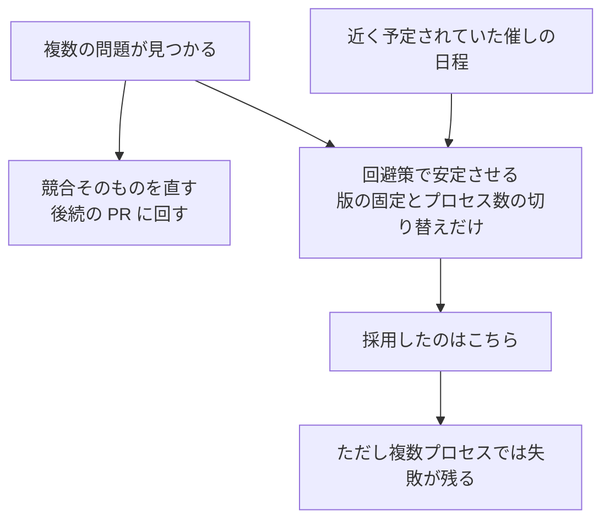

**Answer (English)**

Timing and scope. A ParallelCluster workshop on April 9, 2026 depended on this test case, so I prioritized a stable run for that date and limited the PR to two changes: pin the base image to `pytorch/pytorch:2.10.0-cuda12.6-cudnn9-runtime` to match the venv path, and add `NPROC_PER_NODE=${NPROC_PER_NODE:-4}` so the default stays 4 but the workshop can choose 1. I didn't touch `ddp.py`. The trade-off is explicit in the PR: with four processes per node the failure remains. The barrier-based synchronization was left for a follow-up PR and isn't implemented or tested here; the current `ddp.py` in the repository still has none.

**回答 (日本語)**

時期と範囲である。このテストケースを使う ParallelCluster のワークショップが 2026 年 4 月 9 日にあったので、その日に安定して動くことを優先し、PR を 2 つの変更に絞った。ベースのイメージを venv の経路とそろえて `pytorch/pytorch:2.10.0-cuda12.6-cudnn9-runtime` に固定し、`NPROC_PER_NODE=${NPROC_PER_NODE:-4}` を足して既定の 4 を保ちつつワークショップでは 1 を選べるようにした。`ddp.py` は変えていない。代償は PR にはっきり書いた。1 ノードに 4 プロセスでは失敗が残る。barrier を使う同期は後続の PR に回し、ここでは実装も検証もしていない。リポジトリの今の `ddp.py` にもまだ無い。
:::

:::details Q7. [Bug] Review found a bug in your own shell change. What was it?
**質問 (日本語)**

レビューで、自分の足したシェルの変更に不具合が見つかった。何だったか。

**原因の連鎖 (図)**

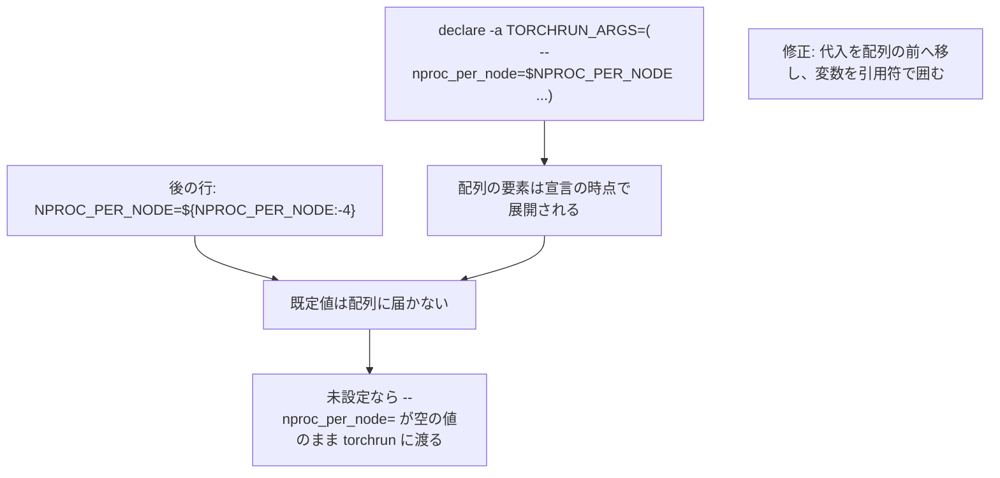

**噛み砕き (ひとことで)**

一覧を作る行の順番がずれていて、既定値が反映されていなかった。

| 項目 | 内容 |
|---|---|
| 原因 | シェルの一覧 (配列) を作る行が、既定値を設定する行より先に書かれていたため、既定値が一覧に反映されず、空の値がそのまま使われていた。 |
| やったこと | 既定値を設定する行を一覧より前に移し、変数を引用符で囲んだ。 |
| 良い点 | レビューで見つかった小さな誤りを、代入の位置を移して変数を引用符で囲むことで直せた。 |
| 悪い点・代償 | 気づかずにいたら、既定値に頼る人はプロセス数の指定が空のまま渡ってしまうところだった。 |

**図 (やさしい版)**

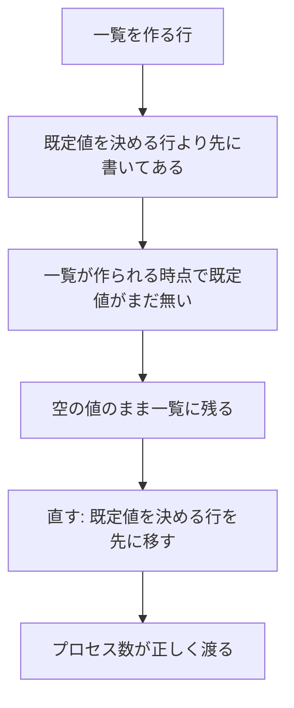

**Answer (English)**

In my first commit, the bash array `TORCHRUN_ARGS` containing `--nproc_per_node=$NPROC_PER_NODE` was declared before the line that set the default `NPROC_PER_NODE=${NPROC_PER_NODE:-4}`. Bash expands array elements at declaration time, so when the variable wasn't set, the empty value was baked into the array and the default never took effect. The reviewer caught it. I moved the assignment above the array and quoted the variable. It's small, but anyone relying on the default would have passed `--nproc_per_node=` with an empty value to torchrun instead of 4.

**回答 (日本語)**

最初の commit では、`--nproc_per_node=$NPROC_PER_NODE` を含む bash の配列 `TORCHRUN_ARGS` を、既定値の `NPROC_PER_NODE=${NPROC_PER_NODE:-4}` を設定する行より前で宣言していた。bash は配列の要素を宣言の時点で展開するので、変数が未設定なら空の値が配列に焼き付き、既定値が効かない。レビューで見つかった。代入を配列の前に移し、変数を引用符で囲んだ。小さな誤りだが、既定値に頼る人は 4 ではなく空の値の `--nproc_per_node=` を torchrun に渡すところだった。
:::

:::details Q8. Isn't `--break-system-packages` dangerous?
**質問 (日本語)**

`--break-system-packages` は危なくないか。

**噛み砕き (ひとことで)**

仕組みが拒む設定を、使い捨てのコンテナだと割り切って上書きした。

| 項目 | 内容 |
|---|---|
| 論点 | 仕組みが拒むシステム全体へのインストールを、特別な指定で押し通してよいか。 |
| 選んだこと | コンテナは使い捨てでホストと分かれており、イメージは手順書から作り直せるので、害は小さいと判断して使った。 |
| 良い点 | 新しい版の仕組み (Python 3.12) が既定で拒むシステムへのインストールを上書きでき、学習の実行でその結果も確かめた。 |
| 悪い点・代償 | この指定は仕組み自身が頼る部品を上書きしてしまう危険があり、長く使うホストでは使わない判断をしている。 |

**図 (やさしい版)**

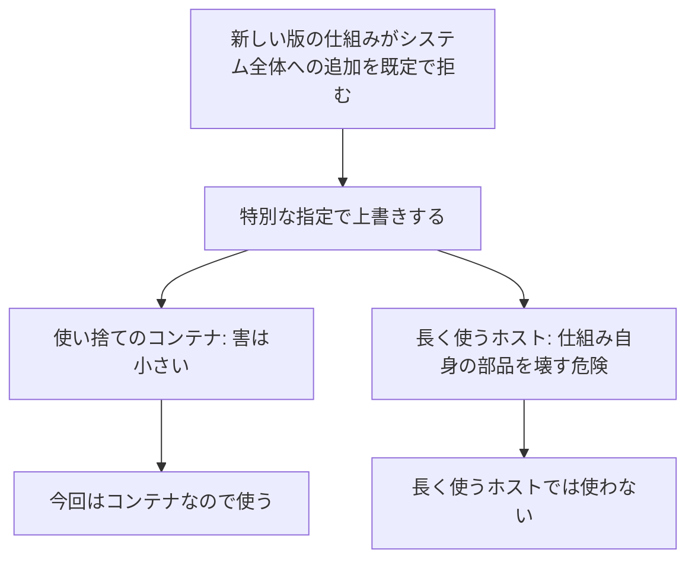

**Answer (English)**

The 2.10.0 image ships Python 3.12, which follows PEP 668 and refuses system-wide `pip install` by default; the flag overrides that. The risk is that pip overwrites packages the image's own Python depends on. Here the container is disposable and isolated from the host, and the image is rebuilt from the Dockerfile, so the harm is small, and the training runs exercised the result. I wouldn't use it on a long-lived host.

**回答 (日本語)**

2.10.0 のイメージは Python 3.12 で、PEP 668 に従い既定ではシステムへの `pip install` を拒み、このフラグはそれを上書きする。危険は、pip がイメージ自身の Python が頼るパッケージを上書きすることである。ここではコンテナが使い捨てでホストから切り離されていて、イメージは Dockerfile から作り直せるので害は小さく、学習の実行でその結果も確かめた。長く使うホストでは使わない。
:::

### 検証と振り返り

:::details Q9. How was the workaround verified, and by whom?
**質問 (日本語)**

回避策はどう検証され、誰が確かめたか。

**Answer (English)**

I tested the changed container path on two c5n.9xlarge nodes with one and four processes per node, deleting MNIST with `rm -rf ../data` before every run so each run repeated the first download, and confirmed the image reported `2.10.0+cu126`. With four processes per node, a rank still raised an exception during the download, as expected. The maintainer tested the venv sbatch separately on SageMaker HyperPod Slurm with two ml.c5.2xlarge nodes. Not the container path, because those CPU instances have no NVIDIA drivers. With one process per node, five of five passed. With four, four of five passed, and the failed run showed the same MNIST and GLOO errors.

**回答 (日本語)**

変えたコンテナの経路を c5n.9xlarge の 2 ノードで、1 ノードに 1 プロセスと 4 プロセスの両方で試した。毎回の前に `rm -rf ../data` で MNIST を消して初めてのダウンロードから再現させ、イメージの中の版が `2.10.0+cu126` であることも確かめた。1 ノードに 4 プロセスでは、想定どおりダウンロードで例外を出す rank がまだ現れた。メンテナは別に SageMaker HyperPod の Slurm の ml.c5.2xlarge の 2 ノードで、コンテナの経路ではなく venv の sbatch を確かめた。NVIDIA のドライバの無いその CPU のインスタンスでは、コンテナの経路が使えないからである。1 ノードに 1 プロセスで 5 回中 5 回、4 プロセスで 5 回中 4 回成功し、失敗した 1 回は同じ MNIST と GLOO の型だった。
:::

:::details Q10. How would you fix the race properly, and what would you check?
**質問 (日本語)**

競合を本当に直すならどうし、何を確かめるか。

**噛み砕き (ひとことで)**

競合を本当に直すなら、同時に書き込まないことを保証し、全回成功するまで検証する。

| 項目 | 内容 |
|---|---|
| 論点 | データの競合を本当に直すなら何をし、何を確かめるか。 |
| 選んだこと | レビューで提案された「全員がそろうまで待つ」仕組みなどで同時に書き込まないことを保証する。合わせて、共有データの持ち方や保存場所の見直しも次に調べる。 |
| 良い点 | どんな直し方であっても「同時に書き込まない」という保証がゴールだと明確にできる。 |
| 悪い点・代償 | 検証には、データを消してから何度も試し、1 ノードに複数プロセスで全回成功することを求める必要があり、1 回でも失敗したら競合が隠れているとみなす厳しさが要る。 |

**図 (やさしい版)**

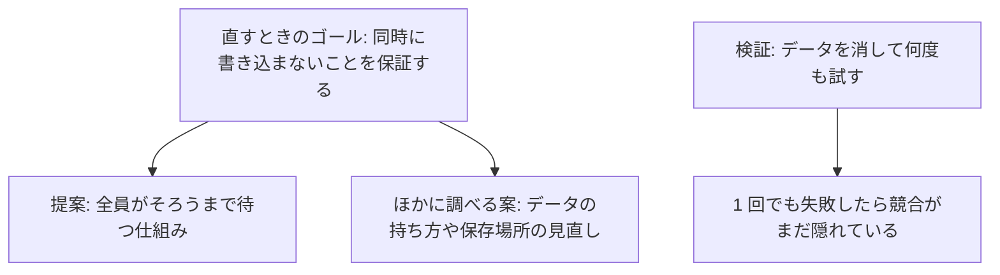

**Answer (English)**

The review proposed synchronizing with `torch.distributed.barrier()` in `ddp.py`. Whatever the exact form, the follow-up has to guarantee that ranks don't download and write into the shared directory concurrently. In my Issue I also listed three things to investigate next: `--container-mounts` settings for shared data, synchronizing with a barrier that doesn't depend on the dataset, and reviewing the storage. To verify a fix, I'd reuse the same harness: delete the data before each run, run four processes per node many times, and require every run to pass, since a 4 of 5 pass rate is exactly the signal that hides a race.

**回答 (日本語)**

レビューでは `ddp.py` で `torch.distributed.barrier()` を使って同期することが提案された。形はどうあれ、後続の修正は、各 rank が共有のディレクトリへ同時にダウンロードして書かないことを保証する必要がある。Issue では、共有データ向けの `--container-mounts` の設定、データセットによらない barrier での同期、ストレージの見直し、の 3 つも次に調べる項目に挙げた。修正の検証には同じ手順を使う。毎回の前にデータを消し、1 ノードに 4 プロセスで何度も動かし、全回の成功を求める。5 回中 4 回の成功こそ、競合を隠す信号だからである。
:::

## まとめ

PR #1039 は、依存のパッケージの不足と引数の名前の不一致を直した。PR #1048 は、版の固定とプロセスの数の切り替えを足した。共有のストレージへの同時のダウンロードを防ぐ同期は、後続の課題として残った。
