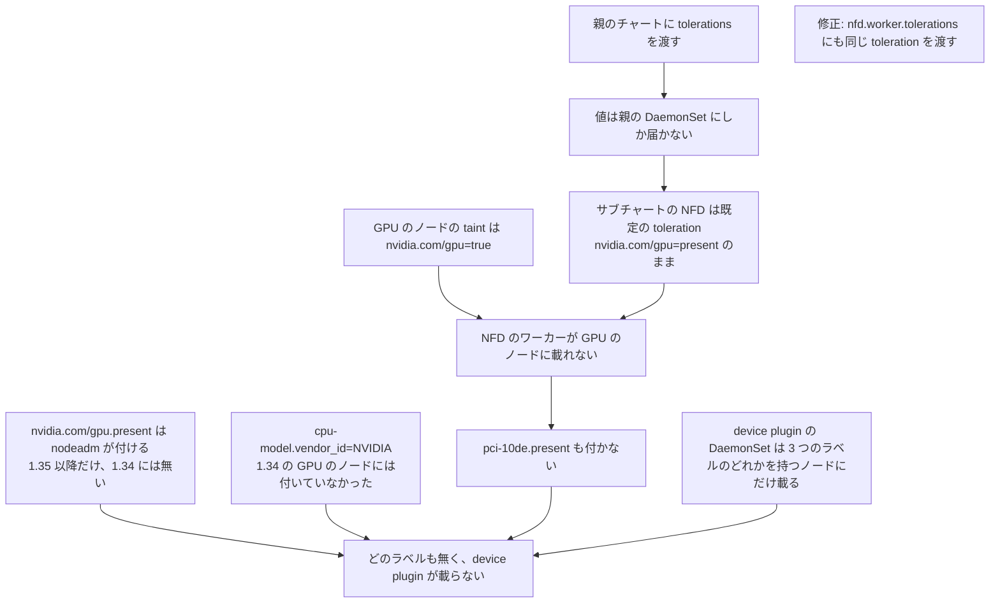
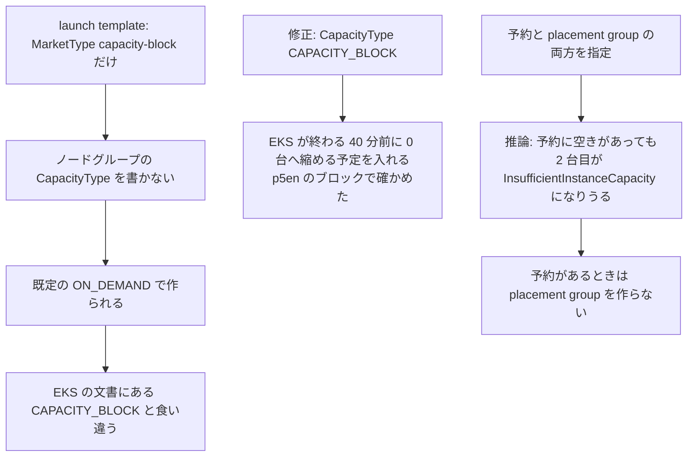
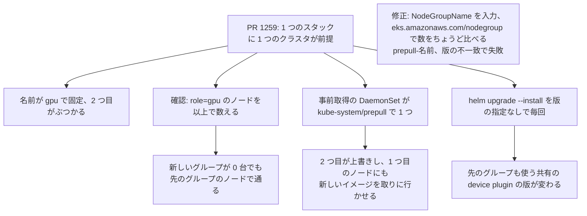
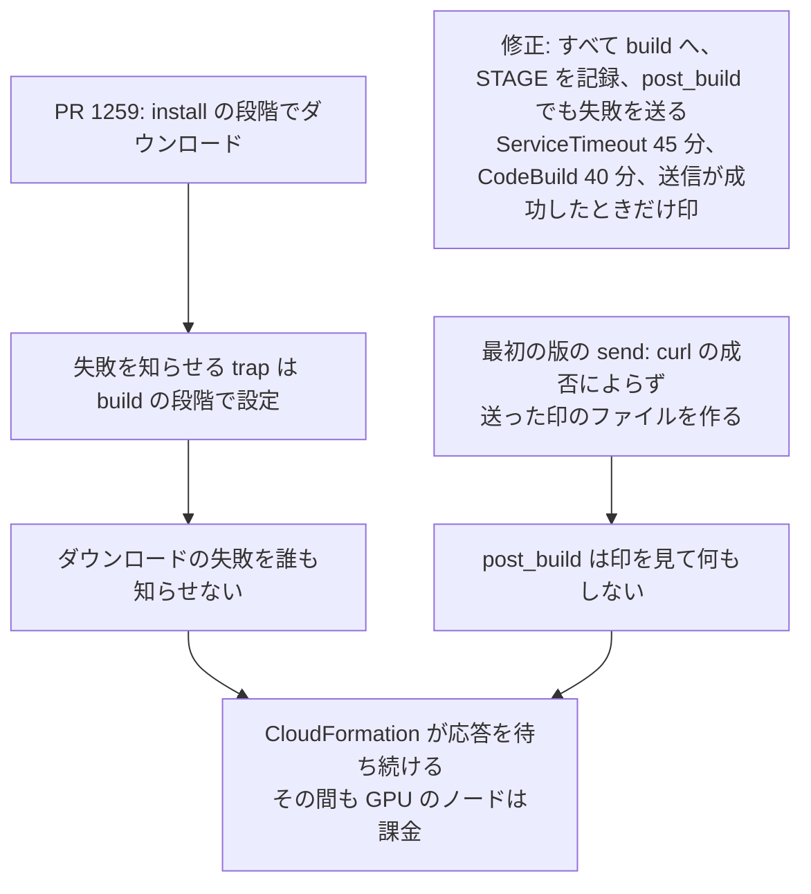
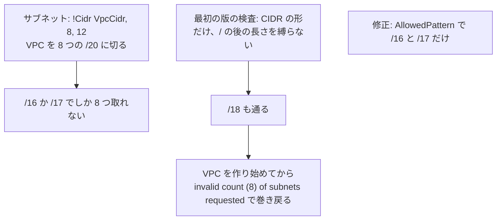
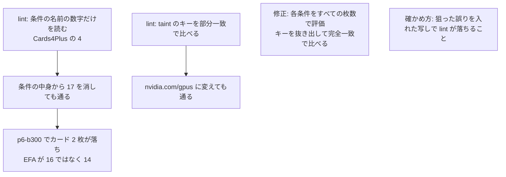
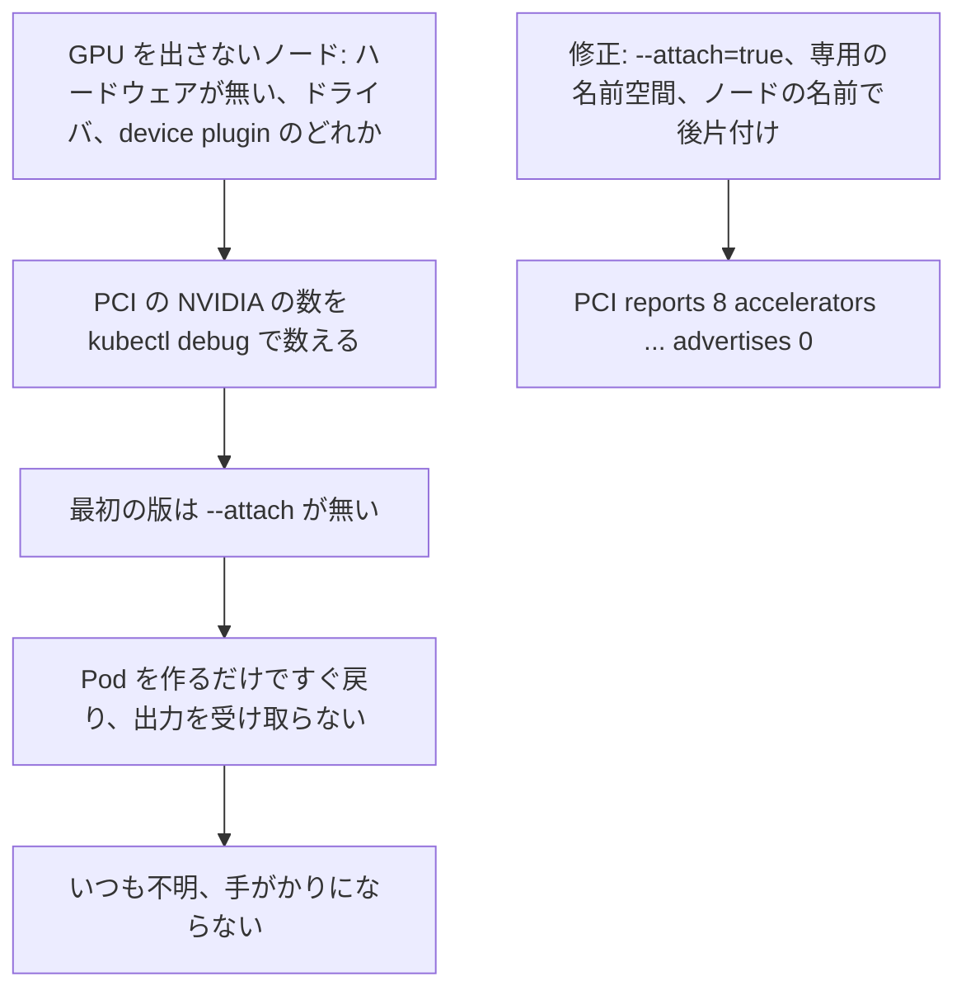
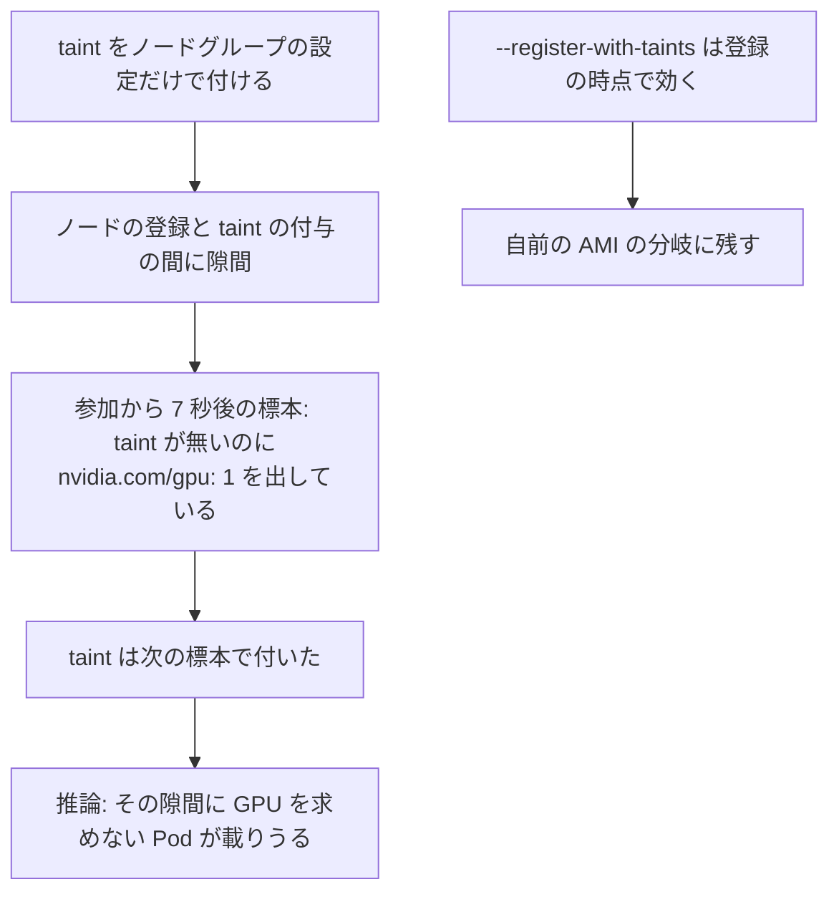
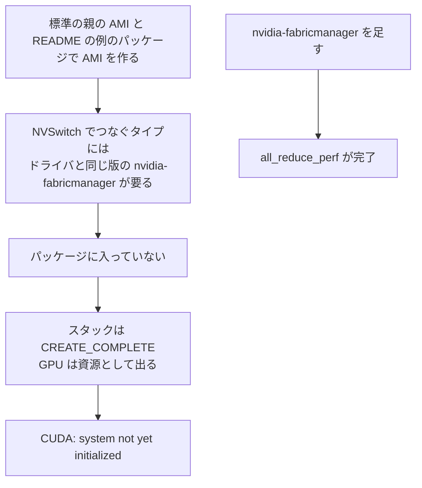

## はじめに

本章は、前章「Awsome: EKS の GPU クラスタを CloudFormation で作る」の [PR #1269](https://github.com/awslabs/awsome-distributed-ai/pull/1269) について、技術面接で聞かれたときに答えるための想定問答をまとめたものである。前章の本文が Zenn の 1 章あたりの文字数の上限に近いので、想定問答を別の章に分けた。

## 技術面接の準備 (FAQ)

この節は、前章の内容を技術面接で聞かれたときに答えるための想定問答である。システム設計面接の流れに合わせて、全体と設計、不具合の原因の深掘り、検証と振り返りの 3 つに分けた。各問は英語の質問 (見出し)、日本語の質問、英語の回答、日本語の回答の順に書いた。不具合の問には原因の連鎖の図を付け、回答は症状、原因、突き止め方、直し方と比べた案、検証、残ったこと、の順に話す。回答は前章の本文と、PR、マージ前後のコードで確かめた事実だけを使う。

### 全体と設計

:::details Q1. Give me a two-minute overview of this design.
**質問 (日本語)**

この設計を 2 分で説明してほしい。

**Answer (English)**

The goal was a CloudFormation path for EKS GPU clusters that also works when you already have a cluster and only want to add GPUs. I split #1259's single template into network, cluster, GPU node group and AMI templates, plus a root that creates them from S3 URLs, so a full build is one submission and partial adoption uses a child directly. The node group template can be deployed many times on one cluster: names, readiness counts and image pre-pull are per node group, while the cluster-scoped device plugin releases are shared under an install-if-absent, fail-on-mismatch policy. AMIs come from an existing ID, a package list or a recipe, decided by which input is set. Capacity can be On-Demand, a targeted ODCR or a Capacity Block. The stack succeeds only when every node is Ready and advertises exactly the expected GPUs and EFA, and the bootstrap reports failures to CloudFormation on every path I tested, with CloudFormation's wait capped at 45 minutes even if a report never arrives. It was tested on Kubernetes 1.34 to 1.36, a Capacity Block, an existing cluster and a private-only endpoint.

**回答 (日本語)**

狙いは、既にクラスタを持っていて GPU だけを足したい場合にも使える、EKS の GPU クラスタを作る CloudFormation の経路だった。#1259 の 1 つのテンプレートを、ネットワーク、クラスタ、GPU のノードグループ、AMI の 4 つと、それらを S3 の URL から作る root に分けた。全部を作るなら提出は 1 つで、一部だけ使うなら子を直接使う。ノードグループのテンプレートは 1 つのクラスタに何度でも出せる。名前、確認の数え方、イメージの事前取得はノードグループごとで、クラスタに 1 つの device plugin のリリースは、無ければ入れ、版が違えば失敗させる方針で共有する。AMI は既にある ID、パッケージの一覧、レシピのどれかを、埋めた入力から決める。容量は On-Demand、targeted の ODCR、Capacity Block から選べる。スタックが成功するのは、すべてのノードが Ready で、期待する数の GPU と EFA をちょうど出したときだけで、失敗は試したすべての経路で CloudFormation に知らせ、知らせが届かなくても CloudFormation が待つのは長くても 45 分である。Kubernetes 1.34 から 1.36、Capacity Block、既存のクラスタ、private だけの endpoint で試した。
:::

:::details Q2. What were the requirements and design goals?
**質問 (日本語)**

要件と設計の狙いは何だったか。

**Answer (English)**

Someone who already has an EKS cluster and a VPC and only wants GPUs had no path, neither in the template nor in the eksctl manifests. I set seven goals. Users can bring their own AMI, or build one within the same stack deployment. They can add GPUs to an existing cluster, and add more than one GPU node group to the same cluster, for example g7 and g7e for prefill and decode in disaggregated inference. They can choose On-Demand, a targeted ODCR, or a Capacity Block. The stack succeeds only once GPU and EFA resources are registered. And the repository should maintain as few pinned versions as possible. The custom AMI goal came from a real gap: when the PR started, the EKS AL2023 NVIDIA AMI didn't recognize g7 GPUs, and nodes went Ready while advertising none.

**回答 (日本語)**

既に EKS のクラスタと VPC を持っていて GPU だけを足したい人が使える経路が、テンプレートにも eksctl のマニフェストにも無かった。設計の狙いは 7 つである。自前の AMI を持ち込むか、同じスタックの作成の中で作れる。既存のクラスタに GPU を足せ、1 つのクラスタに GPU のノードグループを複数足せる (例えば分離推論で prefill と decode を g7 と g7e に分ける)。On-Demand、targeted の ODCR、Capacity Block から選べる。GPU と EFA の資源が登録されて初めてスタックが成功する。リポジトリが保守する固定の版をできるだけ少なくする。自前の AMI の狙いは実際の隙間から来た。PR を始めた時点では EKS の AL2023 の NVIDIA の AMI が g7 の GPU を認識せず、ノードは Ready なのに GPU を 1 つも出さなかった。
:::

:::details Q3. Why four child templates and a root, instead of more conditions in one?
**質問 (日本語)**

なぜ 1 つのテンプレートに条件を足さず、4 つの子と root に分けたのか。

**Answer (English)**

A single template is easy to read and publish, but supporting existing clusters, VPCs and AMIs adds branches, and parameters that matter in only one branch end up next to the ones that always matter. Independent templates without a root separate the concerns, but a full deployment then needs four stacks in order with outputs passed by hand. I chose four children and a root that creates them from S3 URLs, the same shape as the aws-pcs and HyperPod EKS roots. The trade-off is that testing a change means uploading all five templates to S3 first, which the README documents. The AMI stack depends only on the network, so the AMI build and cluster creation run in parallel.

**回答 (日本語)**

1 つのテンプレートは読むのも公開するのも楽だが、既存のクラスタ、VPC、AMI に対応するたびに分岐が増え、1 つの分岐でしか意味の無いパラメータが、いつも意味のあるものと並ぶ。root を作らずに子を独立させると関心は分かれるが、全部を作るには 4 つのスタックを順に作り、出力を手で渡す必要がある。4 つの子と、それらを S3 の URL から作る root にした。aws-pcs と HyperPod EKS の root と同じ形である。代償は、変更を試すには先に 5 つのテンプレートを S3 に置く必要があることで、手順は README に書いた。AMI のスタックはネットワークだけに依存させたので、AMI のビルドとクラスタの作成は並んで進む。
:::

:::details Q4. How do you manage the shared, cluster-scoped device plugin releases?
**質問 (日本語)**

クラスタに 1 つの共有の device plugin のリリースをどう扱うか。

**Answer (English)**

There's one release per plugin per cluster, one for NVIDIA and one for EFA, so the question is who may change its version. #1259 ran `helm upgrade --install` without a version every time, so a second stack could silently change the version of the shared plugin the first group was already using. A release per node group doesn't restrict where the DaemonSet lands, so two copies of the same plugin would sit on the same nodes and conflict. Install-only-if-absent silently accepts a mismatch. I chose: install if absent, leave it alone if the version matches, fail the stack if it differs. The cost is an explicit upgrade procedure: upgrade the release first with Helm `--reset-then-reuse-values`, then align each stack; my first README order couldn't work because the existing stack would fail its own check, which review caught. I tested 0.20.0 to 0.20.1 and both stacks reached `UPDATE_COMPLETE`. Limit: a plugin installed another way, such as by the GPU Operator, isn't detected.

**回答 (日本語)**

リリースはクラスタにプラグインごとに 1 つ (NVIDIA 用と EFA 用) なので、問題は誰が版を変えてよいかである。#1259 は毎回、版を指定せずに `helm upgrade --install` を実行していたので、2 つ目のスタックが、1 つ目のグループも使っている共有のプラグインの版を黙って変えうる。ノードグループごとにリリースを分けても DaemonSet の載る先は分かれず、同じプラグインが 2 つ同じノードに載って競合する。無ければ入れるだけの方法は食い違いを黙って通す。採ったのは、無ければ入れ、同じ版なら触らず、違う版ならスタックを失敗させる方針である。代償は版を上げる手順が要ることで、Helm の `--reset-then-reuse-values` でリリースを先に上げ、その後で各スタックをそろえる。最初の README の順では既存のスタックが自分の確認で止まるので上げられない、とレビューで見つかった。0.20.0 から 0.20.1 への移行を試し、2 つのスタックがどちらも `UPDATE_COMPLETE` になった。限界は、GPU Operator など別の方法で入れたプラグインが見えないことである。
:::

:::details Q5. How does the template decide where the node AMI comes from, and what changes with a custom AMI?
**質問 (日本語)**

ノードの AMI をどこから持ってくるかをどう決め、自前の AMI だと何が変わるか。

**Answer (English)**

By which input is filled: `NodeAmiId` uses an existing AMI, `NodeImagePackages` builds one with EC2 Image Builder from the standard EKS AMI plus packages, and `NodeImageRecipeArn` builds from your own recipe. More than one is rejected before any resource is created; all empty lets EKS pick from `AmiType`. A named selector would read better but lets selector and inputs disagree. With a custom AMI, EKS stops adding the bootstrap config, so user data must carry the cluster endpoint, certificate, Service CIDR, containerd's runtime and kubelet flags. EKS's chosen IPv4 Service CIDR isn't a CloudFormation attribute, so I made `ServiceIpv4Cidr` an input on the cluster template, defaulting to `172.20.0.0/16`, outside the VPC default. And I add the `eks.amazonaws.com/nodegroup` label in kubelet flags, because only EKS AMIs get it automatically, and the readiness check counts nodes by it.

**回答 (日本語)**

どの入力を埋めたかで決める。`NodeAmiId` は既にある AMI を使い、`NodeImagePackages` は EKS の標準の AMI にパッケージを入れて EC2 Image Builder で作り、`NodeImageRecipeArn` は自分のレシピから作る。2 つ以上を埋めると作成の前に拒み、すべて空なら EKS が `AmiType` から選ぶ。方法の名前を選ぶパラメータのほうが読みやすいが、名前と入力が食い違いうる。自前の AMI では EKS が起動の設定を足さなくなるので、ユーザーデータにクラスタの endpoint、証明書、Service CIDR、containerd のランタイム、kubelet のフラグを持たせる。EKS が選んだ IPv4 の Service CIDR は CloudFormation の属性に無いので、クラスタのテンプレートで `ServiceIpv4Cidr` を入力にし、既定を VPC の既定の範囲の外の `172.20.0.0/16` にした。また `eks.amazonaws.com/nodegroup` のラベルを kubelet のフラグで付ける。EKS の AMI でしか自動で付かず、確認はこのラベルでノードを数えるからである。
:::

:::details Q6. Why exact GPU and EFA counts as the success condition, and not just Ready?
**質問 (日本語)**

なぜ成功の条件を Ready ではなく、GPU と EFA の数のちょうどの一致にしたのか。

**Answer (English)**

Because Ready isn't enough: with the g7 driver gap, nodes were Ready and advertised no GPUs. When `GpuNodeCount` is nonzero, the stack succeeds only if the group has exactly that many nodes, each Ready and advertising exactly the expected `nvidia.com/gpu` and `vpc.amazonaws.com/efa` counts for its type, from the `GpuCount` and `NicLayout` mappings. #1259 accepted "nodes with nonzero GPU and EFA, at least `GpuNodeCount`", which passes an 8-GPU node advertising 1, ignores Ready, and passes instantly at 0. The boundary matters: this checks Kubernetes registration, not that CUDA works, and testing showed exactly that gap with Fabric Manager.

**回答 (日本語)**

Ready では足りないからである。g7 のドライバの隙間では、ノードは Ready なのに GPU を出さなかった。`GpuNodeCount` が 0 でなければ、グループのノードがちょうどその数で、各ノードが Ready で、`GpuCount` と `NicLayout` の対応表から決まるタイプごとの数の `nvidia.com/gpu` と `vpc.amazonaws.com/efa` をちょうど出すときだけ成功にした。#1259 は「GPU と EFA が 0 でないノードが `GpuNodeCount` 以上」で通していたので、8 GPU のタイプで 1 つしか出ないノードも数え、Ready を見ず、0 台ならすぐ通った。境界が大事で、この確認は Kubernetes の登録を見るもので、CUDA が動くことまでは見ない。試験ではまさにその隙間が Fabric Manager で現れた。
:::

### 不具合の原因の深掘り

:::details Q7. [Bug] On Kubernetes 1.34 the NVIDIA device plugin landed on no node. Why?
**質問 (日本語)**

Kubernetes 1.34 で NVIDIA の device plugin がどのノードにも載らなかった。なぜか。

**原因の連鎖 (図)**

**Answer (English)**

The NVIDIA device plugin DaemonSet only schedules onto nodes that have one of three labels. From 1.35, nodeadm adds `nvidia.com/gpu.present=true`, so 1.36 worked. On 1.34 that label doesn't exist, and the fallback label, `feature.node.kubernetes.io/pci-10de.present`, comes from the node-feature-discovery worker. The reviewer found and diagnosed this before merge. That worker couldn't schedule on GPU nodes: the template passed `tolerations` to the parent chart, but that value only reaches the parent's DaemonSet, not the bundled NFD subchart, which kept its default toleration for `nvidia.com/gpu=present`, while our taint is `nvidia.com/gpu=true`. The reviewer confirmed it by rendering with `helm template`, and saw GPUs appear within 20 seconds after adding the value by hand. The fix passes the same toleration to `nfd.worker.tolerations`. I verified on 1.34 with two g4dn.8xlarge that the NFD worker ran and the label appeared. #1259's end-to-end run used `GpuNodeCount=0`, which is why it never hit this.

**回答 (日本語)**

NVIDIA の device plugin の DaemonSet は、3 つのラベルのどれかを持つノードにだけ載る。1.35 以降は nodeadm が `nvidia.com/gpu.present=true` を付けるので 1.36 では載った。1.34 にはそのラベルが無く、代わりの `feature.node.kubernetes.io/pci-10de.present` は node-feature-discovery のワーカーが付ける。レビューした人がマージの前に見つけて原因を突き止めた。そのワーカーが GPU のノードに載れなかった。テンプレートは親のチャートに `tolerations` を渡していたが、その値は親の DaemonSet にしか届かず、同梱の NFD のサブチャートには届かない。サブチャートは自分の既定の toleration `nvidia.com/gpu=present` のままで、こちらの taint は `nvidia.com/gpu=true` だった。レビューした人が `helm template` で描いて確かめ、手で値を足すと 20 秒以内に GPU が出ることも見た。修正は同じ toleration を `nfd.worker.tolerations` にも渡すもので、1.34 と g4dn.8xlarge 2 台で NFD のワーカーが動きラベルが付くことを確かめた。#1259 の全体の実行は `GpuNodeCount=0` だったので、この問題に当たらなかった。
:::

:::details Q8. [Bug] What went wrong with Capacity Blocks and placement groups?
**質問 (日本語)**

Capacity Block と placement group で何がまずかったか。

**原因の連鎖 (図)**

**Answer (English)**

A must-fix from review: #1259 and my first version only set `MarketType: capacity-block` in the launch template and never set `CapacityType` on the node group, so it defaulted to `ON_DEMAND`. I didn't observe the old version through the end of a block; the bug is a mismatch with the EKS documentation, which describes `CAPACITY_BLOCK` for these node groups, and with it EKS schedules a scale-to-zero 40 minutes before the block ends. The fix sets it from the reservation type. On a p5en.48xlarge block I confirmed the stack completed after the block started, with 8 GPUs and 16 EFA, and that EKS scaled to zero 40 minutes before the end. Before the block starts, launches fail with `Capacity Reservation ... is not yet active` and retry, so the README records that as observed behavior. Separately, I stopped creating a placement group whenever a reservation is used. The reviewer reported both nodes launched with both set, so this is my reasoning, not a failure I reproduced: reserved capacity isn't in the stack's placement group, so a second node could fail with `InsufficientInstanceCapacity`. The trade-off is that the reservation decides placement.

**回答 (日本語)**

レビューでマージの前に直すべきとされた 1 件である。#1259 と最初の版は launch template に `MarketType: capacity-block` を入れるだけで、ノードグループに `CapacityType` を書かず、既定の `ON_DEMAND` になっていた。古い版をブロックの終わりまで動かして見たわけではなく、不具合は EKS の文書との食い違いである。文書はこのノードグループに `CAPACITY_BLOCK` を設定することを記載していて、これがあると EKS はブロックの終わる 40 分前に 0 台へ縮める予定を入れる。修正は予約の種類から入れる。p5en.48xlarge のブロックで、開始の後にスタックが GPU 8、EFA 16 で完了し、終わる 40 分前に EKS が 0 台にすることを確かめた。開始の前は起動が `Capacity Reservation ... is not yet active` で失敗して再試行されるので、README には観察した挙動として書いた。別に、予約を使うときは placement group を作らないようにした。レビューした人は両方を指定しても 2 台とも起動したと報告したので、これは再現した失敗ではなく推論である。予約した容量はスタックの placement group の中に無いので、2 台目が `InsufficientInstanceCapacity` で失敗しうる。代償は、置き場所を予約が決めることである。
:::

:::details Q9. [Bug] What broke when a second GPU node group joined the same cluster?
**質問 (日本語)**

同じクラスタに 2 つ目の GPU のノードグループを足すと、何が壊れたか。

**原因の連鎖 (図)**

**Answer (English)**

Everything that assumed one stack per cluster. The node group name was hard-coded as `gpu`, so a second one collided; `NodeGroupName` became a parameter with `gpu` as the default. The readiness check counted nodes labeled `role=gpu` with "at least", and every GPU group carries that label, so a new group could pass with zero nodes of its own using the other group's; it now selects by `eks.amazonaws.com/nodegroup` and requires exact counts. The pre-pull DaemonSet was one fixed name, `kube-system/prepull`, so a second stack overwrote it and sent the first group's nodes after the new image; the reviewer caught this, and it's now named per node group, lowercased with underscores turned into hyphens because DaemonSet names don't allow them. The trade-off there is that `ng_B` and `ng-b` map to the same name, in which case the second stack's pre-pull doesn't start and it warns. And unversioned `helm upgrade --install` could change the shared plugin's version, which Q4 covers.

**回答 (日本語)**

1 つのクラスタに 1 つのスタックを前提にしていたものすべてである。ノードグループの名前が `gpu` と書き込まれていたので 2 つ目がぶつかり、`NodeGroupName` を入力にして既定を `gpu` にした。確認は `role=gpu` のラベルのノードを「以上」で数えていて、どの GPU のグループもこのラベルを持つので、新しいグループは自分のノードが 0 台でも別のグループのノードで通り得た。今は `eks.amazonaws.com/nodegroup` で選び、数のちょうどの一致を求める。事前取得の DaemonSet は `kube-system/prepull` という 1 つの名前で、2 つ目のスタックが上書きし、1 つ目のグループのノードにも新しいイメージを取りに行かせた。レビューで見つかり、今はノードグループごとの名前で、DaemonSet の名前が許さないので小文字にし `_` を `-` に変える。その代償として `ng_B` と `ng-b` は同じ名前になり、その場合 2 つ目のスタックの事前取得は始まらず警告を出す。版を指定しない `helm upgrade --install` が共有のプラグインの版を変えうる件は Q4 で扱った。
:::

:::details Q10. [Bug] How could CloudFormation end up waiting with GPUs running and no answer?
**質問 (日本語)**

どうして、GPU が動いたまま答えが来ずに CloudFormation が待ち続けることがありえたのか。

**原因の連鎖 (図)**

**Answer (English)**

Lambda starts CodeBuild with the response URL, and CodeBuild installs, checks, and sends the response to CloudFormation itself, which avoids Lambda's 15-minute limit. The failure to design against is silence: CloudFormation keeps waiting while GPU nodes run and cost money.

There were two gaps. In #1259, downloads ran in the `install` phase but the failure `trap` was set in `build`, so a failed download produced no answer and the default one-hour wait. And in my first version, `send()` created its "responded" marker even when `curl` failed, so `post_build` skipped its fallback. The reviewer reproduced that against an unreachable URL: `curl` failed with "Failed to connect", `send` returned 0, and the marker existed.

I moved all work into `build` and record the failing stage, kept `post_build` as a fallback that reports failure, and now write the marker only after `curl --retry 3` succeeds. `ServiceTimeout: 2700` caps CloudFormation's wait at 45 minutes, and CodeBuild's timeout went from 60 to 40 minutes so `post_build` has time to answer before that cap. I tested the response path with a URL returning 403 and a correct one. If the response URL stays unreachable, nothing can arrive, and the 45-minute cap is what ends the wait.

**回答 (日本語)**

Lambda が応答先の URL を渡して CodeBuild を起動し、CodeBuild が導入と確認をして自分で CloudFormation に応答を送る。これで Lambda の 15 分の上限を避ける。防ぐべき故障は沈黙で、CloudFormation が待ち続ける間も GPU のノードは動き、料金がかかる。

抜けは 2 つあった。#1259 は `install` の段階でダウンロードし、失敗を知らせる `trap` は `build` の段階で設定していたので、ダウンロードが失敗すると答えが無く、既定の 1 時間を待った。そして最初の版の `send()` は、`curl` が失敗しても「送った」印を作ったので、`post_build` が予備の知らせを飛ばした。レビューした人は届かない URL で再現し、`curl` が "Failed to connect" で失敗し、`send` が 0 を返し、印ができていることを示した。

すべての処理を `build` に入れて失敗した段階を記録し、`post_build` を失敗を知らせる予備として残し、印は `curl --retry 3` が成功したときだけ作るようにした。`ServiceTimeout: 2700` で CloudFormation の待ちを 45 分までにし、CodeBuild の上限を 60 分から 40 分に縮めて、その上限の前に `post_build` が答える時間を残した。応答の経路は 403 を返す URL と正しい URL で試した。応答先に届かない状態が続けば何も届かないので、45 分の上限が待ちを終わらせる。
:::

:::details Q11. [Bug] A /18 VPC passed validation and then failed. Why?
**質問 (日本語)**

/18 の VPC が検査を通った後で失敗した。なぜか。

**原因の連鎖 (図)**

**Answer (English)**

Subnets are carved with `!Cidr [VpcCidr, 8, 12]`, eight /20 blocks, which only fits in a /16 or /17 VPC. #1259 accepted any string, and my first version checked only the CIDR shape. I actually asked in the PR whether that might be too strict; the reviewer created stacks and showed the opposite: a /18 passes the check, then fails mid-deployment with `invalid count (8) of subnets requested`, an error that names neither the parameter nor the CIDR. The merged pattern allows only /16 and /17. The cost is coupling: if the subnet layout changes, this pattern must change with it.

**回答 (日本語)**

サブネットは `!Cidr [VpcCidr, 8, 12]` で 8 つの /20 に切り出し、これは /16 か /17 の VPC にしか収まらない。#1259 はどんな文字列も受け付け、最初の版は CIDR の形だけを見た。筆者は PR で、厳しすぎるのではと意見を求めたほどだった。レビューした人はスタックを作って逆を示した。/18 は検査を通り、デプロイの途中でパラメータの名前も CIDR も出ない `invalid count (8) of subnets requested` で失敗する。マージした形は /16 と /17 だけを通す。代償は結びつきで、サブネットの切り方を変えたらこの検査も一緒に変える必要がある。
:::

:::details Q12. [Bug] Review showed your lint passing broken templates. How?
**質問 (日本語)**

レビューで、lint が壊れたテンプレートを通すことが示された。どうしてか。

**原因の連鎖 (図)**

**Answer (English)**

The reviewer tested whether each check actually catches the mistake it's for, which is the right way to test a linter. Two failed. The network card check read the number in a condition's name, the 4 in `Cards4Plus`, without evaluating the condition, so removing `"17"` from it still passed. p6-b300.48xlarge has 17 cards, and `Cards4Plus` gates card indices 2 and 3, the third and fourth cards, so without 17 in that list it would lose those two cards and advertise 14 EFA instead of 16. And the taint check compared by substring, so changing the key to `nvidia.com/gpus` still passed. Now lint evaluates every `CardsNPlus` condition for every card count and requires it to be true exactly at N or more, and it extracts every `nvidia.com/...` key and requires an exact match. For every check I added or tightened, I ran it against a copy with the targeted mistake and confirmed it fails.

**回答 (日本語)**

レビューした人は、各検査が狙った誤りを本当に見つけるかを試した。lint の正しい試し方である。2 つが落第だった。ネットワークカードの検査は、条件の名前の数字 (`Cards4Plus` の 4) を読むだけで条件を評価しなかったので、そこから `"17"` を消しても通った。p6-b300.48xlarge のカードは 17 枚で、`Cards4Plus` はカード番号 2 と 3 (3 枚目と 4 枚目) を決めるので、一覧から 17 が消えるとその 2 枚が落ち、EFA が 16 ではなく 14 になるのにである。taint の検査は部分一致で比べていたので、キーを `nvidia.com/gpus` に変えても通った。今の lint はすべての `CardsNPlus` の条件をすべての枚数について評価し、ちょうど N 枚以上で真になることを求め、`nvidia.com/...` のキーをすべて抜き出して完全一致を求める。足したり厳しくしたりした検査はすべて、狙った誤りを入れた写しに対して走らせ、失敗することを確かめた。
:::

:::details Q13. [Bug] Diagnostics always printed "unknown" for the GPU count. Why?
**質問 (日本語)**

診断が GPU の数をいつも「不明」と出していた。なぜか。

**原因の連鎖 (図)**

**Answer (English)**

A node that advertises no GPUs could be missing hardware, have a driver that doesn't recognize it, or lack the device plugin, and from outside they look the same. So the diagnostic counts NVIDIA devices on the node's PCI bus with `kubectl debug`: if PCI shows GPUs but the resource is 0, the hardware is there and you look at the driver or plugin. My first version omitted `--attach`, so the command created the debug Pod and returned immediately without its output, and the count was always "unknown"; the reviewer saw that on a T4 node in the 1.34 run. It now uses `--attach=true`, runs in the stack's `nvidia-device-plugin` namespace, and cleans up by a name that includes the node, so it can't delete someone else's debug Pod in `default`. I confirmed on g4dn.8xlarge and p5en.48xlarge that it prints lines like `PCI reports 8 accelerator(s) ... the node advertises 0`. I avoided asking the EC2 API instead, because that adds IAM, network and throttling to a path where something has already failed.

**回答 (日本語)**

GPU を出さないノードには、ハードウェアが無い、ドライバが認識しない、device plugin が無い、の場合があり、外からは同じに見える。そこで診断は `kubectl debug` でノードの PCI の NVIDIA のデバイスを数える。PCI に GPU が見えて資源が 0 なら、ハードウェアはあるのでドライバかプラグインを調べればよい。最初の版は `--attach` を付けていなかったので、コマンドは診断の Pod を作るだけですぐ戻り、出力を受け取らず、数はいつも「不明」だった。レビューした人は 1.34 の実行で T4 のノードでそれを見た。今は `--attach=true` を付け、スタックの `nvidia-device-plugin` の名前空間で動かし、ノードの名前を含む名前で後片付けするので、`default` にある誰かの診断の Pod を消すことはない。g4dn.8xlarge と p5en.48xlarge で `PCI reports 8 accelerator(s) ... the node advertises 0` のような行が出ることを確かめた。EC2 の API に聞かなかったのは、すでに何かが失敗している経路に IAM、通信、スロットリングを足すことになるからである。
:::

:::details Q14. [Bug] Why set the GPU taint both in the node group and in kubelet flags?
**質問 (日本語)**

なぜ GPU の taint を、ノードグループの設定と kubelet のフラグの両方で付けるのか。

**原因の連鎖 (図)**

**Answer (English)**

The taint `nvidia.com/gpu=true:NoSchedule` keeps non-GPU Pods off GPU nodes, and it's set in the node group config. On the custom-AMI branch I also set `--register-with-taints`, because the flag applies at registration. I removed the flag and watched from registration: a sample 7 seconds after joining showed an untainted node already advertising `nvidia.com/gpu: 1`, and the taint arrived in the next sample, so a window exists. The PR doesn't record which branch that sample came from, so I claim the window can exist, not where. The reviewer's observation that the taint was present one second after creation came from the EKS-AMI path, whose user data has no such flag, so it shows that path is in time, not the flag's effect. The cost is keeping two declarations in sync.

**回答 (日本語)**

`nvidia.com/gpu=true:NoSchedule` の taint は GPU を求めない Pod を GPU のノードから外すためのもので、ノードグループの設定で付けている。自前の AMI の分岐では、登録の時点で効く `--register-with-taints` でも付ける。筆者がフラグを外して登録の直後から観察すると、参加から 7 秒後の標本で taint の無いノードが `nvidia.com/gpu: 1` を出していて、taint は次の標本で付いた。隙間があるということである。この標本をどちらの分岐で取ったかは PR に書いていないので、隙間がありうるとは言うが、どこにあるかまでは言わない。作成の 1 秒後から taint が付いていたというレビューの観察は EKS の AMI の経路のもので、その経路のユーザーデータにフラグは無いので、フラグの効果ではなく、その経路で間に合っていることを示す。代償は 2 か所の宣言をそろえ続ける手間である。
:::

:::details Q15. [Bug] A p5en.48xlarge node with your AMI passed the check but CUDA failed. Why?
**質問 (日本語)**

自前の AMI の p5en.48xlarge のノードは確認を通ったのに、CUDA が失敗した。なぜか。

**原因の連鎖 (図)**

**Answer (English)**

This is the exact boundary of my success check. The stack reached `CREATE_COMPLETE` and the GPUs were registered, but CUDA failed with `system not yet initialized`. p5en uses NVSwitch, which needs `nvidia-fabricmanager` at the same version as the driver, and the README's example package list didn't include it. After adding it, NCCL's `all_reduce_perf` completed. I deliberately documented it in the README instead of adding it to the template, because the Fabric Manager version has to match each user's driver, and putting it in the template would make the repository own that pairing. The general lesson: resource registration and compute readiness are different claims, so test both on the AMI and instance type you'll actually use.

**回答 (日本語)**

これはまさに成功の確認の境界である。スタックは `CREATE_COMPLETE` になり GPU も登録されたが、CUDA が `system not yet initialized` で失敗した。p5en は NVSwitch を使い、ドライバと同じ版の `nvidia-fabricmanager` が要るが、README の例のパッケージの一覧に入っていなかった。足すと NCCL の `all_reduce_perf` が完了した。テンプレートに足さず README に書いたのはわざとである。Fabric Manager の版は利用者ごとのドライバに合わせる必要があり、テンプレートに入れるとその組み合わせをリポジトリが持つことになる。一般的な教訓は、資源の登録と計算できることは別の主張なので、実際に使う AMI とインスタンスタイプで両方を試すことである。
:::

:::details Q16. How did you decide which versions to pin and which to expose, and what did review find?
**質問 (日本語)**

どの版を固定し、どれをパラメータにするかをどう決め、レビューで何が見つかったか。

**Answer (English)**

By who knows the right value and what correctness depends on. #1259 hard-coded kubectl and Helm in the buildspec, so every cluster version change needed a template edit; a per-version Mappings table would block new EKS versions until someone added a row. kubectl and Helm became parameters with tested defaults; lint only checks that the default kubectl is within one minor version of the default Kubernetes version; nothing compares `KubectlVersion` with the real cluster at deploy time. The device plugin charts are parameters but pinned by default, because unpinned means effectively `latest`, and correctness depends on the driver. Review found the wiring gap: the docs said the root controls the kubectl version, but the root had no `KubectlVersion`, so a 1.34 cluster ran kubectl 1.36.4, two minor versions ahead. The root now passes all four, `KubectlVersion`, `HelmVersion` and the two chart versions, and the 1.34 test confirmed the value reached the node group.

**回答 (日本語)**

正しい値を誰がよく知っているかと、正しさが何で決まるかで決めた。#1259 は kubectl と Helm を buildspec に書き込んでいたので、クラスタの版を変えるたびにテンプレートの修正が要った。版ごとの Mappings の表は、誰かが行を足すまで新しい EKS の版を止める。kubectl と Helm は試した版を既定にしたパラメータにし、lint は kubectl と Kubernetes の既定のマイナーバージョンの差が 1 以内であることだけを見て、デプロイの時に実際のクラスタと比べる仕組みは無い。device plugin のチャートもパラメータだが既定で固定した。固定しないと実質 `latest` で、正しさはドライバとの組み合わせで決まるからである。レビューでは配線の抜けが見つかった。文書は root で kubectl の版を決めると書いていたのに root に `KubectlVersion` が無く、1.34 のクラスタで、マイナーバージョンが 2 つ先の kubectl 1.36.4 が動いた。今は root が 4 つ (`KubectlVersion`、`HelmVersion`、2 つのチャートの版) を渡し、1.34 の試験で値がノードグループに届くことを確かめた。
:::

:::details Q17. CloudFormation has no loops. How did you handle up to 32 network cards, and why does lint guard the file size?
**質問 (日本語)**

CloudFormation には繰り返しが無い。最大 32 枚のネットワークカードをどう扱い、なぜ lint がファイルの大きさを見張るのか。

**Answer (English)**

EFA needs one interface per network card, from 1 to 32 depending on type. The launch template lists 32 entries and drops missing ones with `AWS::NoValue`. Only seven card counts exist, so I replaced #1259's 31 conditions with six "N or more" thresholds and generate the 32 entries with an 81-line script pasted between markers; `Fn::ForEach` would keep one source, but expanding into list elements was rejected with a duplicate-key error. Lint fails if the pasted block differs from the generator. On size: the README deploys the node group with `--template-body`, limited to 51,200 bytes, so people adding GPUs to an existing cluster don't need a bucket. Adding version parameters pushed the file to 51,540 bytes and broke that, and lint only printed the size. Now lint fails above 95%, parameter details moved to `docs/PARAMETERS.md`, and the merged file is 47,807 bytes.

**回答 (日本語)**

EFA はネットワークカード 1 枚にインターフェースを 1 つ要し、枚数はタイプで 1 枚から 32 枚まで変わる。launch template には 32 枚分を並べ、無い分は `AWS::NoValue` で消す。枚数は 7 通りしか無いので、#1259 の 31 個の条件を「N 枚以上」の 6 個のしきい値にまとめ、32 枚分は 81 行の生成器で作って印の間に貼った。`Fn::ForEach` なら元が 1 つで済むが、リストの要素として展開すると重複キーのエラーで拒まれた。貼った記述が生成器と違えば lint が失敗する。大きさについては、README は既存のクラスタに GPU を足す人がバケットを作らずに済むよう、ノードグループを `--template-body` で出し、これは 51,200 バイトまでである。版のパラメータを足したらファイルが 51,540 バイトになってこれが壊れ、lint は大きさを表示するだけだった。今は 95% を超えたら lint が失敗し、パラメータの詳細は `docs/PARAMETERS.md` に移し、マージした版は 47,807 バイトである。
:::

### 検証と振り返り

:::details Q18. What did you test, and what did you not test?
**質問 (日本語)**

何を試し、何を試していないか。

**Answer (English)**

After review, all 11 lint checks passed with credentials. I created the root on Kubernetes 1.34 with two g4dn.8xlarge, and on 1.35 and 1.36. On two g7.12xlarge the EFA procedure passed: `fi_pingpong` exited 0 and the EFA counters rose by 2,720,004 bytes. A p5en.48xlarge Capacity Block completed with 8 GPUs and 16 EFA. A node group alone was added to a 1.35 cluster made with eksctl. A private-endpoint-only cluster was rejected without `BootstrapVpcId` and completed with it. Deleting all stacks completed. Not tested: the default g7e.12xlarge, and types other than p5en with four or more network cards, because the regions I checked had no capacity; the reviewer did create g7e.12xlarge with a reservation. `SecondaryDeviceIndex` for p6-b300 is unverified, and lint says so. Some review fixes, like the FSx client ingress rule, were preventive: the failure wasn't reproduced with or without the rule.

**回答 (日本語)**

レビューの後の版で、lint は認証情報を与えて 11 の検査が失敗 0 だった。root は Kubernetes 1.34 と g4dn.8xlarge 2 台、1.35、1.36 で作成した。g7.12xlarge 2 台で EFA の手順が通り、`fi_pingpong` が終了コード 0 で、EFA の計数が 2,720,004 バイト増えた。p5en.48xlarge の Capacity Block は GPU 8、EFA 16 で完了した。eksctl で作った 1.35 のクラスタにノードグループだけを足せた。private だけの endpoint のクラスタは `BootstrapVpcId` が無いと拒まれ、あると完了した。すべてのスタックの削除も完了した。試していないのは、既定の g7e.12xlarge と、ネットワークカードが 4 枚以上の p5en 以外のタイプで、確かめたリージョンに容量が無かった。g7e.12xlarge はレビューした人が予約を使って作成した。p6-b300 の `SecondaryDeviceIndex` は未検証で、lint もそう言う。FSx のクライアントの受信の規則のように、レビューの修正の一部は予防のもので、規則があってもなくても失敗は再現していない。
:::

:::details Q19. What are the known limitations, and what would you change next?
**質問 (日本語)**

既知の限界は何で、次に何を変えるか。

**Answer (English)**

The root fixes the node group name to `gpu`, so switching between the EKS AMI and a custom AMI on a root-created stack changes `AmiType`, forces a replacement, and fails with `NodeGroup already exists` while the old group still holds the name; the README says to recreate the stack, or to change `NodeGroupName` in the same update on a standalone stack. The device plugin check only sees this template's release names, so a plugin installed by the GPU Operator isn't detected. After deleting a node group stack, the shared plugin releases, an orphaned pre-pull DaemonSet, and the access entry EKS created for the node role remain; the README shows how to remove the access entry. And Fabric Manager stays a README step. Next, I'd look at passing `NodeGroupName` through the root and detecting plugins by what's scheduled on the nodes rather than by release name.

**回答 (日本語)**

root はノードグループの名前を `gpu` に固定しているので、root で作ったスタックで EKS の AMI と自前の AMI を切り替えると `AmiType` が変わって置き換えが起き、古いグループが名前を持っている間は `NodeGroup already exists` で失敗する。README は、root ではスタックを作り直し、単独のスタックでは同じ更新で `NodeGroupName` を変えるよう書いている。device plugin の確認はこのテンプレートのリリース名しか見ないので、GPU Operator が入れたものは見えない。ノードグループのスタックを消した後は、共有のプラグインのリリース、どのノードにも合わない事前取得の DaemonSet、EKS がノードのロールに作った access entry が残り、README は access entry の消し方を示している。Fabric Manager は README の手順のままである。次は、root から `NodeGroupName` を渡すことと、リリース名ではなくノードに載っているものでプラグインを見つけることを考える。
:::

:::details Q20. A new GPU instance type launches. What do you change?
**質問 (日本語)**

新しい GPU のインスタンスタイプが出た。何を変えるか。

**Answer (English)**

Add the type to the allowed instance types and the two mappings, `NicLayout` for network cards and EFA and `GpuCount` for the exact GPU check; lint checks those lists agree and, with credentials, compares `NicLayout` with `ec2:DescribeInstanceTypes`. If the card count is new, add a `CardsNPlus` threshold for it, regenerate the block with `tests/render-nic-block.py`, and paste it between the markers; lint then evaluates every threshold for every card count, including the new one. And if the EKS AMI's driver doesn't recognize the new GPU yet, that's what the custom AMI paths are for: g7 was the case that motivated them, and the readiness check fails the stack instead of reporting nodes that advertise no GPUs.

**回答 (日本語)**

許可するインスタンスタイプと、2 つの対応表 (ネットワークカードと EFA の `NicLayout`、GPU の数をちょうど比べる `GpuCount`) に足す。lint はこれらの一致を確かめ、認証情報があれば `NicLayout` を `ec2:DescribeInstanceTypes` と比べる。カードの枚数が新しければ、その枚数の `CardsNPlus` の条件を足し、`tests/render-nic-block.py` で記述を生成し直して印の間に貼る。lint は新しい枚数も含めて、すべてのしきい値の条件を評価する。EKS の AMI のドライバがまだ新しい GPU を認識しないなら、自前の AMI の経路がそのためにある。g7 がそれを作るきっかけで、確認は GPU を出さないノードを成功と報告せず、スタックを失敗させる。
:::

## まとめ

前章の設計を、全体と設計、不具合の原因の深掘り、検証と振り返りの順に、20 の問で答えられるようにした。最初に聞かれやすいのは Q1 の 2 分の概要説明で、掘り下げは、1 つのクラスタに複数のノードグループを足す設計 (Q4、Q9) と、CloudFormation への応答の確実さ (Q10) に集まりやすい。不具合の問は、症状、原因の連鎖、突き止め方、直し方と比べた案、検証、残ったこと、の順に話すと崩れにくい。
