## はじめに

本章では、SageMaker HyperPod を EKS で作るためのテンプレートまわりの 3 件をまとめる。[PR #1206](https://github.com/awslabs/awsome-distributed-ai/pull/1206) は Lambda の起動の失敗を直し、[Issue #1205](https://github.com/awslabs/awsome-distributed-ai/issues/1205)（RFC）は同じ仕組みの重複を解消する方向を提案し、[PR #1188](https://github.com/awslabs/awsome-distributed-ai/pull/1188) は古いワークショップのリンクを新しいドキュメントに移した。

:::details CloudFormation のカスタムリソースと Lambda Layer
CloudFormation は、テンプレートに書いた AWS のリソースを作る。AWS のリソースではない処理（ここでは Helm のチャートのインストール）は、カスタムリソースとして Lambda の関数に任せる。Lambda Layer は、関数とは別に配る追加のファイルで、ここでは git、helm、kubectl と、それらが使うライブラリが入っている。
:::

## Issue と PR の概要

| 番号 | 解決したいこと | やったこと | マージ |
| --- | --- | --- | --- |
| PR #1206 | `helm-chart-installer` の Lambda が起動の時点で `cannot import name 'ssl'` で失敗し、HyperPod on EKS の作成が止まる | テンプレートから `LD_LIBRARY_PATH` の 1 行を消した | [a5e8a1c](https://github.com/awslabs/awsome-distributed-ai/commit/a5e8a1c8569080fd219d1064a94d7cb3e51b2e2f) |
| Issue #1205 | 同じ役割の Helm のインストーラが、このリポジトリとサービスチームのリポジトリの 2 か所で別々に保守されている | サービスチームのリポジトリに寄せる提案（本章の執筆時点で開いたまま） | ― |
| PR #1188 | ドキュメントが、廃止されたワークショップのカタログの URL を指している | 新しいドキュメントのサイトの URL に移した | [fbc7184](https://github.com/awslabs/awsome-distributed-ai/commit/fbc71843add50e7c0be506027597493447741b2a) |

## PR #1206: なぜ ssl の import が失敗したか


エラーの文面は `urllib3` の import の失敗だが、実際に失敗していたのは Python の標準の `ssl` モジュールの読み込みである。Lambda Layer が独自の OpenSSL を同梱していて、関数が `LD_LIBRARY_PATH=/opt/python/lib` を設定していたので、python3.12 の `_ssl` がランタイムの `libcrypto` ではなく Layer の古い `libcrypto` を読み、必要な `OPENSSL_3.3.0` のシンボルを解決できなかった。

```
/opt/python/lib/libcrypto.so.3: version 'OPENSSL_3.3.0' not found
```

[helm-chart-stack.yaml](https://github.com/awslabs/awsome-distributed-ai/blob/a5e8a1c8569080fd219d1064a94d7cb3e51b2e2f/1.architectures/7.sagemaker-hyperpod-eks/cfn-templates/nested-stacks/helm-chart-stack.yaml) から、この環境変数の 1 行を消した。Layer と関数の zip は変えていない。

直し方を 1 行の削除に留め、RFC の議論から切り離して単独の PR にしたのは、`main` が起動の時点で壊れていて、重複をどこに寄せるかの議論とは別に直せるからである。Layer と関数の zip を変えないので、差分はテンプレートの 1 行で済む。git の履歴からは、この環境変数が足された理由はわからなかった。筆者は Issue で、この変更を本当の修正ではなく回避策と位置づけている。

テストは、このリポジトリの関数と Layer の実物を、Lambda の実際のランタイムのイメージ `public.ecr.aws/lambda/python:3.12`（x86_64）に入れて行った。arm64 では確かめていない。環境変数があると import に失敗し、無いと import が通ることを確かめた。そのうえで、実際の HyperPod on EKS の作成が、このステップを越えて最後まで進むことを確かめた。

## Issue #1205: 重複をどこに寄せるか

調べる中で、同じ役割の Helm のインストーラが、サービスチームの [aws/sagemaker-hyperpod-cluster-setup](https://github.com/aws/sagemaker-hyperpod-cluster-setup) にもあることがわかった。こちらも同じ `LD_LIBRARY_PATH` を設定しているが、Layer が `libcrypto` と `libssl` を同梱していない。筆者が両方の関数と Layer の実物を x86_64 の python3.12 のイメージで動かした範囲では、このリポジトリの側は同じ import のエラーになり、サービスチームの側（[36318df](https://github.com/aws/sagemaker-hyperpod-cluster-setup/blob/36318df66d8baf5dc74ac369a333295902c47dc0/eks/cloudformation/helm-chart-template.yaml#L154) の時点）は import が通った。2 つのインストーラは別々に作られていて、Layer と `lambda_function.py` の中身がすでに違う。そのため、同じ設定でも、OpenSSL を同梱した Layer を持つこのリポジトリの側だけが壊れた。この不具合は、重複が見つかるきっかけになった。

RFC では、公式のドキュメントが案内しているサービスチームのリポジトリに寄せ、このリポジトリの `cfn-templates/` をやめる方向を提案した。やめるにはこのリポジトリのメンテナの合意が要り、既存のスタックの移行は強制しない。既存のスタックをサービスチームのテンプレートでそのまま更新すると、EKS や HyperPod のクラスタが作り直されるおそれがあり、既存のスタックが参照する S3 の上のテンプレートや Lambda の zip を残すかも決める必要がある。

寄せる時期にも条件がある。このリポジトリのテンプレートは、継続的なノードの準備（`NodeProvisioningMode: Continuous`）が既定で有効である。サービスチームのリポジトリでは既定が空（1 つのインスタンスグループが埋まらないと全体が失敗する従来の方式）で、既定を変える [aws/sagemaker-hyperpod-cluster-setup#5](https://github.com/aws/sagemaker-hyperpod-cluster-setup/pull/5) は、コメントを書いた時点では開いたままだった。筆者は Issue へのコメントで、#5 か同等の変更が入るまで切り替えを待つべきだと提案した。すべての CloudFormation のリソースの 1 対 1 の照合と、既存のスタックを移す検証は、まだしていない。

## PR #1188: リンクの移行

README など 3 つのファイルの 5 か所のリンクを、新しいドキュメントのサイトに移した。S3 のオブジェクトの場所に使われているワークショップの ID は、ドキュメントのリンクではないので変えなかった。レビューでメンテナから、同じ古い URL が `automate-smhp-eks/` の 2 つのスクリプトの実行時の表示にも残っていると指摘があり、[マージした差分](https://github.com/awslabs/awsome-distributed-ai/commit/fbc71843add50e7c0be506027597493447741b2a)ではその 2 つのスクリプトも変わっている。テストは、最初の 3 つのファイルで古い URL が `grep` で見つからないことと、新しい URL が 5 か所にあることを確かめ、Markdown の表示でリンクを確かめた。インフラのデプロイはしていない。

## 技術的な要点

- **`LD_LIBRARY_PATH` で起きる上書き**。ランタイムが持つライブラリを、同梱した古いライブラリで上書きすることがある。エラーの文面が上の層（ここでは urllib3）のものでも、動的リンカのエラーで実際に失敗している層を確かめる。
- **Lambda の起動の失敗の再現**。Lambda の公式のランタイムのイメージに、実物の関数と Layer を入れると、手元で再現できる。
- **同じ役割の実装が 2 か所にあるとき**。片方を直すだけでなく、どちらを正にするかを提案する。ただし、正にする側の既定が劣るなら、追いつくまで切り替えを待つ。
- **リンクの移行**。ドキュメントだけでなく、スクリプトが実行時に表示する文字列も探す。

## PR の整理 (FAQ)

この節は、本章の PR を、設計の判断、不具合の原因、検証の 3 つの面から問答の形で整理したものである。問は、全体と設計、不具合の原因の深掘り、検証と振り返りの 3 つに分けた。各問は英語の質問 (見出し)、日本語の質問、噛み砕き (ひとことでの表とやさしい版の図)、英語の回答、日本語の回答の順に書いた。不具合の問には原因の連鎖の図を付け、回答は症状、原因、突き止め方、直し方と比べた案、検証、残ったこと、の順に書いた。回答は本章の本文と、PR、Issue、マージ前後のコード、AWS の公式の文書で確かめた事実だけを使う。

### 全体と設計

:::details Q1. What do these three changes do, in short?
**質問 (日本語)**

この 3 つの変更は、要するに何をしたのか。

**Answer (English)**

HyperPod on EKS creation was failing because a CloudFormation custom resource Lambda, the Helm chart installer, died at initialization with an ssl import error. PR #1206 fixed it by deleting one line, an `LD_LIBRARY_PATH` setting in the template. While investigating, I found the service team maintains a separate copy of the same installer, so I opened Issue #1205 as an RFC to consolidate on theirs, with the migration risks and a timing condition spelled out. Separately, PR #1188 moved documentation links off a retired workshop catalog. The design idea across all three: fix what's broken now with the smallest change, and handle the structural question separately.

**回答 (日本語)**

CloudFormation の custom resource の Lambda (Helm のチャートのインストーラ) が初期化の時点で ssl の import のエラーで死に、HyperPod on EKS の作成が止まっていた。PR #1206 は、テンプレートの `LD_LIBRARY_PATH` の 1 行を消して直した。調べる中で、サービスチームが同じインストーラの別の写しを保守していると分かったので、Issue #1205 をそちらに寄せる RFC として出し、移行のリスクと時期の条件を書いた。別に PR #1188 は、廃止されたワークショップのカタログからドキュメントのリンクを移した。3 つに共通する考えは、今壊れているものは最小の変更で直し、構造の問題は分けて扱うことである。
:::

### 不具合の原因の深掘り

:::details Q2. [Bug] The error said urllib3. What actually failed?
**質問 (日本語)**

エラーは urllib3 を指していた。実際には何が失敗したのか。

**原因の連鎖 (図)**

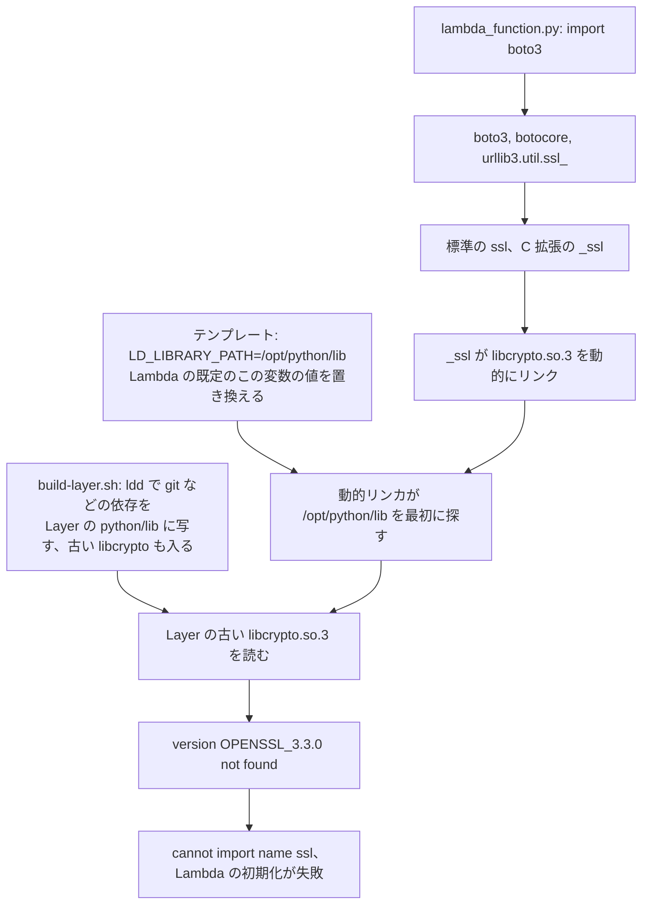

**噛み砕き (ひとことで)**

| 項目 | 内容 |
|---|---|
| 原因 | 設定ファイルが、部品を探す場所の並び順を書き換えていて、その並び順のせいで、同梱していた古い暗号化の部品 (OpenSSL) を先に見つけてしまい、必要な新しい機能の名前が無くて失敗した |
| やったこと | 設定ファイルからその並び順を書き換える行を消し、元の並び順 (実行する場所にある新しい部品を先に見つける並び) に戻した |
| 良い点 | 差分 (直した行の数) が 1 行で、レビューしやすい。本物の関数と部品を、公式の実行する場所の型で試して、直ることを確かめた |
| 悪い点・代償 | その行がなぜ足されたかは履歴から分からず、なぜ今になって壊れたかも特定できていない。この直し方は回避策であって、古い部品を同梱する仕組みそのものを直すものではない |

**図 (やさしい版・直す前)**

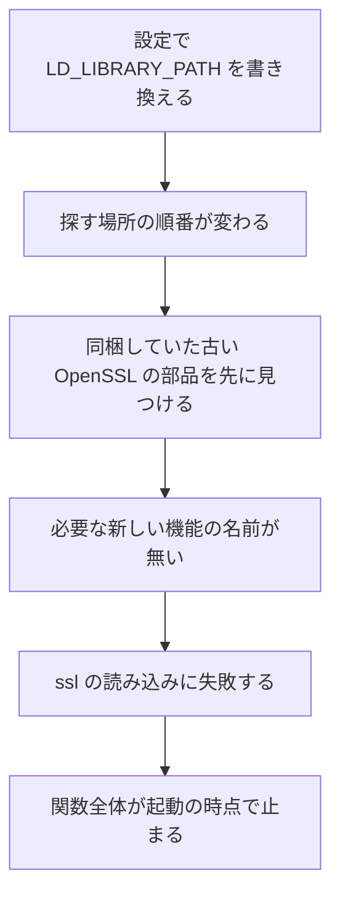

**図 (やさしい版・直した後)**

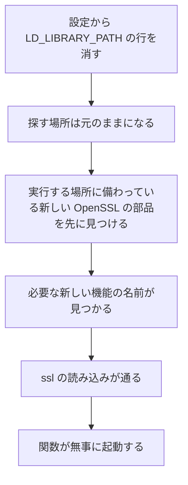

**比喩 (事実を曲げない範囲で)**

これは、新しい工具箱 (実行する場所に備わっている新しい部品) の横に、ほかの道具を運び込んだときに古い工具箱 (同梱した古い部品) も一緒に入ってしまい、さらに「まずこっちを探せ」という張り紙 (設定ファイルの 1 行) が貼ってあったようなものである。古い工具箱には必要な新しい工具が入っていないので作業ができない。張り紙を外せば、新しい工具箱がそのまま使われる。

**Answer (English)**

The visible error was `cannot import name 'ssl' from 'urllib3.util.ssl_'`, but the real failure was one layer down, and the dynamic linker said so: `/opt/python/lib/libcrypto.so.3: version 'OPENSSL_3.3.0' not found`. The import chain is the function importing boto3, botocore, urllib3, then Python's `ssl`, whose C extension `_ssl` dynamically links `libcrypto`. Two things combined. The Layer's build script copies the shared-library dependencies of git, helm and kubectl into the Layer's `python/lib` using `ldd`, so an older `libcrypto.so.3` ended up there. And the template set `LD_LIBRARY_PATH=/opt/python/lib`, which replaces Lambda's default value of that variable, so the loader searches `/opt/python/lib` first; the default, per the Lambda documentation, starts with `/var/lang/lib` and doesn't include `/opt/python/lib`. So python3.12's `_ssl` loaded the Layer's old `libcrypto` instead of the runtime's, couldn't resolve the `OPENSSL_3.3.0` symbols it needs, and the whole function failed at initialization.

**回答 (日本語)**

見えていたエラーは `cannot import name 'ssl' from 'urllib3.util.ssl_'` だったが、本当の失敗は 1 つ下の層にあり、動的リンカがそう言っていた。`/opt/python/lib/libcrypto.so.3: version 'OPENSSL_3.3.0' not found` である。import の連鎖は、関数が boto3、botocore、urllib3 を読み、次に Python の `ssl` を読み、その C 拡張の `_ssl` が `libcrypto` を動的にリンクする、という順である。2 つが重なった。Layer のビルドのスクリプトは `ldd` で git、helm、kubectl の共有ライブラリの依存を Layer の `python/lib` に写すので、古い `libcrypto.so.3` がそこに入っていた。そしてテンプレートが `LD_LIBRARY_PATH=/opt/python/lib` を設定していて、これは Lambda が既定で与えるこの変数の値を置き換え、動的リンカに `/opt/python/lib` を最初に探させる。Lambda の文書によれば、既定は `/var/lang/lib` から始まり、`/opt/python/lib` を含まない。そのため python3.12 の `_ssl` はランタイムではなく Layer の古い `libcrypto` を読み、必要な `OPENSSL_3.3.0` のシンボルを解決できず、関数全体が初期化で失敗した。
:::

:::details Q3. [Bug] Why did it break now? Did something change?
**質問 (日本語)**

なぜ今になって壊れたのか。何かが変わったのか。

**噛み砕き (ひとことで)**

| 項目 | 内容 |
|---|---|
| 原因 | 「いつから」「何が原因で」壊れたかは、まだ特定できていない。設定ファイルの該当する行自体は、インストーラを最初に足した時からずっと変わっていなかった |
| やったこと | 変更の履歴を確認し、分からないことは分からないとそのまま認めたうえで、今どういう仕組みで失敗するか、消せば直ることだけを示した |
| 良い点 | 確かめていないことを確かめたと言わない誠実さがある |
| 悪い点・代償 | 「いつから」「何が原因で」壊れたかは今も分からないまま残っている |

**図 (やさしい版)**

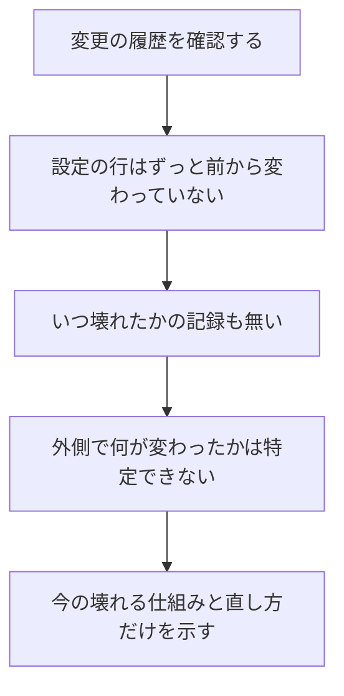

**Answer (English)**

I can't claim a cause I didn't find. In git history, the `LD_LIBRARY_PATH` line and `Runtime: python3.12` have both been in the template since the commit that first added the installer, and no commit explains why the variable was added. Neither the Issue nor the PR records when the failure started or was first seen. So the honest answer is: the template didn't change, and I didn't identify what outside it did. What I can show is the mechanism by which it fails today, and that removing the variable makes it work. The fragile part is the dependency on whatever `libcrypto` happens to be bundled in the Layer. Consolidating on the installer the official documentation points to removes that copy altogether.

**回答 (日本語)**

見つけていない原因は言えない。git の履歴では、`LD_LIBRARY_PATH` の行も `Runtime: python3.12` も、インストーラを最初に足した commit からテンプレートにあり、変数を足した理由を説明する commit は無い。Issue にも PR にも、失敗がいつ始まり、いつ最初に見つかったかの記録は無い。だから正直な答えは、テンプレートは変わっておらず、その外で何が変わったかは突き止めていない、である。示せるのは、今どういう仕組みで失敗するかと、変数を消せば動くことである。脆いのは、Layer にたまたま同梱された `libcrypto` に頼っている部分である。公式のドキュメントが案内するインストーラに寄せれば、その写し自体が無くなる。
:::

:::details Q4. Why a one-line fix in its own PR, and how did you know nothing else needed the variable?
**質問 (日本語)**

なぜ 1 行の修正を単独の PR にしたのか。ほかにその変数を必要とするものが無いと、どうして分かったのか。

**噛み砕き (ひとことで)**

| 項目 | 内容 |
|---|---|
| 論点 | 1 行だけの小さな修正を、どこまで信じてよいか。他にその設定の値を必要とするものが無いと、どうやって確かめるか |
| 選んだこと | 「今壊れている問題を直す」ことと「インストーラをどちらに寄せるか決める」ことを分け、設定ファイルの 1 行を消すだけの修正を単独で出した |
| 良い点 | 差分が小さくレビューしやすい。本物の実行する場所で、必要な部品 (git や helm など) が消した後も変わらず動くこと、実際の作成も最後まで終わることを確かめた |
| 悪い点・代償 | 試した経路についてだけ言えることで、全部の経路を確かめたわけではない。これは本当の直し方ではなく回避策だと、はっきり書いた |

**図 (やさしい版)**

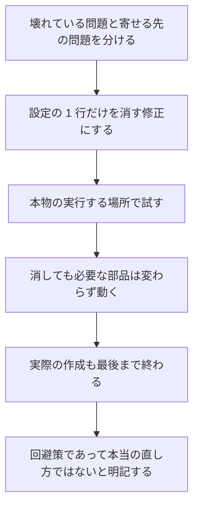

**Answer (English)**

`main` was broken at startup, and that could be fixed independently of where to consolidate the duplicated installer. Removing the one `LD_LIBRARY_PATH` line from `helm-chart-stack.yaml` fixed it without touching the Layer or the function zip, so the diff was one line and easy to review. Since git history didn't explain why the variable existed, the evidence is the test: in the official Lambda runtime image the import succeeded without it, the Layer's git, helm and kubectl paths still worked, and a real HyperPod on EKS creation completed. That supports removing it for the paths I tested. Why git still finds its libraries isn't recorded in the PR, because it doesn't show where each one resolves them. The next step is to check that with `ldd`. I was explicit in the Issue that this is a workaround, not the real fix.

**回答 (日本語)**

`main` が起動の時点で壊れていて、重複したインストーラをどこに寄せるかとは別に直せたからである。`helm-chart-stack.yaml` から `LD_LIBRARY_PATH` の 1 行を消せば、Layer と関数の zip に触れずに直り、差分は 1 行でレビューしやすい。git の履歴は変数がある理由を説明しなかったので、根拠は試験である。Lambda の公式のランタイムのイメージで変数が無くても import が通り、Layer の git、helm、kubectl の経路も動き、実際の HyperPod on EKS の作成も完了した。試した経路については変数を消しても動くと示せた。なぜ git がライブラリを見つけられるのかは、それぞれがどこから解決するかの記録が PR に無いので分からない。次に `ldd` で確かめる。Issue では、これは本当の修正ではなく回避策だとはっきり書いた。
:::

:::details Q5. How do you reproduce a Lambda initialization failure locally?
**質問 (日本語)**

Lambda の初期化の失敗を手元でどう再現するか。

**噛み砕き (ひとことで)**

| 項目 | 内容 |
|---|---|
| 論点 | 手元のパソコンで、本物に近い形でこの種の初期化の失敗をどう再現するか |
| 選んだこと | 本物の関数と、同梱した部品の実物を、公式の実行する場所の型 (イメージ) に入れて、設定の値がある場合と無い場合を比べた |
| 良い点 | 本物に近い条件で再現できた。実際の作成でも、このステップを越えることまで確かめた |
| 悪い点・代償 | 別の種類の CPU (arm64) では試しておらず、そのことはそのまま伝える |

**図 (やさしい版)**

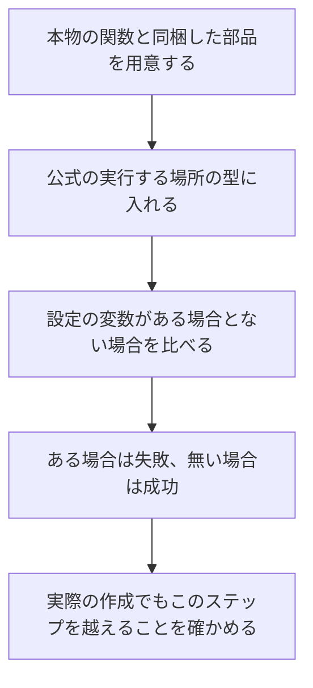

**Answer (English)**

Put the real artifacts into the real runtime. I took the repository's actual function and Layer and ran them in the official Lambda runtime image, `public.ecr.aws/lambda/python:3.12` on x86_64, then compared the import with and without the environment variable: it failed with it and succeeded without it. That reproduces the import failure with the actual function and Layer in the official runtime image. Then I confirmed end to end that a HyperPod on EKS creation got past this step. I didn't test arm64, and I'd say so.

**回答 (日本語)**

本物の成果物を本物のランタイムに入れる。リポジトリの関数と Layer の実物を、Lambda の公式のランタイムのイメージ `public.ecr.aws/lambda/python:3.12` (x86_64) で動かし、環境変数があるときと無いときの import を比べた。あると失敗し、無いと通った。実際の関数と Layer を使い、公式のランタイムのイメージで import の失敗を再現した。そのうえで、HyperPod on EKS の作成がこのステップを越えることを最後まで確かめた。arm64 は試しておらず、そのことは言う。
:::

:::details Q6. [Bug] The service team's installer has the same variable. Why didn't it break?
**質問 (日本語)**

サービスチームのインストーラにも同じ変数がある。なぜそちらは壊れなかったのか。

**原因の連鎖 (図)**

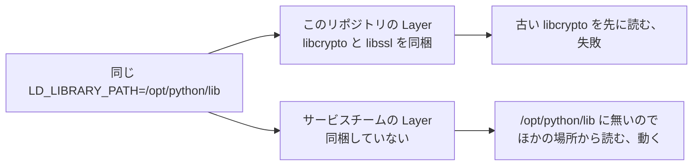

**噛み砕き (ひとことで)**

| 項目 | 内容 |
|---|---|
| 原因 | 設定の値 (探す場所の並び順) は同じでも、同梱している部品の中身が違っていた。こちらは古い暗号化の部品を同梱していたが、サービスチーム側は同梱していなかった |
| やったこと | 両方の関数と部品を、同じ公式の実行する場所の型で動かして比べ、違いが設定ではなく同梱する部品にあると確かめた |
| 良い点 | 不具合の正体が「この部品とこの設定の組み合わせ」だと切り分けられた。これが 2 つのインストーラが重複していたと気づいたきっかけでもある |
| 悪い点・代償 | 2 つのインストーラが別々に作られてずれていたこと自体は、この比較だけでは直らない |

**図 (やさしい版)**

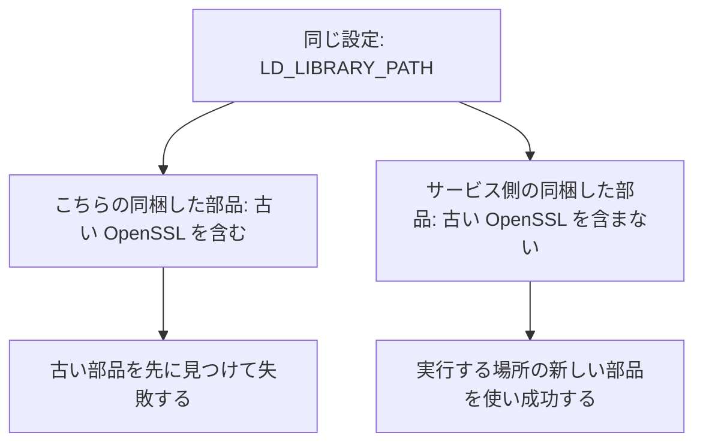

**Answer (English)**

Same setting, different Layer. The service team's template, at the commit I compared, sets the same `LD_LIBRARY_PATH=/opt/python/lib`, but its Layer doesn't bundle `libcrypto` and `libssl`. With nothing there to shadow the runtime's library, the loader falls through and the import works. I ran both functions and Layers in the same x86_64 python3.12 image: ours failed with the same import error, theirs passed. The two installers had been built separately and had diverged in both the Layer and `lambda_function.py`. So the bug is really "this Layer plus this variable", and it's also how I discovered the duplication.

**回答 (日本語)**

設定は同じで、Layer が違う。比べた commit の時点のサービスチームのテンプレートは同じ `LD_LIBRARY_PATH=/opt/python/lib` を設定しているが、その Layer は `libcrypto` と `libssl` を同梱していない。ランタイムのライブラリを覆い隠すものが無いので、ローダーは先へ探し進み、import は通る。両方の関数と Layer を同じ x86_64 の python3.12 のイメージで動かすと、こちらは同じ import のエラーで失敗し、あちらは通った。2 つのインストーラは別々に作られ、Layer と `lambda_function.py` の両方で分かれていた。つまり不具合の正体は「この Layer とこの変数の組み合わせ」で、重複を見つけたきっかけでもある。
:::

:::details Q7. What did you propose in the RFC, and why not switch right away?
**質問 (日本語)**

RFC で何を提案し、なぜすぐに切り替えないのか。

**噛み砕き (ひとことで)**

| 項目 | 内容 |
|---|---|
| 論点 | 公式の文書が案内するインストーラにすぐ切り替えるか、提案 (RFC) として出して待つか |
| 選んだこと | 公式が案内するインストーラに寄せる提案を出した。実行にはメンテナの合意が要る。既存のスタックを更新するとクラスタが作り直されるおそれがあるので、既存の移行は強制しない。また、サービスチーム側の既定の設定 (従来の方式) がまだ違い、それを変える PR が開いたままなので、それが入るまで切り替えを待つよう提案した |
| 良い点 | クラスタを壊すおそれのある変更を急がず、合意と時期をそろえてから進められる |
| 悪い点・代償 | すべての設定を 1 つずつ照らし合わせる確認と、実際に移行してみる試験はまだしていない |

**図 (やさしい版)**

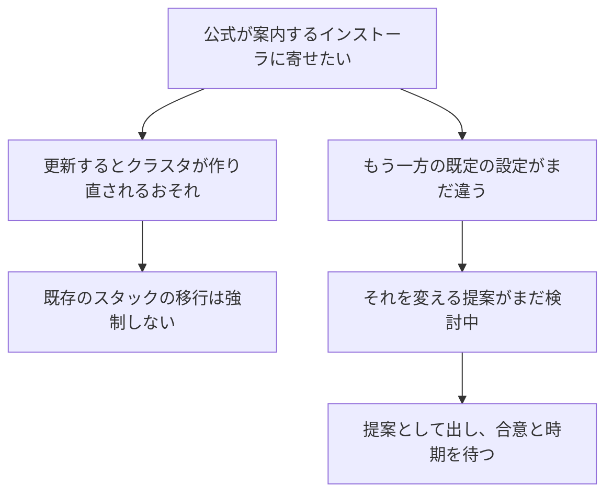

**Answer (English)**

Consolidate on the service team's installer, which the official documentation points to, and retire this repository's `cfn-templates/`. That needs maintainer agreement, and it wouldn't force existing stacks to migrate, because updating them with the service team's template could replace the EKS or HyperPod cluster, and we'd have to decide what to do with the S3 templates and Lambda zips they still reference. There was also a condition on timing: this repository enables continuous node provisioning, `NodeProvisioningMode: Continuous`, by default, while the service team's default was the older all-or-nothing mode, and the PR that changes their default was still open. So I proposed waiting until it, or an equivalent change, lands. A one-to-one comparison of all CloudFormation resources and a migration test haven't been done yet.

**回答 (日本語)**

公式のドキュメントが案内しているサービスチームのインストーラに寄せ、このリポジトリの `cfn-templates/` をやめる提案である。メンテナの合意が要り、既存のスタックの移行は強制しない。サービスチームのテンプレートで更新すると EKS や HyperPod のクラスタが作り直されるおそれがあり、それらが参照する S3 のテンプレートや Lambda の zip をどうするかも決める必要があるからである。時期にも条件があった。このリポジトリは継続的なノードの準備 (`NodeProvisioningMode: Continuous`) が既定で有効だが、サービスチームの既定は、1 つのグループが埋まらないと全体が失敗する従来の方式で、既定を変える PR はまだ開いていた。そこで、それか同等の変更が入るまで待つことを提案した。すべての CloudFormation のリソースの 1 対 1 の照合と、移行の試験はまだしていない。
:::

:::details Q8. The Layer still ships an older OpenSSL. Who should fix that?
**質問 (日本語)**

Layer には古い OpenSSL が残ったままである。それは誰が直すべきか。

**噛み砕き (ひとことで)**

| 項目 | 内容 |
|---|---|
| 論点 | 今も残っている古い暗号化の部品 (OpenSSL) の同梱は、誰が直すべきか |
| 選んだこと | 今回の修正ではわざと触らず、差分を 1 行に留めた。長い目で見た答えとして、インストーラを 1 つの持ち主 (サービスチーム) が持つ 1 つにまとめることを、別の提案 (RFC) で提案している (まだ決まっていない) |
| 良い点 | 直す範囲を 1 行に留めたことで、レビューしやすい修正にできた |
| 悪い点・代償 | 古い部品はこの修正の後もまだ残っている |

**図 (やさしい版)**

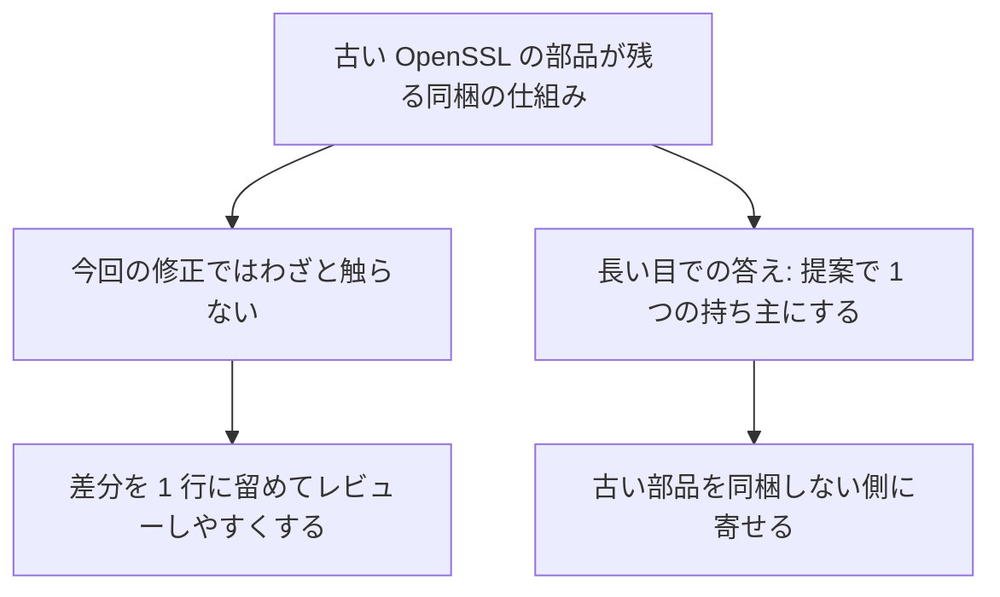

**Answer (English)**

I deliberately didn't touch the Layer in the fix PR, to keep the change to one reviewable line; the build script still copies the dependencies the same way. The longer-term answer is the RFC: one installer with one owner, the service team's, whose Layer doesn't bundle `libcrypto` and `libssl`, rather than two separately maintained copies, one of which bundles its own OpenSSL.

**回答 (日本語)**

修正の PR では、変更をレビューしやすい 1 行に留めるため、Layer にはわざと触れなかった。ビルドのスクリプトは今も同じように依存を写す。長い目での答えは RFC で、別々に保守される 2 つの写し (片方は独自の OpenSSL を同梱する) を持ち続けるのではなく、`libcrypto` と `libssl` を同梱しないサービスチームのインストーラを、1 つの持ち主が持つ 1 つのインストーラにすることである。
:::

### 検証と振り返り

:::details Q9. The link migration looks trivial. Was there anything to learn?
**質問 (日本語)**

リンクの移行は簡単に見える。学ぶことはあったか。

**Answer (English)**

Two things. I changed five links in three files, but deliberately left the workshop ID used in S3 object paths, because that's a functional asset location, not a documentation link. And the reviewer found the same old URL in three places where two scripts under `automate-smhp-eks/` print it at runtime with `echo`, which I then fixed. The lesson: when migrating links, search strings that scripts print, not only docs. I verified with `grep` that the old URL was gone from the three files I first changed and the new one was in five places, and checked rendering; no infrastructure was deployed for this change.

**回答 (日本語)**

2 つある。3 つのファイルの 5 か所のリンクを移したが、S3 のオブジェクトの場所に使われているワークショップの ID は、ドキュメントのリンクではなく動作に使う資産の場所なので、わざと残した。また、レビューで同じ古い URL が `automate-smhp-eks/` の 2 つのスクリプトの 3 か所で、実行時に `echo` で表示されていると指摘され、それも直した。教訓は、リンクを移すときはドキュメントだけでなく、スクリプトが表示する文字列も探すことである。最初に変えた 3 つのファイルで `grep` により古い URL が見つからず新しい URL が 5 か所にあることを確かめ、表示を確かめた。この変更ではインフラのデプロイはしていない。
:::

:::details Q10. How would you catch this kind of failure before users hit it?
**質問 (日本語)**

この種の失敗を、利用者が当たる前にどう見つけるか。

**噛み砕き (ひとことで)**

| 項目 | 内容 |
|---|---|
| 論点 | 利用者がこの種の失敗に当たってしまう前に、どうやって見つけるか |
| 選んだこと | 手元で使った再現の手順 (本物の関数を公式の実行する場所で動かす) を、そのまま定期的な確認として使い直す案を出した |
| 良い点 | クラスタを実際にデプロイせずに確認できる。インストーラを 1 つに寄せれば、確認が見る場所も半分になる |
| 悪い点・代償 | 回答の範囲では、この確認をいつ、どういう仕組みで自動的に回すかという具体的な作り込みまでは決めていない |

**図 (やさしい版)**

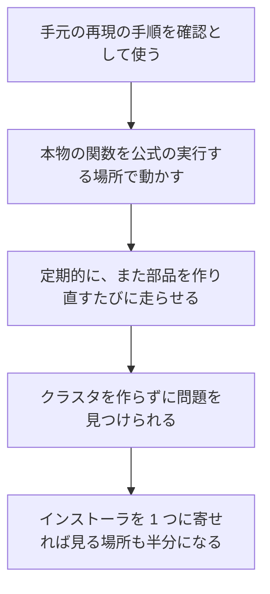

**Answer (English)**

My proposal is to reuse the local reproduction as a check: the real function and Layer in the official runtime image. Running that import check on a schedule, and whenever the Layer is rebuilt, would catch a library shadowing problem without deploying a cluster. Consolidating on one installer also halves the places such a check has to cover.

**回答 (日本語)**

提案は、手元で使った再現の手順を検査に使うことである。本物の関数と Layer を公式のランタイムのイメージで動かす。その import の確認を定期的に、また Layer を作り直すたびに走らせれば、クラスタをデプロイせずにライブラリの覆い隠しの問題を見つけられる。インストーラを 1 つに寄せれば、その確認が見る場所も半分になる。
:::

## まとめ

SSL の失敗は `LD_LIBRARY_PATH` の 1 行の削除で直し、インストーラを 2 か所で保守する重複の解消は、別の RFC として提案した。直すことと、どこに寄せるかを決めることを分けたので、利用者は動くテンプレートを使いながら、移行の条件を確かめられる。
