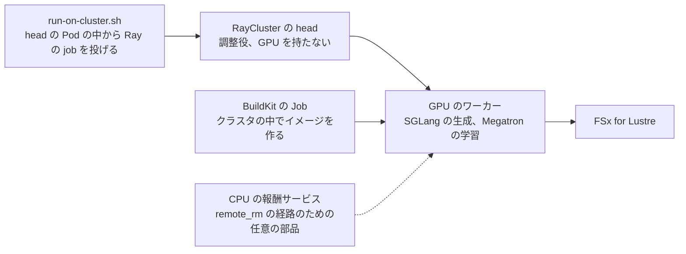
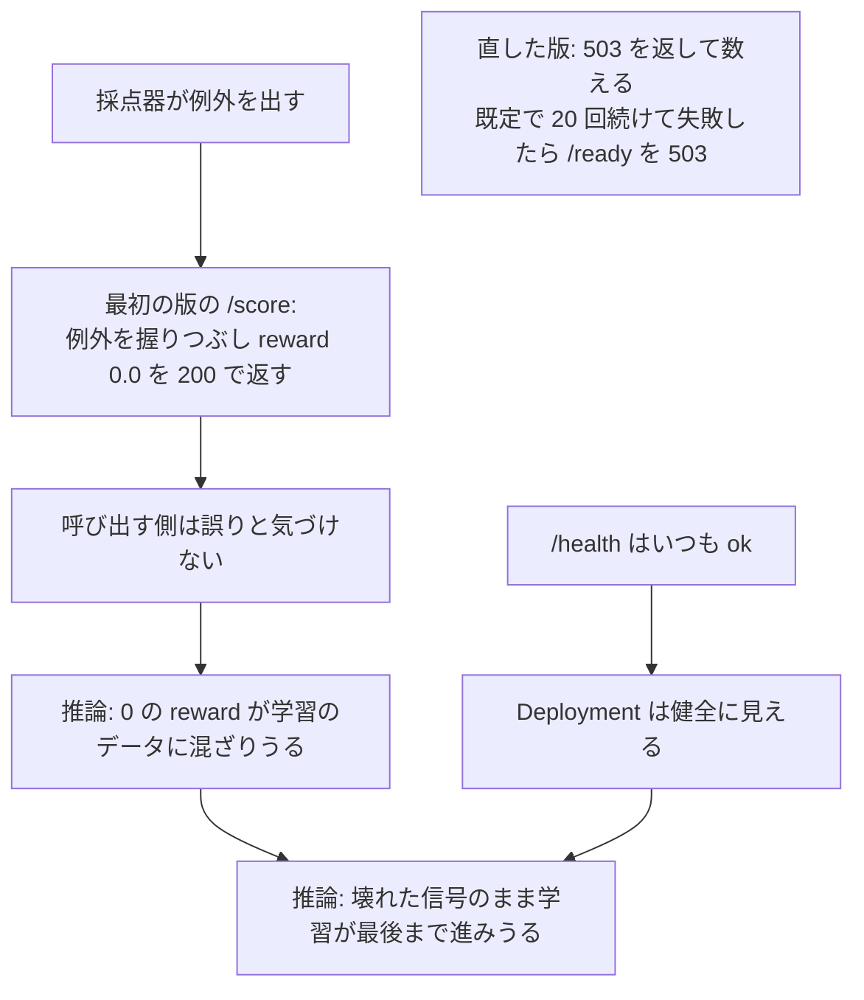
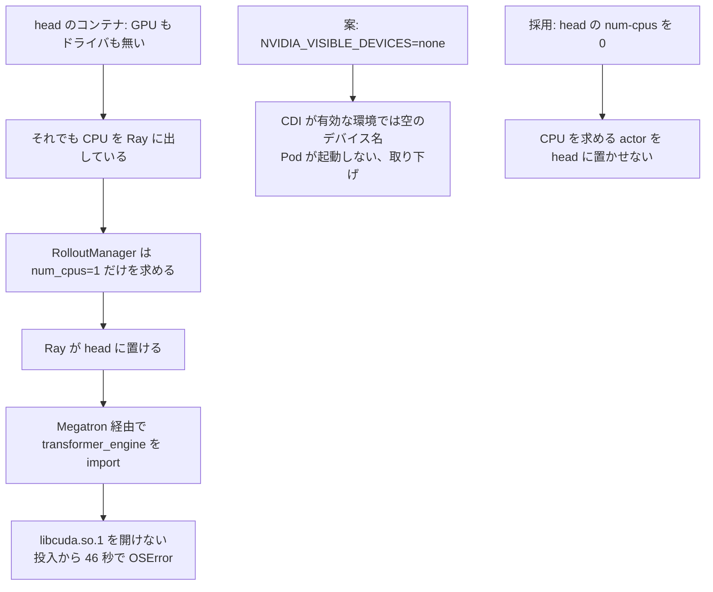
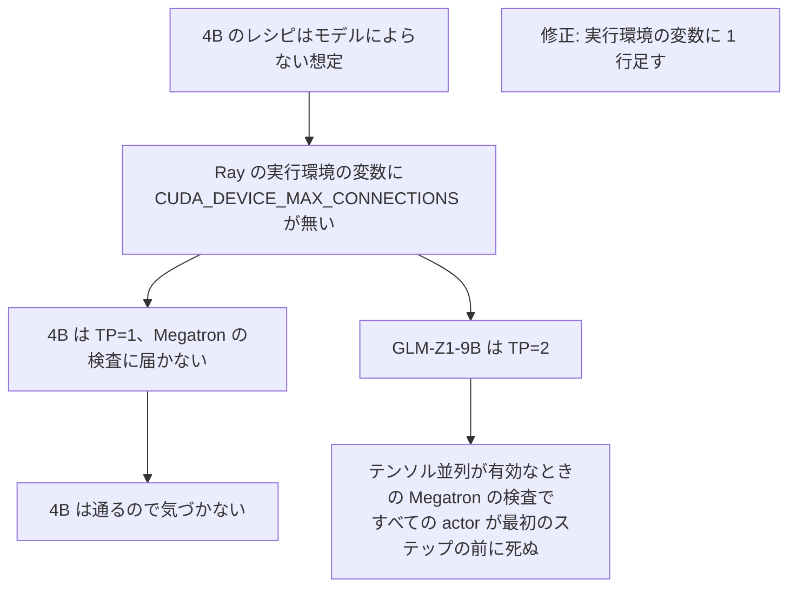
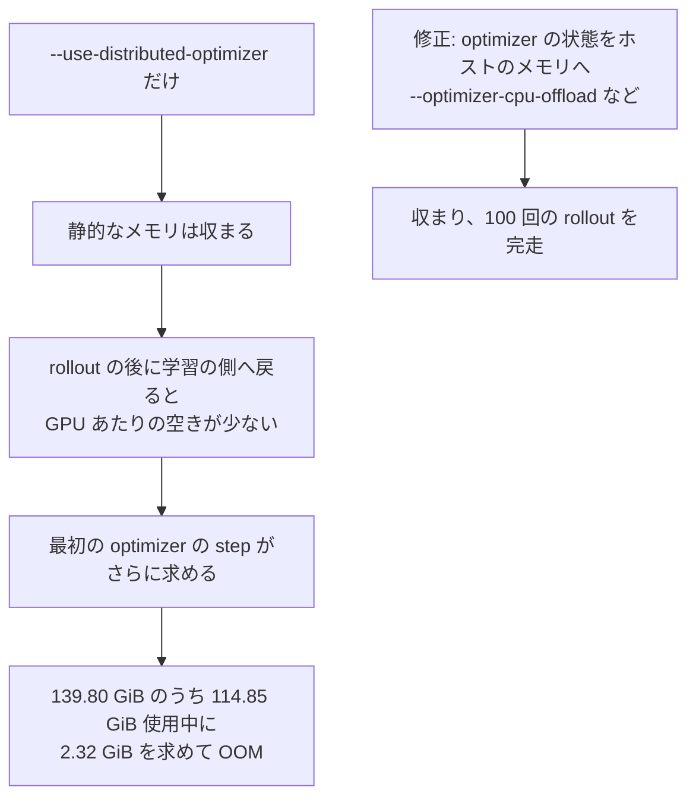
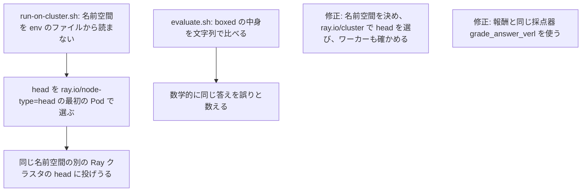
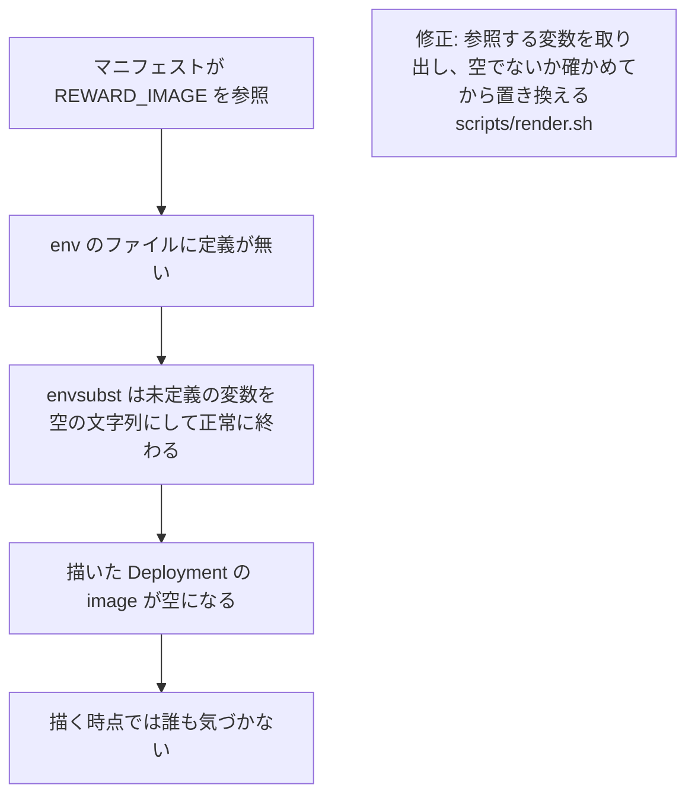

## はじめに

本章では、[miles](https://github.com/radixark/miles) の GRPO のテストケースを足した [Issue #1224](https://github.com/awslabs/awsome-distributed-ai/issues/1224) と [PR #1225](https://github.com/awslabs/awsome-distributed-ai/pull/1225) をまとめる。miles は SLIME を CUDA 13 と NVIDIA Blackwell 向けにフォークしたもので、このテストケースは前章の SLIME のテストケースと同じ形にそろえ、2 つを同じ手順で使って比べられるようにした。

:::details colocated と disaggregated
強化学習の後学習では、生成（rollout）と学習を同じ GPU で交互に行う colocated と、別々の GPU に分ける disaggregated の 2 つの構成がある。colocated は GPU を無駄なく使えるが、生成と学習の切り替えのたびにメモリを入れ替える。disaggregated は切り替えが要らないが、学習した重みを生成の側へネットワーク越しに送る。
:::

## Issue と PR の概要

| 項目 | 内容 |
| --- | --- |
| 解決したいこと | CUDA 13 と Blackwell を対象にした SLIME のフォークの miles を、このリポジトリで SLIME と並べて使い、GPU に合うスタックを選べるようにする |
| やったこと | Dockerfile、RayCluster などの Kubernetes のマニフェスト、dense と MoE のレシピ、報酬サービス、変換と評価のスクリプト、README を足した |
| テスト | レビューの後、別のリージョンに一からクラスタを作り、README の手順どおりに dense と MoE の 4 つの構成、チェックポイントの往復の変換、報酬サービスを確かめた |
| マージ | [f342873](https://github.com/awslabs/awsome-distributed-ai/commit/f342873c8d170678a53231549295e1e5454eb279) |

## どうやったか

テストケースは [examples/training/miles](https://github.com/awslabs/awsome-distributed-ai/tree/f342873c8d170678a53231549295e1e5454eb279/examples/training/miles) にある。ベースのイメージは `radixark/miles` を digest で固定し、その上に AWS の EFA の層を足した。Kubernetes のマニフェストは `envsubst` で値を埋める形で、RayCluster、クラスタの中でイメージを作る BuildKit の Job、データを用意する Pod、報酬を別に計算する `remote_rm` の経路のための CPU の報酬サービスからなる。同梱のレシピは、既定ではルールに基づく報酬を学習の中で計算する。30B MoE は、最初のレシピでは rollout の後の最初の optimizer の step で GPU のメモリが足りなかった。そこでレシピに `--optimizer-cpu-offload` などを足し、optimizer をホストのメモリに逃がした。`run-on-cluster.sh` は、head の Pod の中からレシピを Ray の job として投げる。

## テストをどうしたか

最初の PR の説明には 9 行の結果の表を載せたが、レビューで、同梱した設定だけでは再現できない行があると指摘された。筆者は再現できない行を消し、レビューの後に別のリージョンに一からクラスタを作り、KubeRay を入れ、クラスタの中の BuildKit の Job でイメージを作り、README の Quick Start を step 0 から書いてあるとおりに辿った。以下は、筆者が p5en.48xlarge（1 ノードに H200 8 枚）で、構成ごとに別々に動かした結果で、[PR の最終の返答](https://github.com/awslabs/awsome-distributed-ai/pull/1225)に載せた。値は TensorBoard のイベントファイルから読み戻したもので、実行ごとに記録を分けてある。ループが最後まで回ったことを示す値で、収束を示すものではない。

| 構成 | rollout の回数 | reward | repetition | 時間 |
| --- | --- | --- | --- | --- |
| Qwen3-4B dense、colocated、1 ノード | 100 | 0.508 | 0.023 | 3 時間 15 分 |
| Qwen3-4B dense、disaggregated、2 ノード | 60 | 0.461 | 0.008 | 1 時間 50 分 |
| GLM-Z1-9B dense、colocated、TP=2、2 ノード | 100 | 0.672 | 0.008 | 2 時間 35 分 |
| Qwen3-30B-A3B MoE、colocated、EP のみ、2 ノード | 100 | 0.719 | 0.008 | 5 時間 5 分 |

どの構成も Ray の job は `succeeded` で終わった。チェックポイントは、Hugging Face から Megatron への変換と、4B の実行のチェックポイントからの逆の変換を、README のコマンドで確かめた。報酬サービスは、CPU のノードで 4 つのレプリカが Ready になることと、閾値を下げて readiness の動きを直接確かめた。学習の報酬の経路としては動かしていないので、miles の `remote_rm` が 503 を再試行するかは確かめていない。

4B の 100 回の rollout では、rollout の reward が平らなまま、AIME の評価が 0.596 から 0.333 に下がった。筆者は、応答の平均の長さが伸び、上限の 16384 トークンに届く応答の割合が 0.38 から 0.60 に増えたので、切り詰めと連動していると書いたが、原因は切り分けていない。TP と EP を組み合わせた MoE の構成で FlashInfer の融合を有効にすると出力が崩れること（レシピはこの構成で融合を切る）と、Qwen2.5-72B が試した構成では H200 16 枚に収まらないことは、結果ではなく制約として README の Known Issues に書いた。

## レビューで直したこと

KeitaW さんは、レビューの前に p6-b300.48xlarge の 2 ノードのクラスタで、Qwen3-4B の dense、colocated の構成を GPU 8 枚で最後まで動かしたと報告した。GRPO の生成、報酬、Megatron の学習、colocated の CUDA IPC での重みの同期は Blackwell でも動き、reward は 3 回の rollout で 0.4922、0.5156、0.5313 と動き、AIME の評価は 0.6125 だった。そのうえで、4 回に分けて 18 件の指摘があり、すべて対応した。主なものは次のとおりである。

| 指摘 | 対応 |
| --- | --- |
| `run-on-cluster.sh` が env のファイルの名前空間を読まず、`ray.io/node-type=head` の最初の Pod を選ぶので、別のクラスタの head に投げうる | [マージした版](https://github.com/awslabs/awsome-distributed-ai/blob/f342873c8d170678a53231549295e1e5454eb279/examples/training/miles/run-on-cluster.sh)は、名前空間をフラグ、シェルの変数、env のファイルから決め、`ray.io/cluster` のラベルで head を選び、ワーカーの状態も確かめる |
| 報酬サービスが、採点の例外をすべて reward 0.0 の 200 で返す。壊れたまま 0 の信号で学習が最後まで進む | [マージした版](https://github.com/awslabs/awsome-distributed-ai/blob/f342873c8d170678a53231549295e1e5454eb279/examples/training/miles/reward_service/app.py)は、採点に失敗したら 0.0 ではなく 503 を返して数え、既定で 20 回続けて失敗したら readiness を 503 にする。採点器は別のプロセスで動かし、時間の上限を付ける |
| `evaluate.sh` が文字列の一致で採点していて、数学的に同じ答えを誤りと数える | 報酬と同じ採点器（miles の `grade_answer_verl`）を使う |
| README が引用する miles の commit と、固定したイメージの中の commit が違う | イメージを固定しているものを正として表を直した |
| 検証の表の行のうち、同梱した設定から再現できないものがある | 再現できない行を消し、足りなかった GLM-Z1-9B の設定と実行の環境変数を足して測り直した |

**head の Pod の設定**。head のコンテナは GPU を持たず、`libcuda.so.1` も無い。一方で head は CPU を出しているので、Ray は CPU だけを求める制御用の actor（RolloutManager など）を head に置ける。RolloutManager は Megatron 経由で transformer_engine を import するので、KeitaW さんの実行では投入から 46 秒で `OSError: libcuda.so.1` で止まった。KeitaW さんは、head の `num-cpus` を `'0'` にして制御用の actor を head に置かせない回避策を示し、あわせて head にドライバを持たせる `NVIDIA_VISIBLE_DEVICES=none` を提案した。筆者が p5en.48xlarge で `none` を試すと、GPU Operator が CDI を有効にした環境では空のデバイス名に解決され、Pod が起動しなかった。そこで `num-cpus: '0'` を採り、その限界を設定の横に書いた。この設定は head にドライバを与えるものではなく、CPU を求める actor を head から外すだけである。RolloutManager を head に固定するオプションを使うと、CPU を 1 つ求める RolloutManager を CPU の無い head に置けず、進まなくなる。CPU を求めずに head に固定される actor（`MultiLoRAController`）には、この回避策は効かない。同梱のレシピはこの actor を作らないが、レシピを広げるときは、`libcuda.so.1` を使う actor の置き場所を確かめる。

再現できなかった GLM-Z1-9B の行は、実機で原因を探した。4B のレシピはモデルによらないはずだったが、Ray の実行環境の変数に `CUDA_DEVICE_MAX_CONNECTIONS` が無く、テンソル並列を使う 9B だけが Megatron の検査で止まっていた。4B は TP=1 なのでこの検査に届かず、気づかなかった。

## 技術的な要点

- **報酬サービスの誤りの返し方**。誤りを正常な値（0.0）として返すと、学習は止まらずに無意味な信号で進む。誤りはエラーの状態で返して数え、連続したら readiness で外す。liveness につなぐと、1 つの壊れた入力で Pod が再起動を繰り返す。呼び出す側がエラーを再試行しない場合は、1 件の失敗で rollout のバッチ全体が落ちうるので、呼び出す側の動きも確かめる。
- **Pod の選び方**。同じラベルで選ぶ Pod は、同じ名前空間の別のクラスタのものかもしれない。KubeRay のクラスタのラベルまで含めて選ぶ。
- **digest で固定したイメージの版**。ドキュメントの版や commit は、そのイメージの中を実際に見て書く。
- **envsubst の未定義の変数**。未定義の変数を空の文字列に置き換えて成功する。埋める前に、必要な変数がそろっているかを確かめる。
- **検証の表の範囲**。同梱した設定だけで再現できる行に限る。TP=1 の構成で通っても、TP>1 で初めて通る検査がある。

## 技術面接の準備 (FAQ)

この節は、本章の内容を技術面接で聞かれたときに答えるための想定問答である。システム設計面接の流れに合わせて、全体と設計、不具合の原因の深掘り、検証と振り返りの 3 つに分けた。各問は英語の質問 (見出し)、日本語の質問、英語の回答、日本語の回答の順に書いた。不具合の問には原因の連鎖の図を付け、回答は症状、原因、突き止め方、直し方と比べた案、検証、残ったこと、の順に話す。回答は本章の本文と、PR、Issue、マージ前後のコードで確かめた事実だけを使う。

### 全体と設計

:::details Q1. Why add miles when the repository already had SLIME, and what's the architecture?
**質問 (日本語)**

すでに SLIME があるのに、なぜ miles を足したのか。構成はどうなっているか。

**構成 (図)**

**Answer (English)**

miles is a SLIME fork targeting CUDA 13 and NVIDIA Blackwell. I added it so users can choose the stack that fits their GPU, and kept its structure and procedure the same as SLIME's so the two are easy to compare. The base image is `radixark/miles` pinned by digest, with an AWS EFA layer on top. Kubernetes manifests are rendered from env files and consist of a RayCluster, a BuildKit Job that builds the image inside the cluster, a data-prep Pod, and an optional CPU reward service for the `remote_rm` path. The Ray head is a coordinator without GPUs; GPU workers run SGLang rollout and Megatron training on FSx for Lustre. By default the recipes compute a rule-based reward inside training.

**回答 (日本語)**

miles は SLIME を CUDA 13 と NVIDIA Blackwell 向けにフォークしたものである。利用者が自分の GPU に合うスタックを選べるよう足し、2 つを比べやすいよう構成と手順を SLIME と同じにした。ベースのイメージは `radixark/miles` を digest で固定し、その上に AWS の EFA の層を足した。Kubernetes のマニフェストは env のファイルから値を埋めて作り、RayCluster、クラスタの中でイメージを作る BuildKit の Job、データを用意する Pod、`remote_rm` の経路のための任意の CPU の報酬サービスからなる。Ray の head は GPU を持たない調整役で、GPU のワーカーが FSx for Lustre の上で SGLang の生成と Megatron の学習を受け持つ。レシピは既定では、ルールに基づく報酬を学習の中で計算する。
:::

### 不具合の原因の深掘り

:::details Q2. [Bug] The reward service returned 0.0 on errors. Why is that a bug, and how did you redesign it?
**質問 (日本語)**

報酬サービスは誤りのときに 0.0 を返していた。なぜそれが不具合で、どう作り直したか。

**原因の連鎖 (図)**

**Answer (English)**

Because it hides failure inside a valid-looking value. The first version caught every exception in `/score` and returned reward 0.0 with HTTP 200, and `/health` always said ok. The reviewer pointed out from the code, not from a failed run, that a persistently broken grader would let training run to completion on a flat zero signal while the Deployment looked healthy. The merged version returns 503 for grader failures and timeouts, counts consecutive failures, and after 20 in a row by default turns readiness to 503 so the replica is taken out of service. A malformed gold label is a client error, 422, and isn't counted. The grader runs in a separate process per slot with a wall-clock limit. I tied failures to readiness, not liveness, because with liveness one bad input would crash-loop the Pod. What I didn't verify is whether miles' `remote_rm` retries on 503, because I didn't run the service as the training reward path.

**回答 (日本語)**

失敗を、正しく見える値の中に隠すからである。最初の版は `/score` のすべての例外を拾って reward 0.0 を HTTP 200 で返し、`/health` はいつも ok と答えていた。失敗した実行からではなくコードを読んで、採点器が壊れたままでも Deployment は健全に見え、学習は平らな 0 の信号で最後まで進みうる、とレビューした人が指摘した。マージした版は、採点器の失敗と時間切れに 503 を返し、続けて失敗した回数を数え、既定で 20 回続いたら readiness を 503 にしてレプリカを外す。正解のラベルが壊れているのは呼び出す側の誤りなので 422 にし、数えない。採点器は枠ごとに別のプロセスで、時間の上限つきで動かす。liveness ではなく readiness につないだのは、liveness だと 1 つの壊れた入力で Pod が再起動を繰り返すからである。確かめていないのは、miles の `remote_rm` が 503 を再試行するかで、報酬サービスを学習の報酬の経路として動かしていないからである。
:::

:::details Q3. [Bug] The head Pod crashed with `libcuda.so.1`. What was the mechanism, and why `num-cpus: '0'`?
**質問 (日本語)**

head の Pod が `libcuda.so.1` で落ちた。仕組みは何で、なぜ `num-cpus: '0'` にしたのか。

**原因の連鎖 (図)**

**Answer (English)**

The head container has no GPU and no `libcuda.so.1`, but it advertises CPUs to Ray, and RolloutManager only requests one CPU, so Ray can schedule it on the head. RolloutManager imports transformer_engine through Megatron, which opens `libcuda.so.1`, so the reviewer's run died 46 seconds after submission with `OSError: libcuda.so.1`. The reviewer proposed two options. I tried the reviewer's suggestion of giving the head a driver with `NVIDIA_VISIBLE_DEVICES=none`, but on p5en.48xlarge with the GPU Operator's CDI enabled it resolved to an empty device name and the Pod failed to start, so I backed it out. I adopted `num-cpus: '0'` on the head, which keeps any CPU-requesting actor off it. I documented its limits next to the setting: it doesn't give the head a driver; if you pin RolloutManager to the head it can't be placed; and actors pinned to the head without requesting CPU, such as `MultiLoRAController`, aren't covered. The bundled recipes don't create that actor.

**回答 (日本語)**

head のコンテナは GPU も `libcuda.so.1` も持たないが、Ray には CPU を出していて、RolloutManager は CPU を 1 つ求めるだけなので、Ray は head に置ける。RolloutManager は Megatron 経由で transformer_engine を import し、それが `libcuda.so.1` を開くので、レビューした人の実行は投入から 46 秒で `OSError: libcuda.so.1` で落ちた。提案された選択肢は 2 つあった。まず `NVIDIA_VISIBLE_DEVICES=none` で head にドライバを持たせる方を試したが、GPU Operator が CDI を有効にした p5en.48xlarge では空のデバイス名に解決され、Pod が起動しなかったので取り下げた。採ったのは head の `num-cpus: '0'` で、CPU を求める actor を head に置かせない。限界は設定の横に書いた。head にドライバを与えるものではないこと、RolloutManager を head に固定すると置けなくなること、CPU を求めずに head に固定される actor (`MultiLoRAController` など) には効かないことである。同梱のレシピはその actor を作らない。
:::

:::details Q4. [Bug] Only the GLM-Z1-9B configuration failed. Why didn't the 4B catch it?
**質問 (日本語)**

GLM-Z1-9B の構成だけが失敗した。なぜ 4B では見つからなかったのか。

**原因の連鎖 (図)**

**Answer (English)**

The 4B recipe was meant to be model-independent, but its Ray runtime environment omitted `CUDA_DEVICE_MAX_CONNECTIONS`, which Megatron checks when tensor or context parallelism is enabled; the failure was on p5en.48xlarge, which is H200. The 4B runs at TP=1, so it never reached that check and passed. GLM-Z1-9B runs at TP=2, so every actor died before the first step. I found it while chasing the review finding that some rows of my results table couldn't be reproduced: I added the missing GLM-Z1-9B env file, ran it through the 4B recipe, and it failed. The fix was one line in the runtime env JSON, and it then ran 100 rollouts on two p5en.48xlarge nodes. The general lesson: a configuration that passes at TP=1 hasn't tested the code paths that only exist at TP greater than 1.

**回答 (日本語)**

4B のレシピはモデルによらない想定だったが、Ray の実行環境の変数に `CUDA_DEVICE_MAX_CONNECTIONS` が無く、Megatron はテンソル並列かコンテキスト並列が有効なときこれを検査する。失敗したのは H200 の p5en.48xlarge である。4B は TP=1 なのでこの検査に届かず通った。GLM-Z1-9B は TP=2 なので、すべての actor が最初のステップの前に死んだ。見つけたのは、結果の表の一部が再現できないというレビューの指摘を追っていたときである。足りなかった GLM-Z1-9B の env のファイルを足して 4B のレシピに通すと失敗した。修正は実行環境の JSON の 1 行で、その後 p5en.48xlarge の 2 ノードで 100 回の rollout を回した。一般的な教訓は、TP=1 で通る構成は、TP が 1 より大きいときにだけある経路を試していないことである。
:::

:::details Q5. [Bug] The 30B MoE ran out of GPU memory. What did you do, and what did it cost?
**質問 (日本語)**

30B MoE で GPU のメモリが足りなかった。何をし、代償は何だったか。

**原因の連鎖 (図)**

**Answer (English)**

With the first recipe, the static memory fit, but the first optimizer step after rollout died on two p5en.48xlarge nodes with 114.85 GiB already allocated on a 139.80 GiB GPU while asking for 2.32 GiB more. I added `--optimizer-cpu-offload` with the related overlap and precision-aware options, moving optimizer state to host memory, which is the approach upstream miles uses for large MoE models. The commit records `actor_train_tflops` around 37, against about 306 for the dense 4B, but those are different models, and without offload the run never got past the first step, so I can't attribute that gap to offload alone. I'd only claim offload trades some speed for fitting on the documented hardware, and nodes with more GPU memory may not need it. The run then completed 100 rollouts in about 5 hours with EP only.

**回答 (日本語)**

最初のレシピでは静的なメモリは収まったが、p5en.48xlarge の 2 ノードで、rollout の後の最初の optimizer の step が、139.80 GiB の GPU で 114.85 GiB を使った状態から、さらに 2.32 GiB を求めて落ちた。`--optimizer-cpu-offload` と、関連する重ね合わせと精度を考慮したオプションを足し、optimizer の状態をホストのメモリに移した。上流の miles が大きな MoE で使う方法である。commit には `actor_train_tflops` が約 37 と記録してあり、4B dense は約 306 である。ただし別のモデルの比較で、offload 無しでは最初の step を越えられなかったので、この差を offload だけのせいとは言えない。言えるのは、記載したハードウェアに収める代わりに速さをいくらか払うことと、GPU のメモリが大きいノードなら要らないこともあることだけである。その後、EP のみで 100 回の rollout を約 5 時間で回し切った。
:::

:::details Q6. [Bug] What did review find in `run-on-cluster.sh` and `evaluate.sh`?
**質問 (日本語)**

レビューは `run-on-cluster.sh` と `evaluate.sh` で何を見つけたか。

**原因の連鎖 (図)**

**Answer (English)**

Two correctness bugs found by reading the code. `run-on-cluster.sh` resolved the namespace from the caller's environment or `default`, never from the env file, and picked the head as the first Pod labeled `ray.io/node-type=head`, so with two Ray clusters in a namespace it could submit to the wrong one, and it never checked the workers. It now resolves the namespace from a flag, the shell, or the env file, selects the head with the `ray.io/cluster` label, and requires the workers to be running and ready. `evaluate.sh` claimed to use the math reward function but compared the `\boxed{}` content as strings, so mathematically equal answers counted as wrong. My first fix fell back to a library that wasn't installed in the image, so it silently did nothing; I caught that by testing inside the container. The final version uses the same grader as the training reward, `grade_answer_verl`, so evaluation and training agree.

**回答 (日本語)**

コードを読んで見つかった、正しさの不具合が 2 つある。`run-on-cluster.sh` は名前空間を呼び出し側の環境か `default` から決め、env のファイルからは読まず、head を `ray.io/node-type=head` の最初の Pod で選んでいた。そのため 1 つの名前空間に Ray のクラスタが 2 つあると違うほうに投げうるし、ワーカーも確かめていなかった。今は名前空間をフラグ、シェル、env のファイルから決め、`ray.io/cluster` のラベルで head を選び、ワーカーが起動して準備できていることを求める。`evaluate.sh` は数学の報酬の関数で採点すると書きながら、`\boxed{}` の中身を文字列で比べていたので、数学的に同じ答えを誤りと数えていた。最初の修正は、イメージに入っていないライブラリに頼る形で、黙って何もしていなかった。コンテナの中で試して気づいた。最後の版は学習の報酬と同じ採点器 `grade_answer_verl` を使うので、評価と学習の判定がそろう。
:::

:::details Q7. [Bug] Why did rendering succeed with `image: ""`?
**質問 (日本語)**

なぜ `image: ""` のマニフェストを描いても、成功してしまったのか。

**原因の連鎖 (図)**

**Answer (English)**

`envsubst` replaces an undefined variable with an empty string and exits successfully. In an early draft, before review, `reward-service.yaml` referenced `${REWARD_IMAGE}`, which no env file defined, so the rendered Deployment had `image: ""` and nothing complained at render time. I caught it myself. The fix evolved into a `scripts/render.sh` wrapper that lists the variables a manifest references, checks each is non-empty, and substitutes only those. After that, all four manifests rendered and were accepted by `kubectl apply --dry-run=server` against a live EKS cluster. The pattern to remember: any templating step that succeeds on missing input needs an explicit check in front of it.

**回答 (日本語)**

`envsubst` は未定義の変数を空の文字列に置き換え、成功で終わる。レビューより前の初期の下書きで、`reward-service.yaml` がどの env のファイルにも定義の無い `${REWARD_IMAGE}` を参照していて、描いた Deployment は `image: ""` になり、描く時点では何も文句が出なかった。自分で気づいた。修正は `scripts/render.sh` というラッパーになった。マニフェストが参照する変数を取り出し、それぞれが空でないか確かめ、それらだけを置き換える。その後、4 つのマニフェストすべてが描け、実際の EKS のクラスタに対して `kubectl apply --dry-run=server` で受け入れられた。覚えておく型は、入力が欠けても成功する置き換えの工程には、前に明示的な確認が要るということである。
:::

### 検証と振り返り

:::details Q8. The review said parts of your results table weren't reproducible. How did you respond?
**質問 (日本語)**

レビューで、結果の表の一部が再現できないと言われた。どう対応したか。

**Answer (English)**

The reviewer was right: of the first nine rows, only two had complete settings that shipped with the test case. I removed the rows that couldn't be reproduced, then built a cluster from scratch in a different region, installed KubeRay, built the image with the in-cluster BuildKit Job, and followed the README's Quick Start from step 0 exactly as written. The final table has four configurations run separately on p5en.48xlarge, with values read back from TensorBoard event files, and I state that they show the loop completed, not that it converged. The same re-runs are also where I hit the GLM-Z1-9B variable bug and the 30B MoE memory problem, and constraints I couldn't resolve, such as Qwen2.5-72B not fitting in 16 H200s, went into Known Issues instead of the table.

**回答 (日本語)**

指摘は正しく、最初の 9 行のうち、テストケースに同梱した設定がそろっていたのは 2 行だけだった。再現できない行を消し、別のリージョンに一からクラスタを作り、KubeRay を入れ、クラスタの中の BuildKit の Job でイメージを作り、README の Quick Start を step 0 から書いてあるとおりに辿った。最後の表は p5en.48xlarge で構成ごとに別々に動かした 4 つで、値は TensorBoard のイベントファイルから読み戻し、ループが最後まで回ったことを示すもので収束を示すものではないと書いた。同じやり直しの実行で、GLM-Z1-9B の変数の不具合と 30B MoE のメモリの問題にも当たり、解けなかった制約 (Qwen2.5-72B が H200 16 枚に収まらないことなど) は表ではなく Known Issues に書いた。
:::

:::details Q9. The 4B run's AIME score dropped from 0.596 to 0.333. How do you interpret that?
**質問 (日本語)**

4B の実行で AIME の評価が 0.596 から 0.333 に下がった。どう解釈するか。

**Answer (English)**

Over 100 rollouts the rollout reward stayed roughly constant while AIME fell. Mean response length grew from about 12.1k to 13.5k tokens, and the share of evaluation responses hitting the 16,384-token cap rose from 0.38 to 0.60. That suggests a correlation with truncation, but I didn't isolate a cause, and I said so explicitly. The 30B run on the same cluster moved the other way, which is another reason not to claim causation. If I wanted to settle it, the next experiment would be rerunning the evaluation with a larger token limit.

**回答 (日本語)**

100 回の rollout で、rollout の reward はほぼ横ばいのまま、AIME の評価が下がった。応答の平均の長さは約 12.1k から 13.5k トークンに伸び、評価の応答のうち上限の 16,384 トークンに届く割合は 0.38 から 0.60 に増えた。切り詰めとの相関は示唆されるが、原因は切り分けておらず、そのことははっきり書いた。同じクラスタの 30B の実行は逆の方向に動いたので、それも因果を言わない理由である。決着させたいなら、次の実験はトークンの上限を大きくして評価をやり直すことである。
:::

:::details Q10. What's the most important lesson from the 18 review findings?
**質問 (日本語)**

レビューの 18 件から得た最も大事な教訓は何か。

**Answer (English)**

Most of them weren't about whether it ran, but whether what was written matched reality: a README citing a miles commit different from the one inside the digest-pinned image, a results table with rows that couldn't be reproduced from the shipped settings, an evaluation script whose description didn't match its grading, a fallback that was never installed. A test case is valuable only if a reader can trust what it says and run it. So I treated the pinned image as the source of truth, verified claims inside the container, and rebuilt the whole thing from scratch before the final answer.

**回答 (日本語)**

多くは動くかどうかではなく、書いてあることと実際が合っているかの指摘だった。digest で固定したイメージの中とは違う miles の commit を引く README、同梱した設定からは再現できない行を含む結果の表、説明と採点の仕方が合わない評価のスクリプト、入っていない予備の手段である。テストケースの価値は、読者が書いてあることを信じて動かせることにある。だから固定したイメージを正とし、主張をコンテナの中で確かめ、最後の返答の前に一から全部作り直した。
:::

## まとめ

テストケースの価値は、読者が書いてあることを信じて動かせることにある。レビューの 18 件の多くは、動くかどうかではなく、書いてあることと実際がずれていないかの指摘で、それを実機で確かめて直した。
