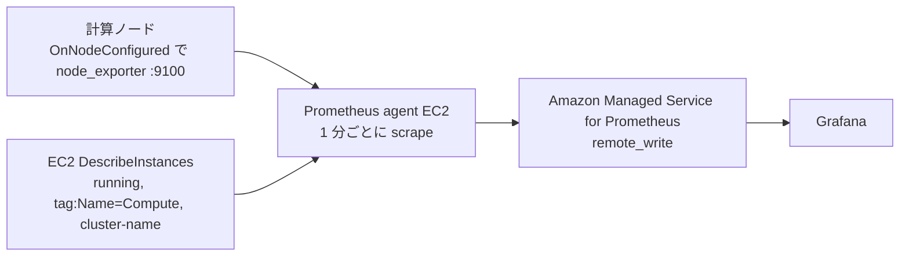
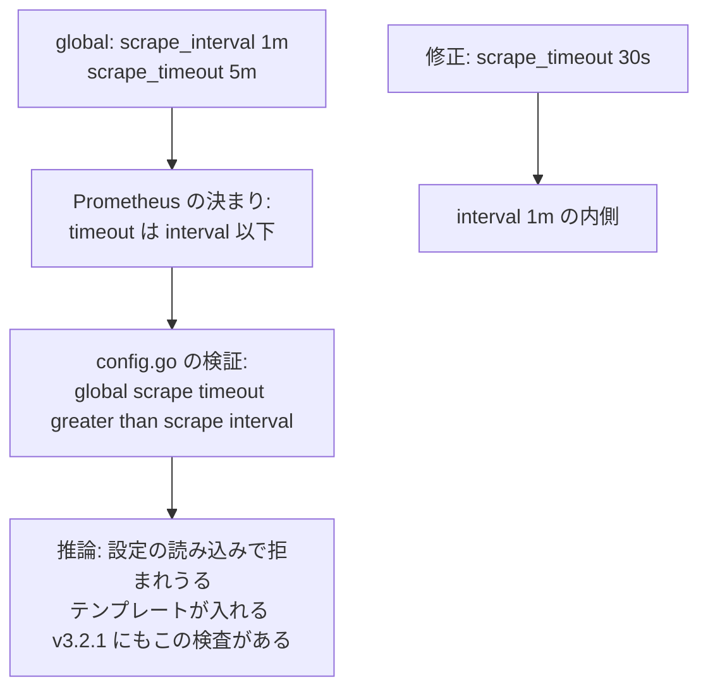
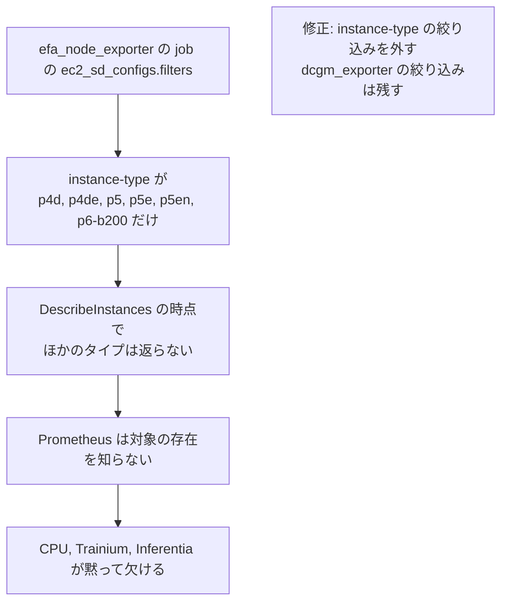
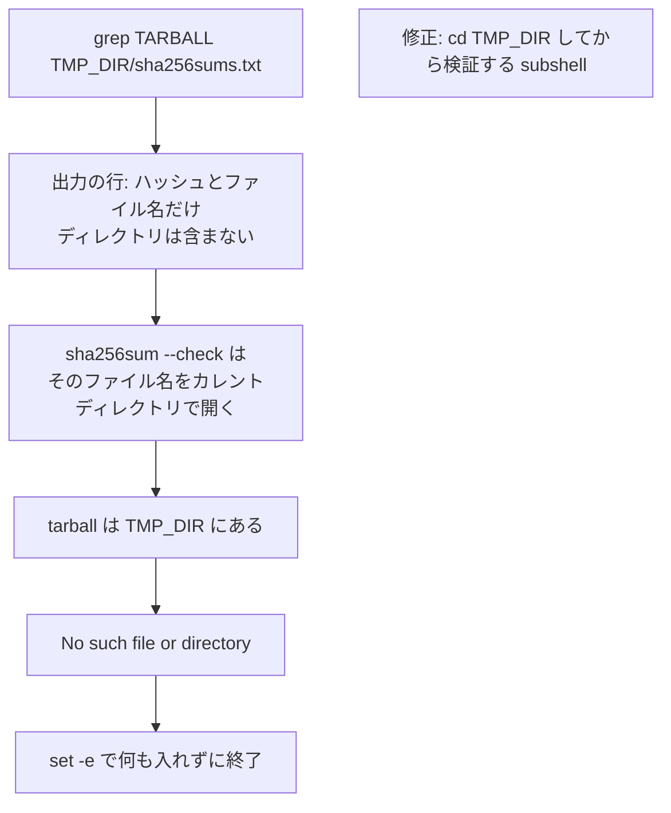
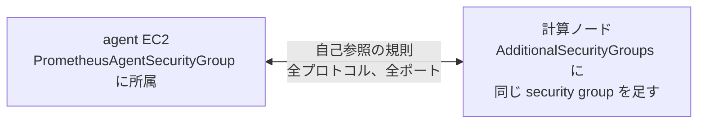

## はじめに

本章では、Prometheus と Grafana の監視の仕組みを AWS ParallelCluster の計算ノードでも使えるようにした [Issue #1042](https://github.com/awslabs/awsome-distributed-ai/issues/1042) と [PR #1043](https://github.com/awslabs/awsome-distributed-ai/pull/1043) をまとめる。

:::details node_exporter と Prometheus の agent
node_exporter は、Linux の CPU、メモリ、ディスク、ネットワークなどの値をポート 9100 で公開するプログラムである。Prometheus はそれを一定の間隔で読みに行き（scrape）、時系列として保存する。このリポジトリの監視の仕組みでは、Prometheus の agent がクラスタの中で各ノードを読み、値を Amazon Managed Service for Prometheus に送り、Grafana がそれを表示する。
:::

## Issue と PR の概要

| 項目 | 内容 |
| --- | --- |
| 解決したいこと | 監視の仕組みが SageMaker HyperPod 向けにしか書かれておらず、ParallelCluster の計算ノードを監視できない |
| やったこと | ParallelCluster 用の node_exporter の導入スクリプトを足し、collector の設定の誤りを直し、README を両方の環境向けに書き直した |
| テスト | ap-northeast-1 の ParallelCluster 3.14.2 のクラスタで、導入のスクリプトを含む計算ノードの設定のまま、監視用のセキュリティグループを差し替えて更新し、Grafana の画面を確かめた |
| マージ | [edeb016](https://github.com/awslabs/awsome-distributed-ai/commit/edeb0163615b341389ccee7bb2609668be410e10) |

## 何を解決しようとしたか

HyperPod では、ライフサイクルスクリプトがコンテナで node_exporter を動かす。ParallelCluster は計算ノードの準備に `OnNodeConfigured` などのカスタムアクションを使うので、同じスクリプトをそのまま使えない。さらに collector の設定に 2 つの問題があった。`scrape_timeout: 5m` が `scrape_interval`（1 分）より長く、Prometheus の決まり（timeout は interval 以下）に反していた。`efa_node_exporter` の job が特定の GPU のインスタンスタイプだけに絞られていて、CPU、Trainium、Inferentia のノードが監視から外れていた。

## どうやったか

[install-node-exporter.sh](https://github.com/awslabs/awsome-distributed-ai/blob/edeb0163615b341389ccee7bb2609668be410e10/1.architectures/2.aws-parallelcluster/post-install-scripts/install-node-exporter.sh) を足した。node_exporter のバイナリ（既定は 1.9.1）を GitHub のリリースから落とし、配布元の `sha256sums.txt` で検証し、専用のユーザーで systemd のサービスとして動かす。ダウンロードは 3 回まで試し、x86_64 と aarch64 の両方に対応し、すでに動いていれば何もしない。[collector の設定](https://github.com/awslabs/awsome-distributed-ai/blob/edeb0163615b341389ccee7bb2609668be410e10/4.validation_and_observability/4.prometheus-grafana/1click-dashboards-deployment/prometheus-agent-collector.yaml) は、`scrape_timeout` を 30 秒にし、インスタンスタイプの絞り込みを外した。

ParallelCluster の側では、計算ノードのキューの `CustomActions.OnNodeConfigured` にこのスクリプトを足し、同じキューの `Networking.AdditionalSecurityGroups` に、agent のスタックが作る監視用のセキュリティグループを足す。agent がノードのポート 9100 に届くのは、このセキュリティグループがあるからである。

## なぜそうしたか

ParallelCluster の `OnNodeConfigured` はノードの準備の最後に動くスクリプトなので、バイナリを入れる形が素直である。スクリプトは GitHub の raw の URL からそのまま参照でき、S3 に置く手間も要らない。node_exporter はハードウェアに依存しないので、インスタンスタイプで絞る理由は無い。

レビューでは KeitaW さんから 3 回に分けて指摘があり、マージした版のスクリプトには次の 3 つが入っている。

- **スクリプトの置き場所**。最初は `utils/` に置いた。レビューで、`utils/` は手元で使う道具の置き場で、計算ノードの準備で動くスクリプトとは種類が違うと指摘され、`post-install-scripts/` に移した。
- **チェックサムの検証**。`sha256sum --check` は、標準入力から読んだファイル名をカレントディレクトリから開く。tarball は一時ディレクトリにあるので、`(cd "$TMP_DIR" && ... | sha256sum --check --status)` の形にした。
- **変数の引用符**。算術の比較の中の変数を引用符で囲み、ShellCheck の SC2086 にそろえた。

PR の説明は node_exporter の版を 1.8.2 と書いていて、スクリプトの既定の 1.9.1 とずれていた。レビューは「コードが正」としていて、使われるのは 1.9.1 である。README の `PCClusterNAME` のパラメータが、CloudFormation のテンプレートの中で `PARALLELCLUSTER_NAME` に正しくつながるかも問われ、筆者はテンプレートの該当行を示して確かめた。

## テストをどうしたか

PR の Test Plan は ParallelCluster 3.12.0 と c5n.9xlarge の計算ノード 2 台を挙げている。実際の記録は、ap-northeast-1 の ParallelCluster 3.14.2 のクラスタで取った。agent のスタックを作り直した。更新に使った設定には、`OnNodeConfigured` にこのブランチの導入のスクリプトがすでに入っていた。`pcluster update-cluster` の変更は、`AdditionalSecurityGroups` の監視用のセキュリティグループを、新しい agent のスタックのものに差し替える 1 件だった。更新の後に計算のフリートを起動し、Grafana の画面を確かめた。

## 技術的な要点

- **`sha256sum --check` が開くファイル**。標準入力から読んだファイル名を、カレントディレクトリから開く。ファイルのあるディレクトリに移ってから検証する。
- **Prometheus の timeout**。`scrape_timeout` は `scrape_interval` 以下にする。[設定の仕様](https://prometheus.io/docs/prometheus/latest/configuration/configuration/#scrape_config)がそう定めている。Issue は Prometheus 3 系の検証で問題になると書いたが、この PR では弾かれることを確かめていない。
- **何度動いても同じになる準備のスクリプト**。すでに動いていれば何もしないようにする。クラスタの更新で再び呼ばれることがある。
- **監視の経路**。exporter を入れるだけでは読めない。読みに行く側から届くように、セキュリティグループも足す。
- **2 つの環境で同じ監視**。収集の側は 1 つにそろえ、ノードに入れる方法だけを環境ごとに分ける。

## 技術面接の準備 (FAQ)

この節は、本章の内容を技術面接で聞かれたときに答えるための想定問答である。システム設計面接の流れに合わせて、全体と設計、不具合の原因の深掘り、検証と振り返りの 3 つに分けた。各問は英語の質問 (見出し)、日本語の質問、英語の回答、日本語の回答の順に書いた。不具合の問には原因の連鎖の図を付け、回答は症状、原因、突き止め方、直し方と比べた案、検証、残ったこと、の順に話す。回答は本章の本文と、PR、Issue、マージ前後のコードで確かめた事実だけを使う。

### 全体と設計

:::details Q1. What was the requirement, and what is the architecture?
**質問 (日本語)**

要件は何で、構成はどうなっているか。

**構成 (図)**

**Answer (English)**

The repository's Prometheus and Grafana stack was written only for SageMaker HyperPod, so ParallelCluster compute nodes couldn't be monitored. node_exporter on each node exposes metrics on port 9100. A Prometheus agent on EC2 discovers targets through EC2 service discovery, filtered by running state and the cluster's tags, scrapes every minute, and remote-writes to Amazon Managed Service for Prometheus, which Grafana reads. My principle was to keep the same collection pipeline for both environments and change only how node_exporter gets installed on the node.

**回答 (日本語)**

リポジトリの Prometheus と Grafana の仕組みが SageMaker HyperPod 向けにしか書かれておらず、ParallelCluster の計算ノードを監視できなかった。各ノードの node_exporter がポート 9100 で値を出す。EC2 の上の Prometheus の agent が、EC2 のサービスディスカバリで、起動中であることとクラスタのタグで絞って対象を見つけ、1 分ごとに読んで Amazon Managed Service for Prometheus に送り、Grafana がそれを読む。方針は、収集の仕組みを両方の環境で同じにし、node_exporter をノードに入れる方法だけを変えることだった。
:::

:::details Q2. HyperPod runs node_exporter in a container. Why a binary with systemd here?
**質問 (日本語)**

HyperPod は node_exporter をコンテナで動かしている。なぜここではバイナリを systemd で動かしたのか。

**Answer (English)**

ParallelCluster prepares compute nodes with custom actions such as `OnNodeConfigured`, which runs at the end of node setup, so installing a binary there fits naturally, and the script can be referenced by its GitHub raw URL without staging it in S3. I'd be careful with one point. In the Issue I wrote that a Docker-based approach was rejected because Docker isn't available during `OnNodeConfigured`. My own test cluster's `OnNodeConfigured` sequence runs `docker/postinstall.sh` before the node_exporter script, so that reason doesn't hold in general. The reasons that do hold are simplicity: one script, no container runtime dependency, and no S3 staging.

**回答 (日本語)**

ParallelCluster は計算ノードの準備に `OnNodeConfigured` などのカスタムアクションを使い、`OnNodeConfigured` は準備の最後に動くので、そこでバイナリを入れる形が素直で、スクリプトは S3 に置かずに GitHub の raw の URL から参照できる。1 点は気を付けて話す。Issue では、`OnNodeConfigured` の間は Docker が使えないので Docker の方式を退けた、と書いた。ところが自分の試験のクラスタの `OnNodeConfigured` では、node_exporter のスクリプトより先に `docker/postinstall.sh` が動いているので、この理由は一般には成り立たない。成り立つ理由は単純さで、スクリプトが 1 本で済み、コンテナのランタイムに頼らず、S3 にも置かなくてよいことである。
:::

:::details Q3. How did you make the install script safe to run on every node?
**質問 (日本語)**

すべてのノードで動かしても安全なように、導入のスクリプトで何をしたか。

**Answer (English)**

It downloads node_exporter, default 1.9.1, from GitHub releases, verifies it against the release's `sha256sums.txt`, and runs it as a systemd service under a dedicated user. Each download is attempted up to three times in total, with a five-second wait between attempts, and that applies separately to the tarball and to the checksum file. It supports x86_64 and aarch64. For idempotency, the first real step checks `systemctl is-active node_exporter` and exits if it's already running, because a cluster update can call the hook again. One honest limit: a checksum from the same release catches a corrupted download, not a compromised release.

**回答 (日本語)**

node_exporter (既定は 1.9.1) を GitHub のリリースから落とし、そのリリースの `sha256sums.txt` で検証し、専用のユーザーで systemd のサービスとして動かす。ダウンロードは初回を含めて最大 3 回試し、試行の間は 5 秒待つ。これは tarball とチェックサムのファイルのそれぞれに別々に効く。x86_64 と aarch64 に対応する。何度動いても同じになるよう、最初の処理で `systemctl is-active node_exporter` を調べ、既に動いていれば終わる。クラスタの更新でフックが再び呼ばれることがあるからである。限界も正直に言う。同じリリースのチェックサムで防げるのはダウンロードの破損で、配布元の改ざんではない。
:::

### 不具合の原因の深掘り

:::details Q4. [Bug] What was wrong with `scrape_timeout`, and how bad was it?
**質問 (日本語)**

`scrape_timeout` の何が悪く、どれくらい深刻だったか。

**原因の連鎖 (図)**

**Answer (English)**

The collector config set `scrape_interval: 1m` and `scrape_timeout: 5m`. Prometheus requires the timeout not to exceed the interval; its configuration docs say so, and its own source validates it while loading the config, returning "global scrape timeout greater than scrape interval". That check is present in `config/config.go` of v3.2.1, the version the agent template installs. So this wasn't cosmetic: a config like that can be rejected at load. I set it to 30 seconds. To be precise about evidence, the PR has no log of the agent actually failing with the old value; I didn't reproduce the failure, I fixed the spec violation, and I don't know whether anyone ran the agent with that config.

**回答 (日本語)**

collector の設定は `scrape_interval: 1m` で `scrape_timeout: 5m` だった。Prometheus は timeout が interval を超えないことを求める。設定の文書がそう書き、Prometheus 自身のソースも設定の読み込みの時に検証し、"global scrape timeout greater than scrape interval" を返す。この検査は、agent のテンプレートが入れる v3.2.1 の `config/config.go` にもある。つまり見た目だけの問題ではなく、そのような設定は読み込みで拒まれうる。30 秒にした。証拠の範囲は正確に言う。古い値で agent が実際に失敗したログは PR に無い。失敗を再現したのではなく、仕様への違反を直した。この設定で agent を動かした人がいたかどうかも分からない。
:::

:::details Q5. [Bug] Why were CPU, Trainium and Inferentia nodes missing from monitoring?
**質問 (日本語)**

なぜ CPU、Trainium、Inferentia のノードが監視から外れていたのか。

**原因の連鎖 (図)**

**Answer (English)**

The filter wasn't a Prometheus relabel rule; it was in EC2 service discovery. The `efa_node_exporter` job's `ec2_sd_configs` filtered `instance-type` to six GPU types, p4d through p6-b200. That filter is applied by the `DescribeInstances` call, so other instance types were never even discovered, and nothing showed them as missing. node_exporter is hardware-independent, so I removed that filter. The `dcgm_exporter` job keeps its instance-type filter on purpose, because DCGM only applies to NVIDIA GPUs. One leftover I'd point out: the job is still named `efa_node_exporter` even though it now covers every node.

**回答 (日本語)**

絞り込みは Prometheus の relabel の規則ではなく、EC2 のサービスディスカバリにあった。`efa_node_exporter` の job の `ec2_sd_configs` が、`instance-type` を p4d から p6-b200 までの 6 つの GPU のタイプに絞っていた。この絞り込みは `DescribeInstances` の呼び出しで効くので、ほかのタイプはそもそも見つからず、欠けていることを示すものも無かった。node_exporter はハードウェアに依存しないので、この絞り込みを外した。`dcgm_exporter` の job の絞り込みは、DCGM が NVIDIA の GPU にしか効かないので、わざと残した。残った点も言っておく。job の名前は、今はすべてのノードを読むのに `efa_node_exporter` のままである。
:::

:::details Q6. [Bug] What did review find in the checksum verification?
**質問 (日本語)**

レビューはチェックサムの検証で何を見つけたか。

**原因の連鎖 (図)**

**Answer (English)**

My first version ran `grep "${TARBALL}" "${TMP_DIR}/sha256sums.txt" | sha256sum --check --status`. The grep finds the right line, but that line contains only the hash and a bare filename, and `sha256sum --check` opens that filename relative to the current directory, while the tarball was in the temp directory. With `set -e`, the script would exit with "No such file or directory" before installing anything. The reviewer explained exactly this and suggested `(cd "$TMP_DIR" && grep "${TARBALL}" sha256sums.txt | sha256sum --check --status)`, which I adopted. I'd also be honest that there's no execution log of the bug in the PR; I tested only with the fixed code.

**回答 (日本語)**

最初の版は `grep "${TARBALL}" "${TMP_DIR}/sha256sums.txt" | sha256sum --check --status` だった。grep は正しい行を見つけるが、その行にはハッシュとディレクトリを含まないファイル名しか無く、`sha256sum --check` はそのファイル名をカレントディレクトリで開く。tarball は一時ディレクトリにあった。`set -e` なので、何も入れないまま "No such file or directory" で終わる。レビューした人がまさにこの説明をし、`(cd "$TMP_DIR" && grep "${TARBALL}" sha256sums.txt | sha256sum --check --status)` を提案し、それを採った。正直に言うと、この不具合の実行のログは PR に無く、試したのは直した後のコードだけである。
:::

:::details Q7. Installing the exporter isn't enough. How does the agent actually reach port 9100?
**質問 (日本語)**

exporter を入れるだけでは足りない。agent はどうやってポート 9100 に届くのか。

**経路 (図)**

**Answer (English)**

Through a self-referencing security group that already existed in the agent stack before this PR. `PrometheusAgentSecurityGroup` has an ingress rule allowing all protocols and ports from members of the same group, the agent instance is a member, and the stack outputs the group's ID. On the ParallelCluster side, you add that group to the compute queue's `Networking.AdditionalSecurityGroups`, which makes the compute nodes members too, so the agent can reach 9100. The PR documented this; it didn't change the security group. If asked whether that's least privilege: it isn't, since it's all ports rather than 9100 only, and that wasn't discussed in the PR. I'd raise it as a follow-up rather than claim it was designed that way.

**回答 (日本語)**

この PR より前から agent のスタックにあった、自己参照のセキュリティグループを通る。`PrometheusAgentSecurityGroup` には、同じグループのメンバーからの全プロトコル、全ポートを許す受信の規則があり、agent のインスタンスはそのメンバーで、スタックはグループの ID を出力する。ParallelCluster の側では、計算ノードのキューの `Networking.AdditionalSecurityGroups` にそのグループを足す。これで計算ノードもメンバーになり、agent が 9100 番に届く。PR はこれを文書にしたもので、セキュリティグループは変えていない。最小権限かと聞かれたら、9100 番だけでなく全ポートなのでそうではなく、PR でも議論していない。そう設計したとは言わず、後続の課題として挙げる。
:::

:::details Q8. Why did the review move the script out of `utils/`?
**質問 (日本語)**

なぜレビューでスクリプトを `utils/` から移したのか。

**Answer (English)**

I originally put it in `utils/` on purpose, citing YAGNI and KISS, since it was the only script of its kind. The reviewer acknowledged that, but pointed out that `utils/` holds tools you run from your workstation, such as `create_config.sh` and `easy-ssh.sh`, while this is an `OnNodeConfigured` hook that runs on compute nodes during bootstrap. Different kinds of things, and more hooks like a DCGM exporter would follow. I agreed and moved it to `post-install-scripts/`. It's a good example of accepting a disagreement on structure because the reviewer's reasoning about future readers was better than mine.

**回答 (日本語)**

最初は YAGNI と KISS を理由に、わざと `utils/` に置いた。この種のスクリプトが 1 本しか無かったからである。レビューした人はそれを認めたうえで、`utils/` は `create_config.sh` や `easy-ssh.sh` のように手元から動かす道具の置き場で、これは計算ノードのブートストラップで動く `OnNodeConfigured` のフックだと指摘した。種類が違い、DCGM exporter のようなフックも後に続く。同意して `post-install-scripts/` に移した。将来の読み手についての相手の理屈のほうが良かったので、構成についての意見の違いを受け入れた例である。
:::

### 検証と振り返り

:::details Q9. How did you test it, and where did the record differ from the plan?
**質問 (日本語)**

どう試し、記録は計画とどこが違ったか。

**Answer (English)**

The PR's test plan listed ParallelCluster 3.12.0, two c5n.9xlarge compute nodes, and two regions. The actual record is from one ParallelCluster 3.14.2 cluster in ap-northeast-1. I recreated the agent stack; the cluster config already had the branch's script in `OnNodeConfigured`, and the `pcluster update-cluster` change set was a single change, swapping the monitoring security group in `AdditionalSecurityGroups`. After the update I started the compute fleet and checked Grafana. Also, the PR description says node_exporter 1.8.2 while the script defaults to 1.9.1; the reviewer treated the code as the source of truth, and the description was never updated. I'd present the 3.14.2 record as what was tested, not the plan.

**回答 (日本語)**

PR の試験の計画は ParallelCluster 3.12.0、c5n.9xlarge の計算ノード 2 台、2 つのリージョンを挙げた。実際の記録は ap-northeast-1 の ParallelCluster 3.14.2 のクラスタ 1 つで取った。agent のスタックを作り直し、クラスタの設定の `OnNodeConfigured` にはブランチのスクリプトが既に入っていて、`pcluster update-cluster` の変更は、`AdditionalSecurityGroups` の監視用のセキュリティグループを差し替える 1 件だった。更新の後に計算のフリートを起動して Grafana を確かめた。また、PR の説明は node_exporter を 1.8.2 と書き、スクリプトの既定は 1.9.1 である。レビューはコードを正とし、説明はその後も直していない。試したものとして示すのは計画ではなく 3.14.2 の記録である。
:::

:::details Q10. What would you improve next?
**質問 (日本語)**

次に何を良くするか。

**Answer (English)**

Four things, all visible in the code. The idempotency check only asks whether the service is active, so changing `NODE_EXPORTER_VERSION` doesn't upgrade an existing node; I'd compare versions. The `efa_node_exporter` job name no longer matches what it scrapes. The security group allows all ports among members; I'd consider limiting it to the exporter ports. And I'd fix the PR description's version and correct the Docker rationale in the Issue, so the written record matches the code.

**回答 (日本語)**

4 つあり、どれもコードから見える。何度動いても同じにする確認はサービスが動いているかしか見ないので、`NODE_EXPORTER_VERSION` を変えても既存のノードは上がらない。版を比べるようにする。`efa_node_exporter` の job の名前が、読んでいるものと合わなくなった。セキュリティグループはメンバーの間で全ポートを許すので、exporter のポートに絞ることを考える。そして PR の説明の版と、Issue の Docker の理由を直し、書かれた記録をコードに合わせる。
:::

## まとめ

PR #1043 は、HyperPod と共通の監視の仕組みを ParallelCluster でも使えるように、計算ノードへの node_exporter の導入スクリプトを足し、collector の timeout と対象の選び方、導入の手順を直した。別の環境に監視を広げるときも、ノードへの導入の方法、収集の対象、ネットワークの経路を分けて確かめると役立つ。
