## はじめに

[awsome-distributed-ai](https://github.com/awslabs/awsome-distributed-ai)（旧名 awsome-distributed-training）は、AWS の上で分散学習と分散推論を動かすためのサンプル集である。本章では、picotron のテストケースを再現できる形に直した [Issue #975](https://github.com/awslabs/awsome-distributed-ai/issues/975) と [PR #1019](https://github.com/awslabs/awsome-distributed-ai/pull/1019) をまとめる。

:::details picotron と、Slurm でジョブが GPU に届くまで
[picotron](https://github.com/huggingface/picotron) は、Hugging Face が公開している教育用の分散学習フレームワークで、テンソル並列（TP）、パイプライン並列（PP）、データ並列（DP）を短いコードで実装している。このテストケースは、SmolLM-1.7B を 2 ノードで TP=2 にして学習する。

Slurm の上でコンテナを使う分散学習では、`sbatch` のスクリプトがホストのシェルで動き、`srun` がノードにタスクを置き、pyxis と enroot がその中でコンテナを起動し、`torchrun` が `RANK` や `MASTER_ADDR` を設定してから学習のプロセスを起動する。ノードの間の通信は、NCCL が aws-ofi-nccl を通して EFA を使うことを狙う。設定が足りないと TCP に落ちることがあるので、実際に EFA が選ばれたかはログで確かめる。
:::

## Issue と PR の概要


| 項目 | 内容 |
| --- | --- |
| 解決したいこと | ビルドが再現しない、手順書が実際の動きと合わない、複数ノードで EFA を使う設定が無い |
| やったこと | picotron の commit を固定し、設定ファイルの読み込み先を直し、EFA と NCCL の環境変数を足し、README の 2 か所を直した |
| テスト | ParallelCluster と Slurm の g5.8xlarge の 2 ノードで、all_reduce のログから EFA が選ばれることを、別の学習ジョブで 5000 ステップの完走を確かめた。主な対象の p4d と p5 では確かめていない |
| マージ | [6056782](https://github.com/awslabs/awsome-distributed-ai/commit/6056782ef127b7013484bc2aa5bc56e5a56bb8c4) |

## 何を解決しようとしたか

Issue #975 は 5 つの問題を挙げていた。

1. Dockerfile が picotron を commit を決めずに clone していたので、上流が変わるとイメージが黙って変わる。
2. Slurm の README が、設定の出力先を `conf/llama-1B-dp2-tp2-pp2/config.json` と書いていた。掲載のコマンドの `--exp_name llama-1B-tp2` と `train.sbatch` が使うのは `conf/llama-1B-tp2/config.json` である。
3. EC2 の README が、コンテナイメージを作る手順を準備の 1 番と 3 番に重ねて書いていた。
4. `train.sbatch` に EFA と NCCL の環境変数が無く、Issue は、p4d や p5 の複数ノードの実行が TCP に落ちたり、気づかないうちに遅くなったりするおそれを挙げていた。
5. `create_config.py` は、テンプレートの `template/base_config.json` をカレントディレクトリから開き、そのテンプレートはこのリポジトリに無く、コンテナの中に clone した picotron にあった。

## どうやったか

[Dockerfile](https://github.com/awslabs/awsome-distributed-ai/blob/6056782ef127b7013484bc2aa5bc56e5a56bb8c4/3.test_cases/pytorch/picotron/picotron.Dockerfile) は、clone のあとに `git checkout 59714b1bf255` を足した。[create_config.py](https://github.com/awslabs/awsome-distributed-ai/blob/6056782ef127b7013484bc2aa5bc56e5a56bb8c4/3.test_cases/pytorch/picotron/create_config.py) は、テンプレートの場所を `__file__` から求めるように変え、テンプレートの JSON を固定した commit から取ってリポジトリに置いた。[train.sbatch](https://github.com/awslabs/awsome-distributed-ai/blob/6056782ef127b7013484bc2aa5bc56e5a56bb8c4/3.test_cases/pytorch/picotron/SmolLM-1.7B/slurm/train.sbatch) には、`FI_EFA_USE_HUGE_PAGE=0`、`FI_PROVIDER=efa`、`NCCL_SOCKET_IFNAME=^docker,lo,veth` を足した。Slurm の README は出力先を `conf/llama-1B-tp2/config.json` に直し、EC2 の README は重なった手順を 1 つにした。

## なぜそうしたか

**torch の版**。`torch==2.1.0` は上げずに残した。固定した commit の `requirements.txt` が `torch==2.1.0` を指定していて、`pip install -e .` がそれで上書きするので、Dockerfile だけ上げても効かないからである。レビューのメンテナは、この理由を書いたことを「直す必要の無いものを後の人が直してしまうのを防ぐ」と評価した。

**EFA の環境変数**。リポジトリの [EFA cheatsheet](https://github.com/awslabs/awsome-distributed-ai/blob/6056782ef127b7013484bc2aa5bc56e5a56bb8c4/1.architectures/efa-cheatsheet.md) に合わせた。`FI_PROVIDER=efa` は、libfabric が使うプロバイダとして EFA を明示する。PR は、スクリプトを動かすためにホストの特定の aws-ofi-nccl の版に頼らないことを理由にした。`FI_EFA_USE_HUGE_PAGE=0` は cheatsheet のプリセット 3.1（libfabric 1.18.0 以上、aws-ofi-nccl 1.7.0 以上）に従い、PyTorch の複数プロセスの dataloader が huge page を使い切って `Cannot allocate memory` になるのを防ぐ。`NCCL_DEBUG` は、cheatsheet が「NCCL を疑うとき以外は切る」と勧めているので入れていない。

**NCCL のソケットのインタフェース**。`NCCL_SOCKET_IFNAME` は、NCCL がソケットでの待ち合わせに使うインタフェースを決める変数で、EFA のプロバイダの選択とは別である。比べた方向は、`en` で始まるインタフェースだけを選ぶ `en` で、使う側を明示できるので意図が読みやすい。メンテナはレビューで、名前が `en` で始まらないインタフェース（例として p4d や p5 の `efa0`、`efa1`）を持つインスタンスでは外れうると指摘し、FSDP、DeepSpeed、nanoVLM の sbatch と同じ除外の形 `^docker,lo,veth` を提案した。PR はこの提案を採り、マージした `train.sbatch` は `^docker,lo,veth` になっている。除外の形の代償は、想定外の不要なインタフェースが増えたときに一覧へ足す必要があることである。

## テストをどうしたか

ParallelCluster 3.13.1 と Slurm 24.05.8 で、g5.8xlarge（A10G、EFAv2）を 2 ノード使った。主な対象の p4d と p5 は、資源と費用の都合で確かめていない。以下の検証は、レビューの前の `NCCL_SOCKET_IFNAME=en` の版で行ったもので、`^docker,lo,veth` に変えた後の再検証は PR に記録が無い。

まず、Docker のビルドのログに `HEAD is now at 59714b1` が出ることで commit の固定を、`create_config.py` をコンテナの中で `--exp_name llama-1B-tp2` で実行し、`conf/llama-1B-tp2/config.json` ができることで README のパスを確かめた。コンテナの外で動くことは筆者が Issue のコメントで報告しているが、PR にはそのコマンドとログを載せていない。

次に、学習とは別に `torchrun` で 2 ノードの all_reduce を動かし、`NCCL_DEBUG=INFO` のログで両ノードが EFA を選んだことを確かめた。g5.8xlarge では GPU Direct RDMA は無効と出る。

```
NCCL INFO NET/OFI Initializing aws-ofi-nccl 1.13.2-aws
NCCL INFO NET/OFI Selected Provider is efa (found 1 nics)
NCCL INFO NET/Libfabric : GPU Direct RDMA Disabled for HCA 0 'rdmap0s29'
NCCL INFO Channel 00/0 : 0[0] -> 1[0] [send] via NET/Libfabric/0
[PASS] all_reduce complete: world_size=2, result=2.0
```

最後に学習ジョブを動かした。設定は SmolLM-1.7B を `num_hidden_layers=5`、DP=1、TP=2、PP=1、`grad_acc_steps=2`、`mbs=4`、`seq_len=128` に縮めた検証用のものである。検証の環境では、手元の `train.sbatch` に PR の対象外の 2 行（後述の `PATH` と `HF_TOKEN`）を足した。`sbatch train.sbatch` は 5000 ステップを NCCL のエラー無しで終了コード 0 で完走し、PR に載せた rank 0 の記録では Step 1 が 215.85 tokens/s、Step 100〜5000 が 7,230〜7,358 tokens/s だった。

## 技術的な要点

- **PyTorch の分散の環境変数を設定するもの**。`RANK`、`WORLD_SIZE`、`MASTER_ADDR` を設定するのは `torchrun` で、`srun` ではない。NCCL の確認も `srun ... torchrun ...` の形で起動する。
- **EFA が使われた証拠**。環境変数を足しただけでは証拠にならない。`Selected Provider is efa` のログを両ノードで確かめる。
- **ParallelCluster の sbatch での Slurm のパス**（検証の環境で踏んだもの、PR の対象外）。ParallelCluster は Slurm を `/opt/slurm/bin` に置き、`/etc/profile.d/` でパスを足す。`sbatch` のスクリプトは非ログインのシェルで動くので、このパスが入らず `srun: command not found` になることがある。そのときは `export PATH=/opt/slurm/bin:$PATH` を足す。コンテナの中から `srun` を呼ぶテストケースでは、別に `--container-mounts` で `/opt/slurm/bin` を見せる必要がある。picotron はコンテナの中から `srun` を呼ばないので、この対処は要らない。
- **pyxis を入れる段階**（検証の環境で踏んだもの）。ParallelCluster のカスタムアクションで pyxis を入れるときは、`OnNodeStart` ではなく `OnNodeConfigured` に置く。`OnNodeStart` はブートストラップの前に動くので、enroot がまだ入っていない。
- **公開モデルでも要る HF_TOKEN**（検証の環境で踏んだもの、PR の対象外）。固定した commit の picotron の `train.py` は、設定ファイルにも環境変数にも `HF_TOKEN` が無いと、公開モデルでも起動で止まる。検証では手元の sbatch に `export HF_TOKEN=""` を足した。

## PR の整理 (FAQ)

この節は、本章の PR を、設計の判断、不具合の原因、検証の 3 つの面から問答の形で整理したものである。問は、全体と設計、不具合の原因の深掘り、検証と振り返りの 3 つに分けた。各問は英語の質問 (見出し)、日本語の質問、噛み砕き (ひとことでの表とやさしい版の図)、英語の回答、日本語の回答の順に書いた。不具合の問には原因の連鎖の図を付け、回答は症状、原因、突き止め方、直し方と比べた案、検証、残ったこと、の順に書いた。回答は本章の本文と、PR、Issue、マージ前後のコードで確かめた事実だけを使う。

### 全体と設計

:::details Q1. What does this PR change, in short?
**質問 (日本語)**

この PR は、要するに何を変えたのか。

**Answer (English)**

The picotron test case trains SmolLM-1.7B on two nodes with tensor parallelism 2, but it wasn't reproducible. The Issue listed five problems: an unpinned upstream clone, a wrong config path in the Slurm README, a duplicated step in the EC2 README, a config script that only worked from one directory, and no EFA settings for multi-node runs. I pinned picotron to commit `59714b1bf255`, made `create_config.py` find its template relative to itself and vendored the template, added three EFA and NCCL variables from the repository's EFA cheatsheet, and fixed both READMEs. I verified on two g5.8xlarge nodes that NCCL selected EFA, and that a cut-down training job ran 5,000 steps.

**回答 (日本語)**

picotron のテストケースは SmolLM-1.7B を 2 ノード、テンソル並列 2 で学習するが、再現できなかった。Issue は 5 つの問題を挙げていた。上流の commit を固定しない clone、Slurm の README の設定のパスの誤り、EC2 の README の手順の重複、1 つのディレクトリからしか動かない設定のスクリプト、複数ノード向けの EFA の設定が無いことである。picotron を commit `59714b1bf255` に固定し、`create_config.py` が自分の場所からテンプレートを探すようにしてテンプレートをリポジトリに置き、リポジトリの EFA cheatsheet から EFA と NCCL の変数を 3 つ足し、2 つの README を直した。g5.8xlarge の 2 ノードで、NCCL が EFA を選ぶことと、縮めた学習ジョブが 5000 ステップを完走することを確かめた。
:::

:::details Q2. What does "reproducible" mean for a test case, and how did that drive your design?
**質問 (日本語)**

テストケースにとって「再現できる」とは何で、それが設計をどう決めたか。

**噛み砕き (ひとことで)**

「再現できる」を 3 つの基準に分けて、直すべき場所をはっきりさせた。

| 項目 | 内容 |
|---|---|
| 論点 | テストケースにとって「再現できる」とはどういうことで、それが直し方をどう決めたか。 |
| 選んだこと | 同じ材料 (入力) から同じイメージができること、スクリプトが動かす場所に頼らないこと、通信が実際に通る道筋を思い込まず確かめること、の 3 つの基準で直した。 |
| 良い点 | 直すべき箇所をこの 3 つの基準に当てはめて選べるので、迷わず判断できる。 |
| 悪い点・代償 | 元の回答では、この 3 つの基準について代償には触れていない。 |

**図 (やさしい版)**

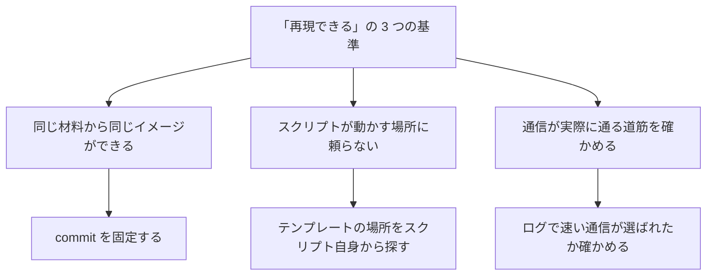

**Answer (English)**

Three things: the same inputs build the same image, the scripts don't depend on where you run them, and the path the traffic actually takes is checked, not assumed. Each fix maps to one of those. Pinning the commit fixes the inputs. Resolving the template from `__file__` removes the dependency on the current directory. And instead of trusting that adding EFA variables is enough, I checked the NCCL log for the selected provider on both nodes.

**回答 (日本語)**

3 つある。同じ入力から同じイメージができること、スクリプトが実行する場所に頼らないこと、通信が実際に通る経路を思い込まず確かめること、である。修正はそれぞれどれかに当たる。commit の固定は入力を固定する。テンプレートを `__file__` から探すことは、カレントディレクトリへの依存を消す。EFA の変数を足せば十分だと信じず、両ノードの NCCL のログで選ばれたプロバイダを確かめた。
:::

:::details Q3. Why keep torch at 2.1.0 instead of upgrading it?
**質問 (日本語)**

なぜ torch を上げず 2.1.0 のまま残したのか。

**噛み砕き (ひとことで)**

torch (学習の部品) を上げても後の処理で上書きされて効かないので、理由を書いて上げずに残した。

| 項目 | 内容 |
|---|---|
| 論点 | なぜ torch (学習に使う部品) を 2.1.0 のままにし、上げなかったか。 |
| 選んだこと | 上げても効かないと分かったので、理由を書き残して 2.1.0 のまま残した。 |
| 良い点 | 後の人が、直す必要の無いものを「直して」しまうのを防げる (レビューでも評価された)。 |
| 悪い点・代償 | 上げるには、固定した picotron の版も一緒に動かす必要があり、それは別の試験を要する別の変更になるので、今回は手を付けていない。 |

**図 (やさしい版)**

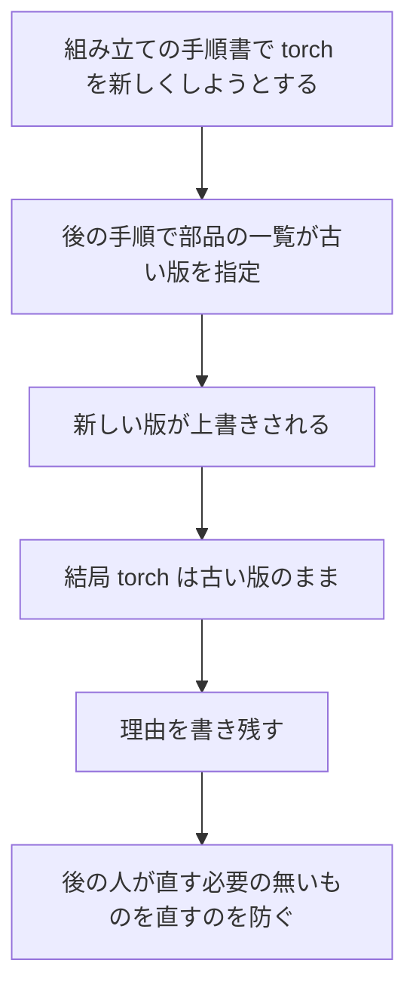

**Answer (English)**

Because upgrading it in the Dockerfile wouldn't take effect. The pinned picotron commit's `requirements.txt` pins `torch==2.1.0`, together with `triton==2.1.0`, `flash-attn==2.5.0` and others, and `pip install -e .` reinstalls those over whatever the Dockerfile installed. So I left it and wrote the reason in the PR, so nobody "fixes" it later. Upgrading would mean moving the picotron pin too, which is a separate change with its own testing.

**回答 (日本語)**

Dockerfile で上げても効かないからである。固定した picotron の commit の `requirements.txt` が `torch==2.1.0` を、`triton==2.1.0` や `flash-attn==2.5.0` などと一緒に固定していて、`pip install -e .` が Dockerfile で入れたものをそれで上書きする。そこで上げずに残し、後の人が「直して」しまわないよう理由を PR に書いた。上げるなら picotron の固定も動かすことになり、それは別の試験を要する別の変更である。
:::

### 不具合の原因の深掘り

:::details Q4. [Bug] What exactly was wrong with the Dockerfile?
**質問 (日本語)**

Dockerfile の何が具体的に悪かったのか。

**原因の連鎖 (図)**

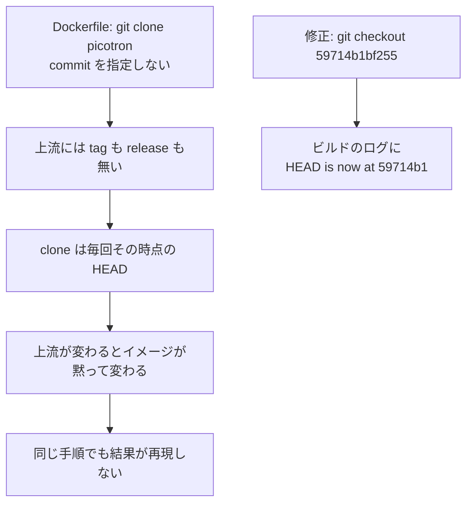

**噛み砕き (ひとことで)**

外部の部品を版の固定無しで取り込んでいたせいで、ビルドのたびに内容が変わっていた。

| 項目 | 内容 |
|---|---|
| 原因 | 組み立ての手順書 (Dockerfile) が外部の部品 (picotron) を取り込むときに版 (commit) を指定しておらず、外部の部品には版の目印 (タグ) も無いので、組み立てるたびにその日の最新が入っていた。 |
| やったこと | 取り込みの後に版を 1 つに固定する行を足した。 |
| 良い点 | 組み立ての記録 (ログ) に固定した版が出ることで、固定が効いたことを確かめられる。 |
| 悪い点・代償 | 元の回答に代償の記述は無い。教訓として、テストケースでは、固定していない依存は何かが壊れる前から不具合である。 |

**図 (やさしい版)**

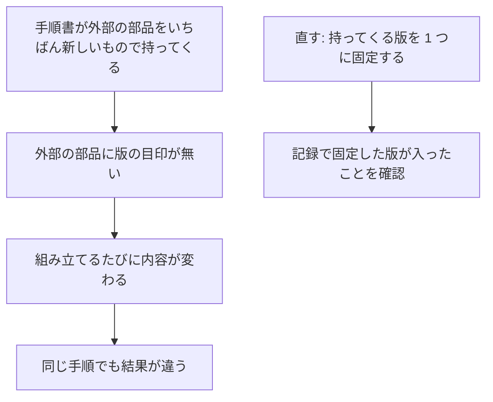

**Answer (English)**

The symptom wasn't an error; it was silent drift. The Dockerfile ran `git clone` and `pip install -e .` with no commit, and upstream picotron has no tags or releases, so every build took whatever HEAD was that day. Two people following the same README could get different code. The fix was one line, `git checkout 59714b1bf255` after the clone, and I verified it from the build log, which shows `HEAD is now at 59714b1`. The lesson I'd generalize: for a test case, an unpinned dependency is a bug even before it breaks anything.

**回答 (日本語)**

症状はエラーではなく、黙ったずれである。Dockerfile は commit を指定せずに `git clone` と `pip install -e .` を実行していて、上流の picotron には tag も release も無いので、ビルドのたびにその日の HEAD を取っていた。同じ README に従った 2 人が違うコードを手にしうる。修正は clone の後の `git checkout 59714b1bf255` の 1 行で、ビルドのログに `HEAD is now at 59714b1` が出ることで確かめた。一般化する教訓は、テストケースでは、固定していない依存は何かが壊れる前から不具合だということである。
:::

:::details Q5. [Bug] Why did `create_config.py` fail outside the container?
**質問 (日本語)**

なぜ `create_config.py` はコンテナの外で失敗したのか。

**原因の連鎖 (図)**

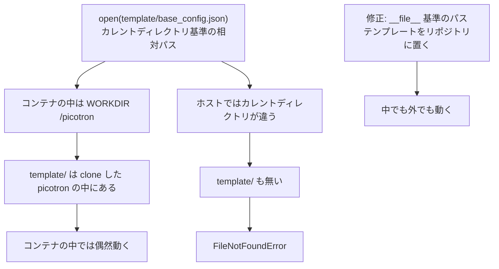

**噛み砕き (ひとことで)**

設定を作るスクリプトが「いま居る場所」頼りで、コンテナの外では壊れていた。

| 項目 | 内容 |
|---|---|
| 原因 | 設定を作るスクリプトが、テンプレートの場所を「いま居る場所」からの相対パスで開いていたので、コンテナの中では偶然動くだけで、ホストでは場所が無く失敗していた。 |
| やったこと | パスをスクリプト自身の場所から組み立てるように直し、テンプレートもリポジトリに写して用意した。 |
| 良い点 | コンテナの中でも外でも同じスクリプトが動くようになった。 |
| 悪い点・代償 | コンテナの外で動いたことは報告したが、そのコマンドと記録 (ログ) は PR に残していない。 |

**図 (やさしい版)**

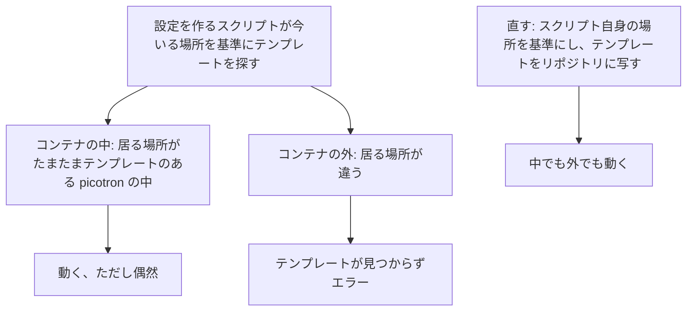

**Answer (English)**

The script opened `template/base_config.json` with a relative path, which resolves against the current working directory, not the script's location. Inside the container it worked by accident: the working directory is `/picotron`, and the template lives in the picotron clone. On the host, both conditions fail, so you get `FileNotFoundError`. There were really two bugs: the path depended on the working directory, and the file didn't exist in this repository at all. So I fixed both: the path is now built from `os.path.abspath(__file__)`, and I copied the template from the pinned commit into the repository. I reported in the Issue that it then ran outside the container, though the PR doesn't include that command and log.

**回答 (日本語)**

スクリプトは `template/base_config.json` を相対パスで開いていて、これはスクリプトの場所ではなくカレントディレクトリから解決される。コンテナの中では偶然動いていた。カレントディレクトリが `/picotron` で、テンプレートは clone した picotron の中にあるからである。ホストではその 2 つの条件がどちらも外れ、`FileNotFoundError` になる。実際には不具合が 2 つあった。パスがカレントディレクトリに頼っていたことと、ファイルがこのリポジトリにそもそも無かったことである。そこで両方を直した。パスは `os.path.abspath(__file__)` から組み立て、テンプレートは固定した commit からリポジトリに写した。その後コンテナの外で動いたことは Issue で報告したが、そのコマンドとログは PR に載せていない。
:::

:::details Q6. [Bug] Without EFA settings, what actually goes wrong, and how did you prove EFA was used?
**質問 (日本語)**

EFA の設定が無いと実際に何が起きるのか。EFA が使われたことをどう証明したか。

**原因の連鎖 (図)**

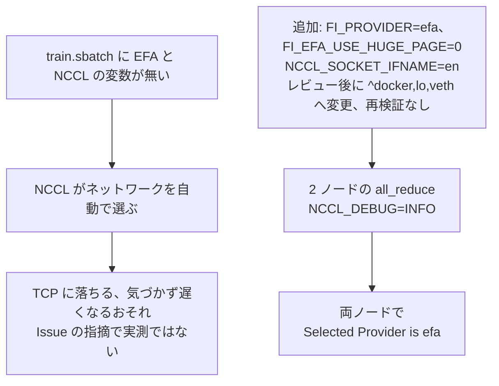

**噛み砕き (ひとことで)**

速い通信の設定が無いと、気づかれないまま遅い経路に落ちることがある。

| 項目 | 内容 |
|---|---|
| 原因 | 複数ノードをつなぐ速い通信路 (EFA) の設定が無いと、通信をまとめる仕組みが自動で経路を選び、遅い経路 (TCP) に落ちるおそれがあると Issue が指摘していた (実測した失敗ではない)。落ちてもエラーにならず気づきにくい。 |
| やったこと | 速い経路 (EFA) を明示する設定、メモリ不足を防ぐ設定、待ち合わせに使う通信路を決める設定、の 3 つを足し、別に 2 ノードの通信を試して、記録 (ログ) で速い経路が選ばれたことを確かめた。 |
| 良い点 | 「気づかれない遅さ」という症状の形を正しく理解した上で対策できた。 |
| 悪い点・代償 | 確かめたのは別に動かした試験で、レビューで変数を直した後の設定や、学習そのものの記録では確認していない。 |

**図 (やさしい版)**

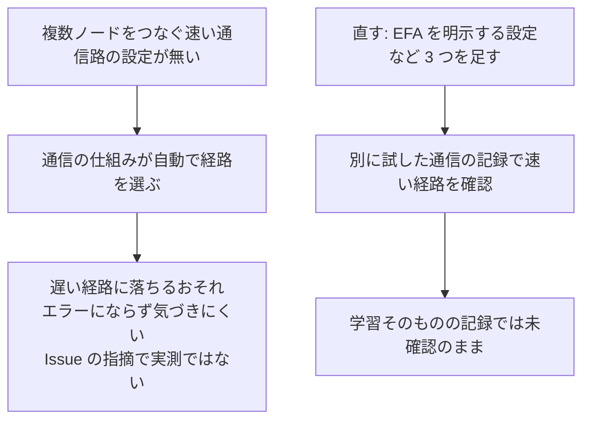

**Answer (English)**

To be precise about the symptom: the Issue said multi-node runs on p4d or p5 "may fall back to TCP or hit silent performance issues". That was a risk the Issue raised, not a failure I measured. The silent part is what matters: a TCP fallback still trains, just slower, so nothing tells you. I added `FI_PROVIDER=efa` to make the libfabric provider explicit regardless of the host's aws-ofi-nccl version, `FI_EFA_USE_HUGE_PAGE=0`, following the cheatsheet preset, so the multi-process dataloader doesn't exhaust huge pages with `Cannot allocate memory`; that one is preventive, and `NCCL_SOCKET_IFNAME` for NCCL's socket bootstrap. For proof, I ran a separate two-node all_reduce with `NCCL_DEBUG=INFO` and checked `Selected Provider is efa` on both nodes. That run used the earlier `NCCL_SOCKET_IFNAME=en` version, and the training job itself ran without `NCCL_DEBUG`, so its own logs don't name the provider. So what I can show is EFA selection in a separate run with the pre-review setting, not for the merged config or the training job itself.

**回答 (日本語)**

症状は正確に言う。Issue は、p4d や p5 の複数ノードの実行が TCP に落ちたり、気づかないうちに遅くなったりする「おそれ」を挙げていた。これは Issue が挙げたリスクで、実測した失敗ではない。大事なのは「気づかない」の部分で、TCP に落ちても学習は遅いまま進むので、何も知らせてくれない。`FI_PROVIDER=efa` はホストの aws-ofi-nccl の版によらず libfabric のプロバイダを明示し、`FI_EFA_USE_HUGE_PAGE=0` は cheatsheet のプリセットに従い、複数プロセスの dataloader が huge page を使い切って `Cannot allocate memory` になるのを防ぐ予防の設定で、`NCCL_SOCKET_IFNAME` は NCCL のソケットでの待ち合わせのインタフェースを決める。証明として、別に 2 ノードの all_reduce を `NCCL_DEBUG=INFO` で動かし、両ノードで `Selected Provider is efa` を確かめた。この実行はレビュー前の `NCCL_SOCKET_IFNAME=en` の版で、学習ジョブ自体は `NCCL_DEBUG` 無しで動かしたので、学習のログにはプロバイダが出ていない。つまり示せるのは、レビュー前の設定で別に動かした実行で EFA が選ばれたことで、マージした設定や学習ジョブそのものについてではない。
:::

:::details Q7. Why `NCCL_SOCKET_IFNAME=^docker,lo,veth` and not `en`?
**質問 (日本語)**

なぜ `NCCL_SOCKET_IFNAME` を `en` ではなく `^docker,lo,veth` にしたのか。

**噛み砕き (ひとことで)**

通信路の名前の指定を、取りこぼしに強い「使わないものを並べる」書き方に変えた。

| 項目 | 内容 |
|---|---|
| 論点 | 通信路の名前の指定を、使うものを並べる書き方 (`en`) にするか、使わないものを並べる書き方 (`^docker,lo,veth`) にするか。 |
| 選んだこと | 最初は使うものを並べる書き方にしたが、レビューで、通信路 (インタフェース) の名前が `en` で始まらないインスタンス (例: p4d や p5) では外れうると指摘され、リポジトリのほかのテストケースと同じ、使わないものを並べる書き方に変えた。 |
| 良い点 | 名前の付け方が違うノードでも取りこぼさない。 |
| 悪い点・代償 | 使わないものを並べる書き方は、新しく不要な通信路が増えたら一覧を書き足す必要がある。 |

**図 (やさしい版)**

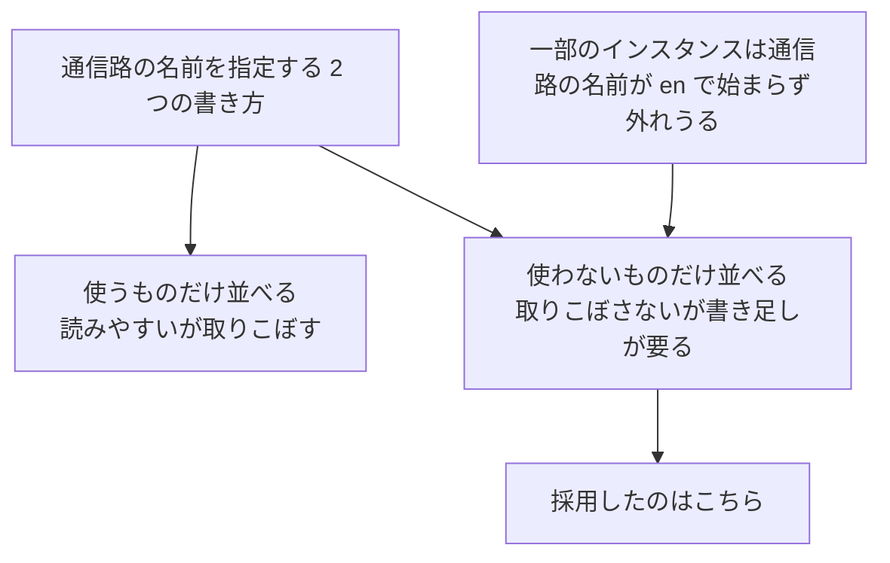

**Answer (English)**

I started with `en`, an allowlist that makes the intended interface explicit and easy to read. The reviewer pointed out it can miss instances whose interfaces don't start with `en`, giving p4d and p5 as examples, and suggested the exclusion form used by other test cases in the repo; the merged change came in as the reviewer's suggestion. The trade-off is that an exclusion list has to grow if a new unwanted interface appears. This variable only picks the interface for NCCL's socket bootstrap; it doesn't choose EFA, which is why the EFA proof comes from the provider log, not from this setting.

**回答 (日本語)**

最初は `en` にした。許可の形で使うインタフェースを明示でき、意図が読みやすいからである。レビューで、p4d や p5 を例に、名前が `en` で始まらないインタフェースを持つインスタンスでは外れうると指摘され、リポジトリのほかのテストケースが使う除外の形を提案された。マージした変更はその提案として入った。代償は、想定外の不要なインタフェースが増えたら除外の一覧を足す必要があることである。この変数は NCCL のソケットでの待ち合わせのインタフェースを決めるだけで、EFA を選ぶものではない。だから EFA の証拠はこの設定ではなく、プロバイダのログから取った。
:::

:::details Q8. [Bug] Your training job needed `HF_TOKEN` even for a public model. Why?
**質問 (日本語)**

公開モデルなのに、学習ジョブが `HF_TOKEN` を要求した。なぜか。

**原因の連鎖 (図)**

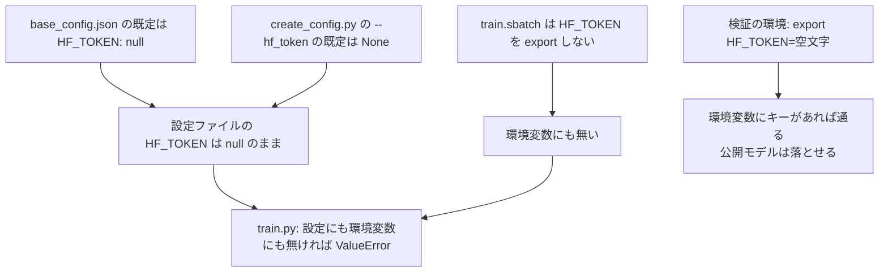

**噛み砕き (ひとことで)**

鍵の設定がどこにも無かったため、公開モデルでも起動が止まっていた。

| 項目 | 内容 |
|---|---|
| 原因 | 学習のスクリプトが、モデルを落とす前に設定ファイルにも環境変数にも鍵 (`HF_TOKEN`) が無ければ止まる仕組みで、設定のテンプレートもスクリプトの既定も実行手順も、どれも鍵を設定していなかった。 |
| やったこと | 検証の環境では一時的に空の鍵を環境変数に入れて通したが、これは PR の対象外で、コミットした実行手順には鍵を設定する行が無い。 |
| 良い点 | 公開モデルでも止まる原因の仕組みを、3 つの経路のどれも鍵を設定していないという事実から正しく説明できた。 |
| 悪い点・代償 | コミットした実行手順のままでは、鍵を用意しない人は同じエラーに当たりうる。 |

**図 (やさしい版)**

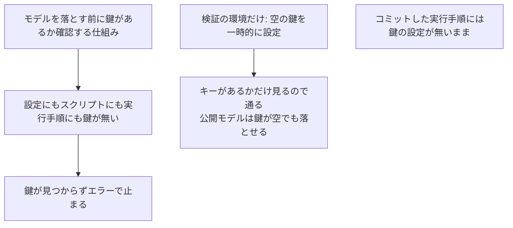

**Answer (English)**

This was in my test environment, outside the PR's scope. The pinned picotron `train.py` raises `ValueError` if `HF_TOKEN` is missing from both the config file and the environment, before it downloads the model. The vendored template defaults `HF_TOKEN` to null, `create_config.py`'s `--hf_token` defaults to None, and `train.sbatch` doesn't export it, so all three paths leave it unset. For the environment, the check only tests whether the key exists, so adding `export HF_TOKEN=""` to my local sbatch let it through, and a public model like SmolLM still downloads. I'd be clear that the committed `train.sbatch` doesn't have that line, so someone running it without a token could hit the same error.

**回答 (日本語)**

これは PR の対象外で、検証の環境で踏んだものである。固定した picotron の `train.py` は、モデルを落とす前に、設定ファイルにも環境変数にも `HF_TOKEN` が無ければ `ValueError` で止まる。リポジトリに置いたテンプレートは `HF_TOKEN` の既定が null で、`create_config.py` の `--hf_token` も既定が None で、`train.sbatch` も export しないので、3 つの経路のどれでも設定されない。環境変数の側の検査はキーがあるかだけを見るので、手元の sbatch に `export HF_TOKEN=""` を足せば通り、SmolLM のような公開モデルは落とせる。コミットした `train.sbatch` にはこの行が無いので、トークン無しで動かした人は同じエラーに当たりうる、ということははっきり言う。
:::

:::details Q9. [Bug] What else broke in your test environment, and why?
**質問 (日本語)**

検証の環境では、ほかに何が壊れ、なぜか。

**原因の連鎖 (図)**

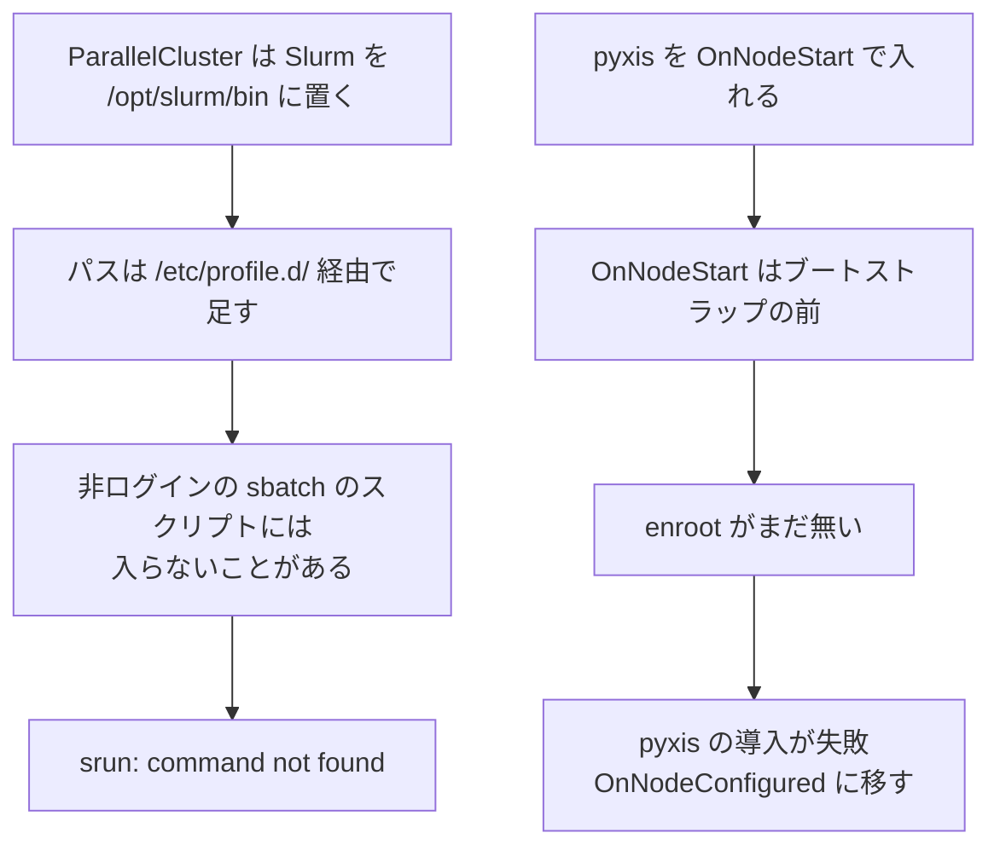

**噛み砕き (ひとことで)**

クラスタの準備の段取りの順番がずれていて、2 つの問題が別々に起きていた。

| 項目 | 内容 |
|---|---|
| 原因 | クラスタの管理の仕組みは、ジョブを動かすコマンド (srun) の場所をログインのときに読む設定でパスに足すが、sbatch のスクリプトはログインしないシェルで動くのでそれを読まないことがある。また、コンテナを動かす補助の仕組み (pyxis) を、土台のソフト (enroot) が入る前の早すぎる段階に入れていた。 |
| やったこと | 道筋を足す行を加え、補助の仕組みを入れる段階を遅い段階に移した。 |
| 良い点 | 「自分のクラスタでは動く」というよくある落とし穴の原因 (段取りの順番) を切り分けられた。 |
| 悪い点・代償 | どちらも今回の PR の対象外で、検証の環境だけで踏んだ問題であり、本題の修正には含まれない。 |

**図 (やさしい版)**

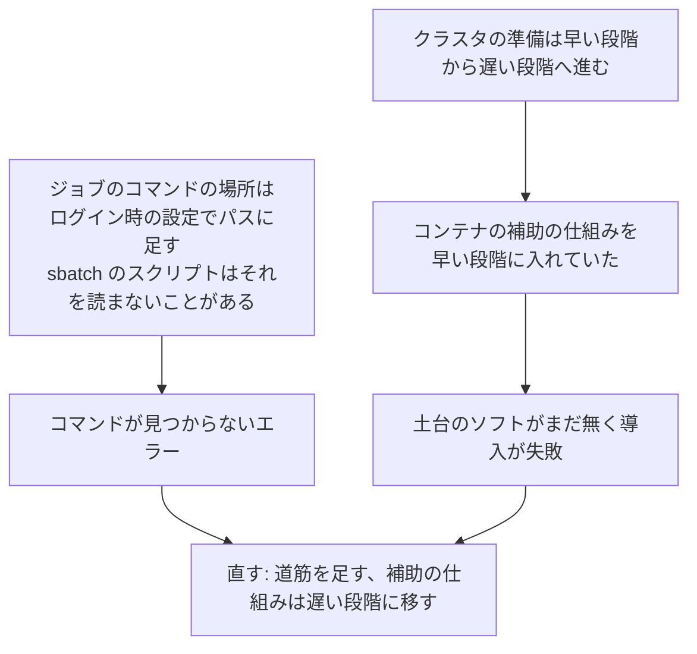

**Answer (English)**

Two ParallelCluster pitfalls, both outside the PR. First, ParallelCluster installs Slurm under `/opt/slurm/bin` and adds it to `PATH` via `/etc/profile.d/`, which a non-login `sbatch` script may not source, so `srun` can be missing; the fix is `export PATH=/opt/slurm/bin:$PATH`. Test cases that call `srun` from inside a container also need `/opt/slurm/bin` mounted, but picotron doesn't, so it didn't need that. Second, pyxis has to go in `OnNodeConfigured`, not `OnNodeStart`, because `OnNodeStart` runs before bootstrap, when enroot isn't installed yet. Both are about lifecycle ordering, which is a common source of "works on my cluster" problems.

**回答 (日本語)**

ParallelCluster の落とし穴が 2 つで、どちらも PR の対象外である。1 つ目に、ParallelCluster は Slurm を `/opt/slurm/bin` に置き、`/etc/profile.d/` でパスを足すが、非ログインの `sbatch` のスクリプトはそれを読まないことがあり、`srun` が見つからないことがある。`export PATH=/opt/slurm/bin:$PATH` で直す。コンテナの中から `srun` を呼ぶテストケースは `/opt/slurm/bin` のマウントも要るが、picotron は呼ばないので要らなかった。2 つ目に、pyxis は `OnNodeStart` ではなく `OnNodeConfigured` に置く。`OnNodeStart` はブートストラップの前に動き、enroot がまだ入っていないからである。どちらも準備の段階の順序の問題で、「自分のクラスタでは動く」問題のよくある原因である。
:::

### 検証と振り返り

:::details Q10. What did you test, and what didn't you?
**質問 (日本語)**

何を試し、何を試していないか。

**Answer (English)**

On ParallelCluster 3.13.1 and Slurm 24.05.8 with two g5.8xlarge nodes: the build log showed the pinned commit, `create_config.py` produced `conf/llama-1B-tp2/config.json`, a two-node all_reduce selected EFA on both nodes, and a cut-down training run completed 5,000 steps with exit code 0, at about 7,230 to 7,358 tokens per second on rank 0 from step 100 to 5,000. Not tested: p4d and p5, the main targets, because of resources and cost, and the final `^docker,lo,veth` value, since my runs used `en`. Separately, I reported that the script ran outside the container, but the PR doesn't include that command and output. I list these so nobody reads more coverage into the PR than it has.

**回答 (日本語)**

ParallelCluster 3.13.1、Slurm 24.05.8、g5.8xlarge の 2 ノードで、ビルドのログに固定した commit が出ること、`create_config.py` が `conf/llama-1B-tp2/config.json` を作ること、2 ノードの all_reduce で両ノードが EFA を選ぶこと、縮めた学習が 5000 ステップを終了コード 0 で完走すること (rank 0 で Step 100〜5000 は毎秒約 7,230〜7,358 トークン) を確かめた。試していないのは、主な対象の p4d と p5 (資源と費用の都合) と、最終の `^docker,lo,veth` の値 (試験は `en` の版) である。これとは別に、コンテナの外で動いたことは報告したが、そのコマンドと出力は PR に載せていない。PR の範囲を実際より広く読まれないよう、これらを並べて書く。
:::

:::details Q11. If you did it again, what would you change?
**質問 (日本語)**

もう一度やるなら何を変えるか。

**噛み砕き (ひとことで)**

証拠をマージ後のコードに合わせ、鍵の扱いと記録の残し方を次回直す。

| 項目 | 内容 |
|---|---|
| 論点 | もう一度やるなら何を変えるか。 |
| 選んだこと | 設定を直した後に通信の確認をやり直す、鍵 (`HF_TOKEN`) の扱いを実行手順にはっきり決めて書く、コンテナの外で動かした記録を PR に付ける、の 3 つ。 |
| 良い点 | 証拠をマージしたコードに合わせ、コメントでの報告だけでなく PR に残る形にできる。 |
| 悪い点・代償 | この 3 つは今回はできておらず、次回への持ち越しとして残っている。 |

**図 (やさしい版)**

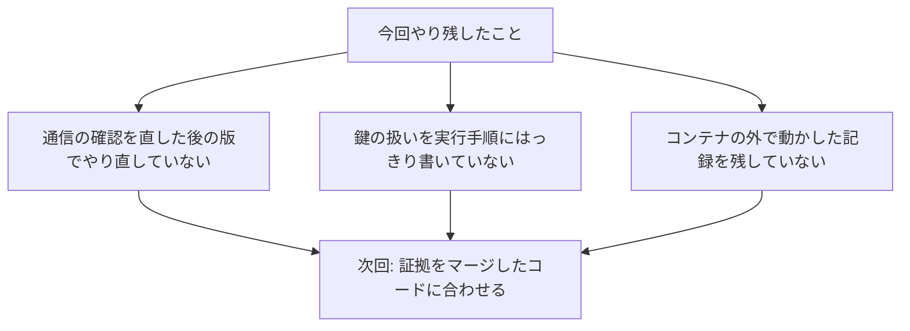

**Answer (English)**

Three things. Re-run the all_reduce check after the review changed `NCCL_SOCKET_IFNAME`, because evidence should match the merged code. Decide explicitly how `HF_TOKEN` should be handled in the committed `train.sbatch`, instead of leaving it only in my local copy. And attach the outside-the-container command and output to the PR, since I only reported it in a comment.

**回答 (日本語)**

3 つある。レビューで `NCCL_SOCKET_IFNAME` が変わった後に all_reduce の確認をやり直す。証拠はマージしたコードに合わせるべきだからである。コミットした `train.sbatch` で `HF_TOKEN` をどう扱うかをはっきり決め、手元の写しだけに残さない。コンテナの外での実行のコマンドと出力を、コメントでの報告だけでなく PR に付ける。
:::

## まとめ

picotron の PR は、上流の commit の固定、`__file__` からのテンプレートの読み込み、EFA の環境変数、README の 2 か所の修正を入れたものである。別に動かした 2 ノードの all_reduce では NCCL のログで EFA が選ばれたことを、学習ジョブでは 5000 ステップの完走を確かめた。再現できるテストケースにするには、上流を固定し、スクリプトをカレントディレクトリに頼らせず、使われる経路をログで確かめる。
