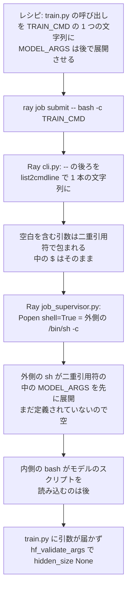
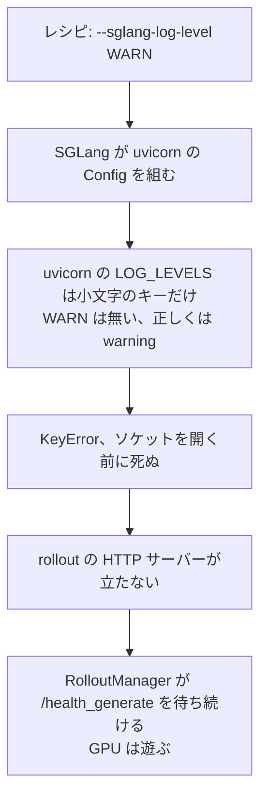
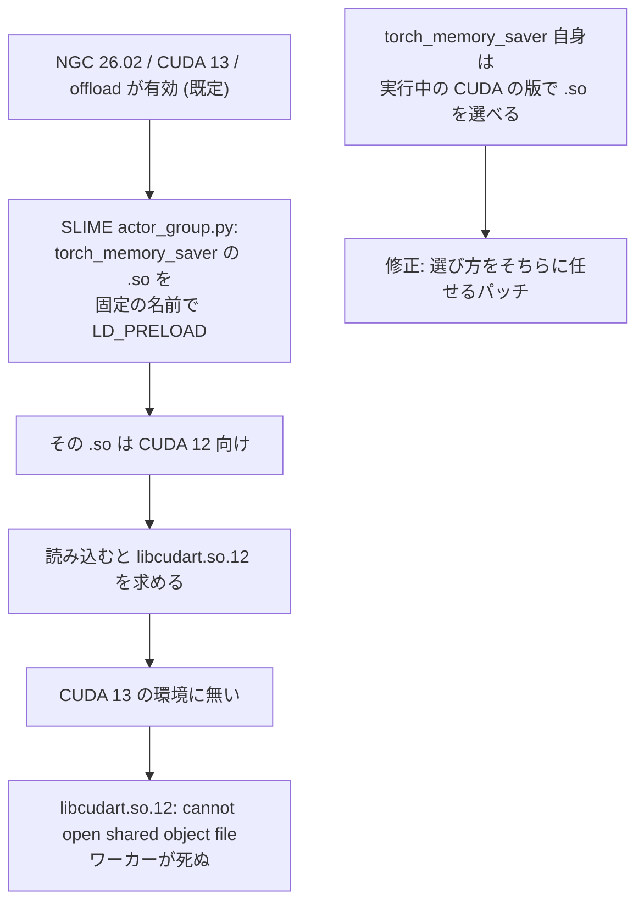
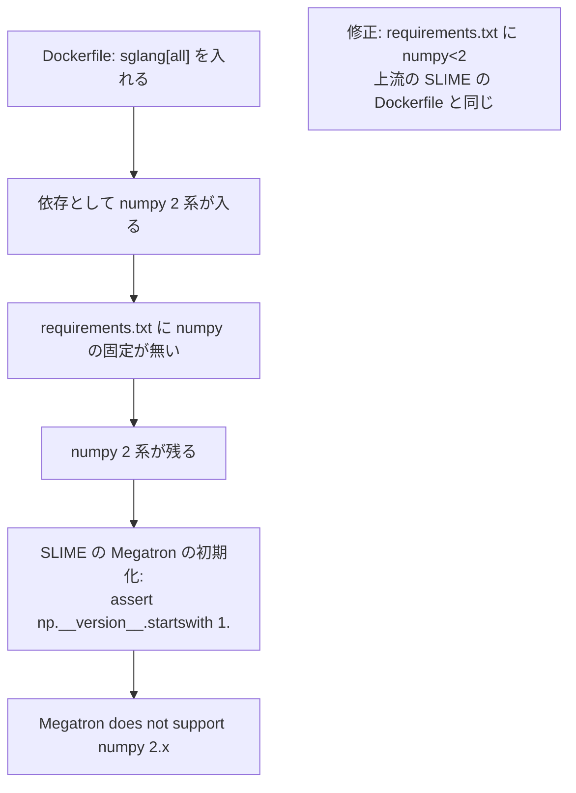
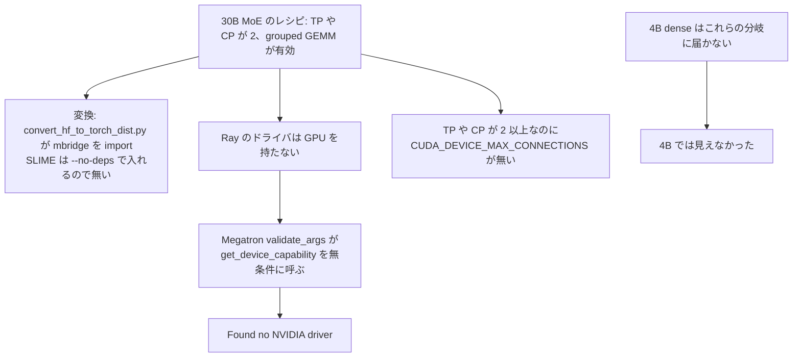

## はじめに

本章では、SLIME の GRPO のテストケースを、NVIDIA H200（p5en）と B300（p6-b300）の上で学習まで通した [Issue #1163](https://github.com/awslabs/awsome-distributed-ai/issues/1163) と [PR #1164](https://github.com/awslabs/awsome-distributed-ai/pull/1164) をまとめる。この PR は 1 つの大きな変更ではなく、原因ごとに分けた小さな修正を 1 本のブランチに積んだもの（epic）である。

:::details SLIME と GRPO
GRPO（Group Relative Policy Optimization）は、同じ問題に対して複数の答えを生成し、そのグループの中での報酬の相対的な良さで方策を更新する強化学習の手法である。[SLIME](https://github.com/THUDM/slime) は、生成（rollout）を SGLang、学習を Megatron-LM に任せ、Ray でそれらを動かす強化学習のフレームワークである。1 回のループは、生成、報酬の計算、学習の 1 ステップ、学習した重みを SGLang に戻す同期、の順に進む。
:::

## Issue と PR の概要

| 項目 | 内容 |
| --- | --- |
| 解決したいこと | テストケースの README どおりに動かしても、学習が始まらない、または途中で止まる |
| やったこと | 止まる原因を 1 つずつ特定し、原因ごとに 1 つの commit で直した。そのうち 4 つは GPU の世代によらない一般の問題だった |
| テスト | EKS の p5en.48xlarge の 2 ノード（H200 16 枚）で、4B の構成で GRPO のループを 3 回、30B MoE の構成で 1 回、最後まで回した。一般の修正は p6-b300.48xlarge の 2 ノードでも確かめた（Issue #1163） |
| マージ | [d8243f1](https://github.com/awslabs/awsome-distributed-ai/commit/d8243f1f5269982d155129144d18090d49a9cb65) |

## 何を解決しようとしたか

ベースのイメージ（NGC の PyTorch 26.02、CUDA 13、SGLang 0.5.12）はすでに Blackwell に対応していたので、B300 を足すのに要るのは設定の値だけのはずだった。ところが動かすと、B300 に固有ではない問題が順に現れた。H100 の p5 で README どおりに動かしても同じように止まるものが多く、それを原因ごとに分けて直した。

## どうやったか

最初に止まったのは、学習の起動の直後だった。`train.py` が `hidden_size None` で止まる。レシピは `train.py` の呼び出しを 1 つの文字列にまとめ、`ray job submit ... -- bash -c "${TRAIN_CMD}"` で渡し、モデルの設定を `\${MODEL_ARGS[@]}` として後で展開させようとしていた。Ray 2.55.1 の `ray job submit` は、`--` より後ろを `subprocess.list2cmdline` でつなぎ直し、`Popen(shell=True)` で外側の `/bin/sh -c` から動かす。そのため、内側の `bash -c` がモデルのスクリプトを読み込む前に、外側のシェルが `${MODEL_ARGS[@]}` を展開し、まだ定義されていないので空になる。

直し方は、さらにエスケープを重ねることではなく、シェルの境界をまたがないことである。SLIME 自身の起動スクリプトは、モデルのスクリプトを読み込んだのと同じシェルで `${MODEL_ARGS[@]}` を展開し、argv として渡している。それに合わせて、[grpo_launch.sh](https://github.com/awslabs/awsome-distributed-ai/blob/d8243f1f5269982d155129144d18090d49a9cb65/3.test_cases/pytorch/slime/recipe/launcher/grpo_launch.sh) を足した。このスクリプトはモデルのスクリプトを読み込み、`MODEL_ARGS` が空なら止まり、`exec python3 train.py "${MODEL_ARGS[@]}" "$@"` で起動する。

ほかの修正は次のとおりである。

| 症状 | 原因 | 修正 |
| --- | --- | --- |
| rollout の HTTP サーバーが立たず、学習が待ち続ける | `--sglang-log-level WARN` を uvicorn が受け付けない（小文字だけ） | `warning` に変えた |
| NGC 26.02 と CUDA 13 の構成で、offload が有効（既定）なとき学習のワーカーが起動の直後に死ぬ | SLIME が `LD_PRELOAD` する `torch_memory_saver` の `.so` が CUDA 12 向け | ビルドの時に当てるパッチで、`torch_memory_saver` 自身の CUDA に合わせた選び方に `.so` を任せる。上流にも修正を出した |
| Megatron の初期化で止まる | `sglang[all]` が numpy 2 系を連れてくる | `numpy<2` を固定した（上流の SLIME の Dockerfile と同じ） |
| 30B MoE の構成だけが止まる | `torch_dist` への変換に要る `mbridge` が無い、GPU の無い Ray のドライバで Megatron の `validate_args` が GPU を調べる、TP や CP が 2 以上のときに Megatron が求める `CUDA_DEVICE_MAX_CONNECTIONS=1` が無い | `mbridge` を入れ、GPU が無いときだけ GPU の問い合わせを飛ばすパッチを当て、環境変数を足した。あわせて、SGLang 0.5.12 では黙って無視される `--sglang-enable-ep-moe` を外した |

## なぜそうしたか

**起動用のスクリプトにした理由**。比べた方向は、レシピの側でクォートを重ねる方法で、起動用のスクリプトを増やさずに済む。筆者は、`ray job submit` が `--` の後ろを `list2cmdline` でつなぎ直し、外側の `/bin/sh` がレシピのクォートによらず `${MODEL_ARGS[@]}` を展開するので、エスケープでは直らないと判断した。SLIME を使わない小さな再現でも、`bash -c` を 1 段で動かすと引数は 25 個届き、`ray job submit -- bash -c` を通すと 0 個になった。起動用のスクリプトを 1 本保守する代わりに、配列が Ray の境界をまたがなくなる。

**世代ごとのディレクトリを作らない理由**。`b300/` のように世代ごとのディレクトリを作ると、違いが 1 か所に見える。ただ、B300 と H200 の違いはほぼ環境変数とフラグの値だけで、レシピを複製すると世代ごとに中身がずれていく。そこで筆者は、1 つのレシピに値の違いだけを持たせる形を提案し、どちらが良いかをメンテナに尋ねた。この PR には B300 向けの値は入っておらず、B300 の対応はレビューした allela-roy さんが引き取った。

**SGLang を下げない理由**。MoE の問題を避けるために SGLang を下げる方向もあった。SGLang 0.5.9 は torch 2.9.1 を求め、ベースのイメージが頼る torch 2.11 と CUDA 13 の組み合わせを壊すので採らなかった。

**1 本の大きな PR にしない理由**。一般の修正と 30B MoE だけの修正を混ぜるとレビューが難しくなるので、原因ごとの小さな commit を 1 本の epic の PR に積んだ。

**パッチの形**。ビルドの時に当てるパッチは、対象の上流のコードがまだ問題を持っているときだけ変更を加え、上流が直した後は何もしない形（self-neutralizing）にした（[apply_slime_patches.py](https://github.com/awslabs/awsome-distributed-ai/blob/d8243f1f5269982d155129144d18090d49a9cb65/3.test_cases/pytorch/slime/patches/apply_slime_patches.py)）。SLIME のフォークを参照せずに一時的な修正を当てられる。

**取り下げた見立て**。H200 で遅くなるのを防ぐつもりだった CUDA graph のフラグは、遅くなることを再現できなかったので外した。「30B MoE の重みの同期が 400 を返す」という見立ても取り下げた。SGLang の既定の設定では 400 は起きず、30B の起動を妨げていた要因の 1 つは、GPU を割り当てない Ray のドライバの上で Megatron の `validate_args` が GPU を調べることだった。確かめられなかった設定は、予防のためでも入れないことにした。

## テストをどうしたか

以下の数値は、すべて EKS の p5en.48xlarge の 2 ノード（H200 16 枚）での結果で、このブランチの Dockerfile から作ったイメージを使った。一般の修正は p6-b300.48xlarge の 2 ノードでも確かめたと Issue #1163 に書いた。B300 については、H200 と同じループの回数と 30B の構成の結果はここでは示さない。組み込みの報酬を使う Qwen3-4B の colocated の構成は、生成、参照と方策の log 確率、Megatron の学習の 1 ステップ、SGLang への重みの同期までの GRPO のループを 3 回最後まで回した。ノードの間の NCCL は EFA を使った（`Selected provider is efa, fabric is efa-direct (found 16 nics)`）。別の実行では、`RM_TYPE=remote_rm` に変えて 4B のレシピを動かし直し、CPU のノードの HTTP の報酬サービスへの 250 回以上の `POST /score` がすべて 200 で返ることを確かめた。Qwen3-30B-A3B の disaggregated の構成（学習 12 枚、生成 4 枚）は、GRPO のループを 1 回最後まで回した。レビューした allela-roy さんも、自分のクラスタで最後まで動くことを確かめた。

## 技術的な要点

- **モデルの引数を定義して展開するシェル**。今回の Ray 2.55.1 とレシピの組み合わせでは、モデルのスクリプトを読み込む前に外側のシェルが `${MODEL_ARGS[@]}` を展開していた。配列を定義するシェルと展開するシェルを同じにする。`ray job submit -- bash -c "..."` のような二重のシェルを避け、配列を展開するシェルと定義するシェルを同じにする。
- **エラーの文面と原因の距離**。エラーの文面（`hidden_size None`）と原因（シェルの展開の順）は遠いことがある。上流のソースを読み、フレームワークを使わない小さな再現で仕組みを確かめる。
- **GPU の世代と、ライブラリと設定の条件の切り分け**。uvicorn のログの指定、Megatron と numpy 2 系の組み合わせ、CUDA 13 の offload で読み込む CUDA 12 向けの `.so` の問題は、GPU の世代によらない。B300 で問題を見つけたときも、GPU の世代だけでなく、ライブラリの版と有効な設定を確かめる。
- **上流の修正と一時的な修正を分ける**。上流で直すべき問題は上流に出し、テストケースの側の一時的なパッチは、対象の上流の修正が入った後には変更を加えない形にする。

## 技術面接の準備 (FAQ)

この節は、本章の内容を技術面接で聞かれたときに答えるための想定問答である。システム設計面接の流れに合わせて、全体と設計、不具合の原因の深掘り、検証と振り返りの 3 つに分けた。各問は英語の質問 (見出し)、日本語の質問、英語の回答、日本語の回答の順に書いた。不具合の問には原因の連鎖の図を付け、回答は症状、原因、突き止め方、直し方と比べた案、検証、残ったこと、の順に話す。回答は本章の本文と、PR、Issue、マージ前後のコード、関係する上流のソースで確かめた事実だけを使う。

### 全体と設計

:::details Q1. You set out to add B300 support. What actually happened?
**質問 (日本語)**

B300 の対応を足すつもりで始めた。実際には何が起きたか。

**Answer (English)**

The base image, NGC PyTorch 26.02 with CUDA 13 and SGLang 0.5.12, already supported Blackwell, so I expected B300 to need only configuration values. When I ran it, failures that weren't B300-specific appeared one after another, and many reproduce on H100 p5 just by following the README. So the work became a series of fixes, one commit per root cause, stacked on one epic branch and squash-merged. Four were general problems independent of GPU generation, and the rest were specific to the 30B MoE configuration. The real skill here was classifying each failure by its actual cause, not by the hardware I happened to be on.

**回答 (日本語)**

ベースのイメージ (NGC の PyTorch 26.02、CUDA 13、SGLang 0.5.12) はすでに Blackwell に対応していたので、B300 に要るのは設定の値だけのはずだった。動かすと B300 に固有ではない失敗が順に現れ、その多くは H100 の p5 で README どおりに動かしても同じように止まるものだった。そのため作業は、原因ごとに 1 つの commit に分けた修正を 1 本の epic のブランチに積み、squash でマージするものになった。4 つは GPU の世代によらない一般の問題で、残りは 30B MoE の構成に固有のものだった。ここで本当に要ったのは、たまたま使っていたハードウェアではなく、実際の原因で失敗を分類することだった。
:::

:::details Q2. Why one epic PR of small commits, and why no per-generation directory?
**質問 (日本語)**

なぜ小さな commit を積んだ 1 本の epic の PR にし、世代ごとのディレクトリを作らなかったのか。

**Answer (English)**

Mixing the general fixes with the 30B MoE-only fixes in one big change makes review hard, so each root cause got its own commit with its own explanation, and the commits went into one epic PR. On structure, a `b300/` directory would show the differences in one place, but the differences between B300 and H200 were almost entirely environment variables and flag values, and duplicated recipes drift apart. So I proposed a single recipe that carries only the value differences, and asked the maintainers which they preferred. This PR contains no B300-specific values; the reviewer picked up the B300 side.

**回答 (日本語)**

一般の修正と 30B MoE だけの修正を 1 つの大きな変更に混ぜるとレビューが難しくなるので、原因ごとに説明つきの commit を分け、それを 1 本の epic の PR に積んだ。構成については、`b300/` のディレクトリにすると違いが 1 か所に見えるが、B300 と H200 の違いはほぼ環境変数とフラグの値だけで、レシピを複製すると中身がずれていく。そこで、1 つのレシピに値の違いだけを持たせる形を提案し、どちらが良いかをメンテナに尋ねた。この PR に B300 に固有の値は入っておらず、B300 の側はレビューした人が引き取った。
:::

### 不具合の原因の深掘り

:::details Q3. [Bug] Training died with `hidden_size None`. What was the root cause?
**質問 (日本語)**

学習が `hidden_size None` で止まった。原因は何か。

**原因の連鎖 (図)**

**Answer (English)**

The error message was far from the cause. The recipe put the `train.py` call into one string, `TRAIN_CMD`, passed it as `ray job submit ... -- bash -c "${TRAIN_CMD}"`, and escaped `${MODEL_ARGS[@]}` so the inner bash would expand it after sourcing the model script. I read Ray 2.55.1's source: the CLI joins everything after `--` into one string with `subprocess.list2cmdline`, and the job supervisor runs that string with `Popen(..., shell=True)`, which means an outer `/bin/sh -c`. So there was one more shell than the recipe assumed. `list2cmdline` wraps the `bash -c` argument in double quotes because it contains spaces, and a shell expands `$` inside double quotes, so that outer shell expanded `${MODEL_ARGS[@]}` first, when it was still undefined, so the inner bash received nothing and `train.py` failed validation with `hidden_size None`. I confirmed the mechanism without SLIME: one level of `bash -c` delivered 25 arguments, and the same command through `ray job submit -- bash -c` delivered 0. If asked which shell `/bin/sh` was: I didn't record it, but the result itself, `train.py` starting with no model arguments, shows it expanded to empty rather than erroring.

**回答 (日本語)**

エラーの文面と原因は遠かった。レシピは `train.py` の呼び出しを `TRAIN_CMD` という 1 つの文字列にまとめ、`ray job submit ... -- bash -c "${TRAIN_CMD}"` で渡し、内側の bash がモデルのスクリプトを読み込んだ後に展開するよう `${MODEL_ARGS[@]}` をエスケープしていた。Ray 2.55.1 のソースを読むと、CLI は `--` より後ろを `subprocess.list2cmdline` で 1 本の文字列につなぎ、job supervisor はそれを `Popen(..., shell=True)`、つまり外側の `/bin/sh -c` で動かす。レシピが想定したより、シェルが 1 段多かったのである。`list2cmdline` は空白を含む `bash -c` の引数を二重引用符で包み、シェルは二重引用符の中の `$` を展開するので、その外側のシェルが、まだ定義されていない `${MODEL_ARGS[@]}` を先に展開したので、内側の bash には何も届かず、`train.py` が `hidden_size None` で検証に失敗した。SLIME を使わずに仕組みを確かめ、`bash -c` を 1 段で動かすと引数は 25 個届き、同じコマンドを `ray job submit -- bash -c` に通すと 0 個になった。`/bin/sh` がどのシェルだったかを聞かれたら、記録はしていないが、`train.py` がモデルの引数無しで起動したという結果そのものが、エラーではなく空に展開されたことを示す、と答える。
:::

:::details Q4. Why a launcher script instead of fixing the quoting?
**質問 (日本語)**

なぜクォートを直さずに起動用のスクリプトにしたのか。

**Answer (English)**

More escaping avoids a new file, but it would depend on how `list2cmdline` rejoins arguments and how the outer shell then parses them, which is internal behavior of Ray, and `list2cmdline` follows Windows-style quoting rules, not POSIX shell rules. I judged escaping couldn't be made reliable. The real fix is not to cross the shell boundary with an array at all. SLIME's own launch scripts expand `${MODEL_ARGS[@]}` in the same shell that sourced the model script, so I did the same: `grpo_launch.sh` sources the model script, exits with an error if `MODEL_ARGS` is empty, and runs `exec python3 train.py "${MODEL_ARGS[@]}" "$@"`. The recipe now passes plain argv to it. One more script to maintain, in exchange for an array that never crosses Ray's boundary, and a fail-fast check instead of a confusing validation error.

**回答 (日本語)**

エスケープを重ねればファイルは増えないが、`list2cmdline` が引数をどうつなぎ直し、外側のシェルがそれをどう解釈するかという Ray の内部の挙動に頼ることになる。しかも `list2cmdline` は POSIX のシェルではなく Windows 流のクォートの規則に従う。エスケープでは確実にできないと判断した。本当の直し方は、配列でシェルの境界をそもそもまたがないことである。SLIME 自身の起動スクリプトは、モデルのスクリプトを読み込んだのと同じシェルで `${MODEL_ARGS[@]}` を展開しているので、それに合わせた。`grpo_launch.sh` はモデルのスクリプトを読み込み、`MODEL_ARGS` が空ならエラーで止まり、`exec python3 train.py "${MODEL_ARGS[@]}" "$@"` で起動する。レシピはこれに普通の argv を渡す。保守するスクリプトが 1 本増える代わりに、配列が Ray の境界をまたがず、分かりにくい検証のエラーの代わりにその場で止まる確認が入る。
:::

:::details Q5. [Bug] The rollout server never came up and training waited forever. Why?
**質問 (日本語)**

rollout のサーバーが立たず、学習が待ち続けた。なぜか。

**原因の連鎖 (図)**

**Answer (English)**

The recipe passed `--sglang-log-level WARN`. SGLang forwards the level to uvicorn, and uvicorn's `LOG_LEVELS` table only has lowercase keys: critical, error, warning, info, debug, trace. So uvicorn raised `KeyError` while building its config, before binding the socket, and the RolloutManager waited forever on `/health_generate` with the GPUs idle. This is a nasty class of failure because nothing crashes visibly; it just hangs. I first changed it to `info`, then to `warning`, to keep the original intent of warning-level verbosity. The proper normalization belongs upstream in SGLang, and the Issue links a related SGLang upstream issue.

**回答 (日本語)**

レシピは `--sglang-log-level WARN` を渡していた。SGLang はこの値を uvicorn に渡し、uvicorn の `LOG_LEVELS` の表は小文字のキー (critical、error、warning、info、debug、trace) しか持たない。そのため uvicorn は設定を組む途中、ソケットを開く前に `KeyError` を出し、RolloutManager は GPU が遊んだまま `/health_generate` を待ち続けた。目に見えて落ちず、ただ止まるので、たちの悪い種類の失敗である。最初は `info` にし、元の意図である警告のレベルの詳しさを保つため `warning` に直した。正しい正規化は上流の SGLang の役目で、Issue には関係する SGLang の上流の issue を挙げている。
:::

:::details Q6. [Bug] Training workers died right after start on CUDA 13. Why?
**質問 (日本語)**

CUDA 13 で、学習のワーカーが起動の直後に死んだ。なぜか。

**原因の連鎖 (図)**

**Answer (English)**

With offload enabled, which is the default, SLIME's `actor_group.py` sets `LD_PRELOAD` to a `torch_memory_saver` hook library chosen by a fixed filename, not by the CUDA runtime. In this image that file was a CUDA 12 build, so loading it required `libcudart.so.12`, which doesn't exist in a CUDA 13 environment, and the worker died with `cannot open shared object file`. `torch_memory_saver` itself can pick the right library for the detected CUDA major version, so the fix is a build-time patch that delegates the choice to it, with a fallback that tries actually loading candidates. I sent the fix upstream too. On H200 with CUDA 13, the preload then resolved to the CUDA 13 build and training reached Megatron initialization.

**回答 (日本語)**

offload が有効 (既定) なとき、SLIME の `actor_group.py` は `torch_memory_saver` のフックのライブラリを、CUDA のランタイムではなく固定のファイル名で選んで `LD_PRELOAD` に入れる。このイメージではそのファイルが CUDA 12 向けのビルドで、読み込むと CUDA 13 の環境には無い `libcudart.so.12` を求め、ワーカーは `cannot open shared object file` で死んだ。`torch_memory_saver` 自身は検出した CUDA のメジャーの版に合うライブラリを選べるので、修正はビルドの時のパッチで選び方をそちらに任せ、候補を実際に読み込んでみる予備の手段も持たせた。上流にも修正を出した。H200 と CUDA 13 では、その後 CUDA 13 向けのビルドが読み込まれ、学習が Megatron の初期化まで進んだ。
:::

:::details Q7. [Bug] Megatron initialization failed with a numpy assertion. Why?
**質問 (日本語)**

Megatron の初期化が numpy の assertion で失敗した。なぜか。

**原因の連鎖 (図)**

**Answer (English)**

The Dockerfile installs `sglang[all]`, which brought in numpy 2, and nothing pinned it back. SLIME's Megatron initialization asserts that the numpy version starts with "1.", so `MegatronTrainRayActor` died with "Megatron does not support numpy 2.x". I pinned `numpy<2` in `requirements.txt`, which is what upstream SLIME's own Dockerfile does. On H200 with CUDA 13 that gave numpy 1.26.4 and clean torch and Megatron imports. In a follow-up commit I also corrected a comment I had written that described a later install step inaccurately; the code was right, the comment wasn't.

**回答 (日本語)**

Dockerfile が入れる `sglang[all]` が numpy 2 系を連れてきて、それを戻す固定が無かった。SLIME の Megatron の初期化は numpy の版が "1." で始まることを assert するので、`MegatronTrainRayActor` が "Megatron does not support numpy 2.x" で死んだ。`requirements.txt` に `numpy<2` を固定した。上流の SLIME の Dockerfile と同じ対処である。H200 と CUDA 13 では numpy 1.26.4 になり、torch と Megatron の import も通った。後の commit で、自分が書いたコメントのうち後のインストールの段階を誤って説明していた箇所も直した。コードは正しく、コメントが正しくなかった。
:::

:::details Q8. [Bug] Why did only the 30B MoE configuration fail?
**質問 (日本語)**

なぜ 30B MoE の構成だけが失敗したのか。

**原因の連鎖 (図)**

**Answer (English)**

Three independent gaps that only the 30B path reaches. The checkpoint conversion imports `mbridge`, but SLIME is installed with `--no-deps`, so it was missing. SLIME calls Megatron's `validate_args` on the Ray driver, which deliberately has no GPU, and with grouped GEMM and TP or CP above 1, Megatron calls `torch.cuda.get_device_capability` and `get_device_arch_version` without checking whether CUDA is available, so it crashed with "Found no NVIDIA driver". And Megatron requires `CUDA_DEVICE_MAX_CONNECTIONS=1` when tensor or context parallelism is enabled on pre-Blackwell GPUs, which wasn't set. The dense 4B recipe never reaches any of those branches, which is why it hid them. I added `mbridge`, a patch that answers those GPU queries only when no GPU is present, returning compute capability (8, 0) and a sentinel architecture value of 9999 so the driver-side validation doesn't take a pre-Blackwell branch, while the GPU workers still query real hardware, and the environment variable. I also removed `--sglang-enable-ep-moe`, which has no effect on SGLang 0.5.12; SLIME parses SGLang flags leniently, so it didn't error.

**回答 (日本語)**

30B の経路だけが届く、独立した 3 つの抜けである。チェックポイントの変換は `mbridge` を import するが、SLIME は `--no-deps` で入れるので無かった。SLIME は Megatron の `validate_args` を、わざと GPU を持たせない Ray のドライバで呼ぶ。grouped GEMM と、TP や CP が 1 より大きいとき、Megatron は CUDA が使えるか確かめずに `torch.cuda.get_device_capability` と `get_device_arch_version` を呼ぶので、"Found no NVIDIA driver" で落ちた。そして Megatron は、Blackwell より前の GPU でテンソル並列やコンテキスト並列が有効なとき `CUDA_DEVICE_MAX_CONNECTIONS=1` を求めるが、それが無かった。4B dense のレシピはどの分岐にも届かないので、これらを隠していた。`mbridge` を入れ、GPU が無いときだけそれらの GPU の問い合わせに答えるパッチを当て (compute capability は (8, 0)、アーキテクチャはドライバの側の検証が Blackwell より前の分岐に入らないよう目印の 9999 を返す。GPU のワーカーは実際のハードウェアに問い合わせる)、環境変数を足した。SGLang 0.5.12 で効かない `--sglang-enable-ep-moe` も外した。SLIME は SGLang のフラグを寛容に解釈するので、エラーにならなかった。
:::

:::details Q9. How do your temporary patches know when upstream has fixed the bug?
**質問 (日本語)**

一時的なパッチは、上流が直したことをどうやって知るのか。

**Answer (English)**

Each patch decides in three steps at build time. If its own marker is already present, it's already applied. If the specific broken pattern is absent, the patch skips the edit; that's a source-pattern check, not proof that upstream is correct in general. For the driver patch, that check reads the installed Megatron's own source and looks for an availability guard around the GPU query, so it tracks the real defect rather than how SLIME's code happens to look. Otherwise it applies, but only if the edit anchor appears exactly once, it refuses to guess, and it compiles the result before writing it back. Any other outcome fails the build. That's how the test case avoids a SLIME fork, and a patch that no longer matches fails the build loudly instead of silently half-applying.

**回答 (日本語)**

各パッチはビルドの時に 3 段で判断する。自分の印が既にあれば、当て済みである。具体的な壊れた形が無ければ、書き換えを飛ばす。これはソースの形による判定で、上流がすべて正しいことを保証するものではない。ドライバのパッチでは、この確認がインストールされた Megatron 自身のソースを読み、GPU の問い合わせの周りに使えるかどうかの確認があるかを見る。だから SLIME のコードの見た目ではなく、本当の欠陥を追える。どちらでもなければ当てるが、書き換える目印がちょうど 1 回だけ現れるときに限り、推測では書き換えず、書き戻す前に結果をコンパイルして確かめる。それ以外の結果はビルドを失敗させる。こうしてテストケースは SLIME のフォークに頼らず、合わなくなったパッチは中途半端に当たるのではなく、ビルドの失敗としてはっきり表に出る。
:::

### 検証と振り返り

:::details Q10. What exactly did you test, and on which hardware?
**質問 (日本語)**

何を、どのハードウェアで試したのか。

**Answer (English)**

All the numbers come from two EKS p5en.48xlarge nodes, 16 H200 GPUs, with an image built from this branch. Qwen3-4B colocated with the built-in reward ran three complete GRPO loops: generation, reference and policy log-probs, one Megatron training step, and weight sync to SGLang, with inter-node NCCL on EFA. With `RM_TYPE=remote_rm`, more than 250 `POST /score` calls to an HTTP reward service on a CPU node all returned 200. Qwen3-30B-A3B disaggregated, 12 GPUs for training and 4 for generation, completed one loop. I verified the general fixes on two p6-b300.48xlarge nodes too, but I don't claim the same loop counts or the 30B result on B300.

**回答 (日本語)**

数値はすべて EKS の p5en.48xlarge の 2 ノード (H200 16 枚) で、このブランチから作ったイメージを使ったものである。組み込みの報酬を使う Qwen3-4B の colocated は、生成、参照と方策の log 確率、Megatron の学習の 1 ステップ、SGLang への重みの同期までの GRPO のループを 3 回回し、ノードの間の NCCL は EFA を使った。`RM_TYPE=remote_rm` では、CPU のノードの HTTP の報酬サービスへの 250 回を超える `POST /score` がすべて 200 で返った。Qwen3-30B-A3B の disaggregated (学習 12 枚、生成 4 枚) はループを 1 回回した。一般の修正は p6-b300.48xlarge の 2 ノードでも確かめたが、B300 で同じループの回数や 30B の結果を得たとは言わない。
:::

:::details Q11. Did you get anything wrong along the way?
**質問 (日本語)**

途中で間違えた見立てはあったか。

**Answer (English)**

Two are recorded in the Issue. I had added a CUDA graph batch-size flag to avoid a slow capture on large-memory GPUs, but I couldn't reproduce the slowdown on H200, so I removed it as unverified rather than ship a preventive flag. I had also listed a 30B weight-sync HTTP 400 as a problem; with SGLang's defaults no 400 occurs, and one of the real blockers was the GPU query on the driver. Separately, I briefly added two MoE serving flags and removed them after confirming SGLang's defaults already did the same thing. The rule I took away: don't ship a setting you couldn't verify, even as a precaution.

**回答 (日本語)**

Issue に記録したのは 2 つある。大きなメモリの GPU でのキャプチャが遅くなるのを避けるつもりで CUDA graph のバッチの大きさのフラグを入れたが、H200 で遅くなることを再現できなかったので、予防のフラグとして出さず未検証として外した。30B の重みの同期が HTTP 400 を返すという項目も挙げていたが、SGLang の既定の設定では 400 は起きず、本当の障害の 1 つはドライバでの GPU の問い合わせだった。これとは別に、MoE の配信のフラグを 2 つ足し、SGLang の既定が同じことをすると確かめて外したこともある。持ち帰った決まりは、確かめられなかった設定は予防のためでも出さないことである。
:::

## まとめ

B300 の対応のつもりで始めた作業は、ほとんどが GPU の世代によらない一般の問題の修正になった。具体的なループの回数と構成の結果は H200 のもので、B300 では一般の修正を確かめた。原因ごとに 1 つの commit に分け、上流の修正と、上流が直すまでの一時的な修正を分けて入れた。
